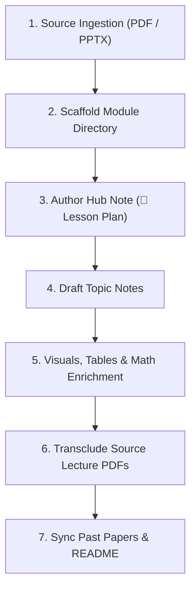

# UCSC Notes Authoring & Style Guide

A dedicated skill for authoring, expanding, and maintaining undergraduate course notes in the **UCSC Notes** Obsidian vault. It ensures every note meets the vault's high standards: rigorous academic depth, intuitive conceptual explanations, clean visual structure, and native Obsidian integration.

---

## 1. Vault Directory Structure & Naming Rules

Always align new modules and notes with the standard hierarchy:

```text
University_Notes_UCSC/
├── Academic Year 01/
│   ├── Semester - 01/
│   └── Semester - 02/
├── Academic Year 02/
│   ├── Semester 01/
│   └── Semester 02/
├── Academic Year 03/       (Future)
├── Academic Year 04/       (Future)
├── Past Papers/
│   ├── Academic Year 01/
│   ├── Academic Year 02/
│   └── Past Papers.md
└── README.md
```

### Key Naming Invariants:
1. **Module Folder:** `<CourseCode> - <Course Name>` (e.g., `IS2202 - Advanced Data Structures and Algorithms`).
2. **Hub / Lesson Plan Note:** `📖 <CourseCode> - <Course Name>.md` (Note: Year 02 uses the `📖 ` emoji prefix, replacing legacy `👉🏻 `).
3. **Topic Notes:** `<Topic Name>.md` (Clean title, capitalized, NO numerical prefix in the filename).
4. **Lecture Notes Directory:** `Lecture Notes/` containing `<CourseCode> Lecture <Num>.pdf`.
5. **Images Directory:** `Images/` containing descriptive, lowercase/snake_case diagrams (`.png`).
6. **Exam Revision Guide (if applicable):** `<CourseCode> - <Short Name> Exam Revision & Quick Reference Guide.md`.

For full structural details, consult [references/vault-conventions.md](references/vault-conventions.md).

---

## 2. End-to-End Workflow: Adding or Updating a Module

When tasked with adding a new module or converting lecture slides into notes:



### Step 1: Ingest & Parse Source Material
- If lecture slides are provided as PDF or PPTX, leverage the sibling skills:
  - Use `.agent/pdf` (via `pdfplumber` or `pypdf`) to extract text, tables, and slide contents from `Lecture Notes/*.pdf`.
  - Use `.agent/pptx` (via `markitdown` or `python-pptx`) if slides are in `.pptx` format.
- Group the slides by syllabus topic boundaries.

### Step 2: Scaffold Module Directory
Use the bundled automation script to quickly create the folder structure and stubs:
```bash
python3 .agent/ucsc-noting-style/scripts/scaffold_module.py \
  --year 2 \
  --sem 1 \
  --code IS2208 \
  --name "Enterprise Architecture" \
  --lecturer "Dr. Kasun Gunawardana" \
  --topics "Foundations of EA" "TOGAF Framework" "ArchiMate Modeling"
```

### Step 3: Author the Hub / Lesson Plan Note
Follow the template in [references/templates.md](references/templates.md):
- Header metadata (`- **Course Code** : ...`, `- **Course Name** : ...`, `- **Lecture** : ...`).
- Tag `#Lesson-Plan` on line 5.
- `> [!important] Goal` callout defining the course mission.
- Section: `# The specific objectives of the module include:` with bold ILO points.
- Section: `# Topic Covered` with numbered Obsidian wikilinks:
  ```markdown
  1. [[Foundations of EA]]
      - **Architecture Domains:** Business, Data, Application, and Technology.
      - **Value Proposition:** Alignment between IT infrastructure and business strategy.
  ```
- Syllabus transclusion at the bottom: `![[<CourseCode> - Syllabus.pdf]]`.

### Step 4: Author Topic Notes
For each topic in the syllabus, write a deep, polished Markdown note conforming to the rules below.

### Step 5: Vault Synchronization
- Check `Past Papers/Past Papers.md`: Add a row for the new course under the appropriate Academic Year and Semester.
- Check `README.md`: Update the directory tree and the Notes Coverage table with the new course and topic list.

---

## 3. Topic Note Anatomy & Formatting Rules

Every topic note must adhere strictly to the following 7 standards:

### 1. Scope Hook / Introduction
Start with a 1-2 sentence paragraph framing the technical boundaries:
> *"This topic covers multiway search trees, formal structural properties of B-Trees of Order $m$, searching, insertion mechanics with median promotion, deletion cases with borrowing and merging, and secondary storage optimization."*

Follow immediately with a divider: `---`.

### 2. Numbered Major Headings
All top-level conceptual sections must be numbered sequentially:
- `# 1. Motivation / Core Problem`
- `# 2. Invariants & Formal Definition`
- `## 2.1 Subtopic / Case Analysis`
- `# 3. Algorithmic Mechanics`

### 3. Bold Lead-in Bullets
Every bullet point must begin with an anchor term in bold:
```markdown
- **Time Complexity:** Probing executes in $O(1)$ average time under simple uniform hashing.
- **Tombstone Lazy Deletion:** Deleted slots are marked with `DELETED` flags to prevent premature search termination.
```

### 4. Obsidian Callouts for High-Yield Takeaways
Use GitHub/Obsidian callout syntax strategically:
- `> [!important] <Title>`: Invariants, core theorems, architectural breakthroughs.
- `> [!tip] <Title>`: Best practices, problem-solving intuition, memory aids.
- `> [!warning] <Title>`: Pitfalls, compilation errors, memory leaks, security flaws.
- `> [!info] <Title>`: Prerequisites, historical context, syllabus notes.

### 5. High-Density Comparative Tables
Mandatory for comparing paradigms, data structures, or performance characteristics:
```markdown
| Operation | Average Case | Worst Case | Space Complexity |
| :--- | :--- | :--- | :--- |
| **Search** | $O(\log n)$ | $O(\log n)$ | $O(1)$ |
| **Insert** | $O(\log n)$ | $O(\log n)$ | $O(1)$ |
```

### 6. Mathematical & Code Rigor
- **Math:** KaTeX syntax for all variables, asymptotics, and bounds (`$O(\log n)$`, `$\alpha = \frac{n}{m}$`, `$\lceil m/2 \rceil$`, `$$...$$`).
- **Code:** Syntactically valid, modern C/C++/Java/Kotlin/Python snippets with explanatory inline comments pointing out errors (`// COMPILE ERROR: ...`) or key mechanisms.
- **Intuitive Analogies:** Include relatable mental models ("grocery shopping trade-off", "refining raw materials", "fat and shallow trees").

### 7. Lecture Notes Transclusion Embed
Every topic note MUST conclude with transclusion links to its raw source PDF slides:
```markdown
---
# Lecture Notes
![[IS2202 Lecture 04.pdf]]
```

---

## 4. Bundled Resources

- **Templates:** See [references/templates.md](references/templates.md) for ready-to-use markdown templates (Lesson Plans, Topic Notes, Exam Guides).
- **Vault Conventions:** See [references/vault-conventions.md](references/vault-conventions.md) for pathing, folder hierarchy, and link formatting rules.
- **Pedagogical Guidelines:** See [references/pedagogical-rules.md](references/pedagogical-rules.md) for tone, voice, and explanatory heuristics.
- **Scaffolding Tool:** Run `python3 .agent/ucsc-noting-style/scripts/scaffold_module.py --help` to automate module directory creation.
