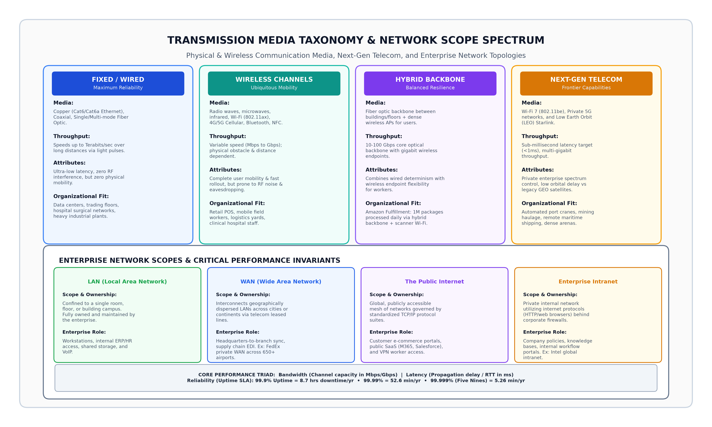
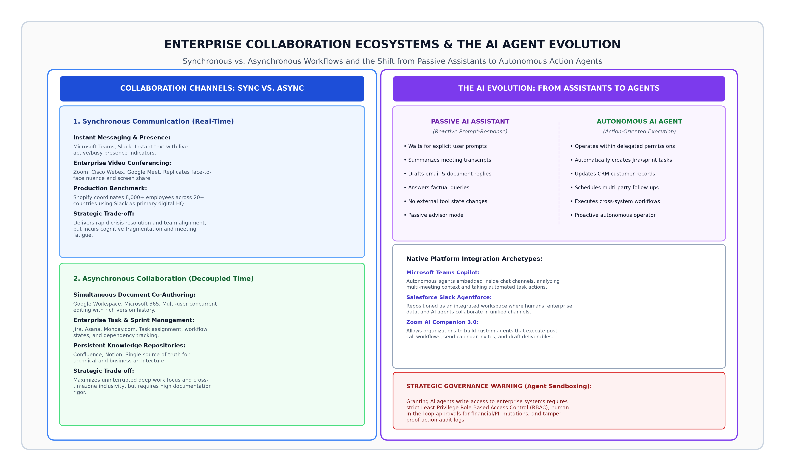
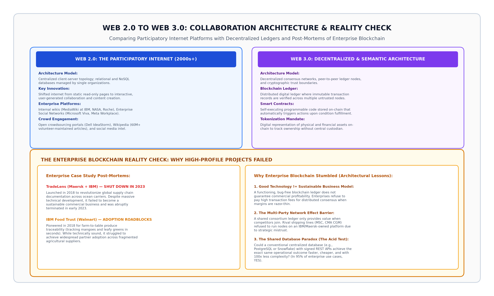
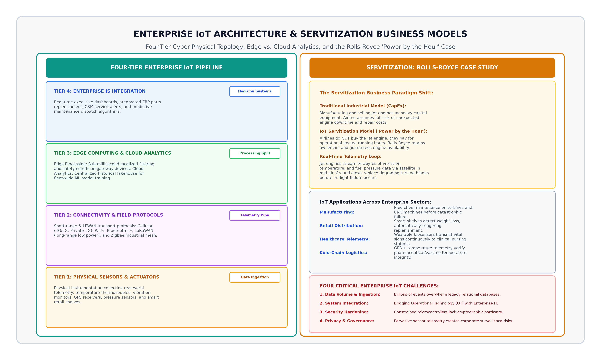

This topic note examines the strategic and architectural foundations of enterprise information transmission—analyzing physical and wireless transmission media, network topologies (LAN, WAN, Internet, Intranet), synchronous and asynchronous collaboration ecosystems, the evolution toward autonomous AI agents, Web 2.0 vs. Web 3.0 paradigms, the enterprise blockchain reality check, IoT servitization models (Rolls-Royce), organizational crowdsourcing, and emerging telecom frontiers (5G-Advanced, 6G, and Edge computing).

---

# 1. Foundations of Information Transmission & Strategic Velocity

In contemporary Information Systems Management, information transmission is the systematic transfer of data across physical or digital communication channels between distributed people, computational systems, and organizational entities.

```
+---------------------------------------------------------------------------------------------------+
|                            THE STRATEGIC INFORMATION TRANSMISSION PIPELINE                        |
|                                                                                                   |
|    [ SENDER ]  --->  [ ENCODER / PROTOCOL ]  --->  [ TRANSMISSION CHANNEL ]  --->  [ RECEIVER ]  |
|    - Human           - TCP/IP, MQTT, HTTP          - Fiber Optic Light Pulses     - ERP / CRM     |
|    - IoT Sensor      - TLS 1.3 Encryption          - 4G/5G / Wi-Fi Radio Waves    - Executive     |
|    - Microservice    - Serialization (JSON/gRPC)   - Low Earth Orbit Satellite    - Database      |
|                                                                                                   |
|    CRITICAL METRICS: Bandwidth (Throughput) | Propagation Latency (RTT) | Availability (SLA)      |
+---------------------------------------------------------------------------------------------------+
```

## 1.1 Organizational Flow Boundaries
Information transmission operates across multiple structural dimensions:
- **Internal vs. External Transmission:** Internal flows synchronize operational departments (e.g., automated shop-floor inventory sensors communicating with centralized SAP ERP databases), whereas external flows interface with supply chain partners, regulatory bodies, and consumers (e.g., Electronic Data Interchange (EDI), customer-facing APIs).
- **Formal vs. Informal Channels:** Formal transmission follows rigidly governed, audited workflows (e.g., digitally signed purchase orders, compliance filings), while informal transmission occurs over organic peer-to-peer collaboration channels (e.g., Slack team chats, ad-hoc voice calls).
- **Physical vs. Digital Channels:** Ranging from legacy physical transport (paper invoices, courier-shipped magnetic backup tapes) to wire-speed digital pulses over transatlantic optical fiber networks.

## 1.2 The Strategic Velocity Imperative
Transmission capability is not merely an IT utility; it is a direct driver of corporate competitive advantage:
- **Compression of Decision Cycles:** High-speed transmission enables real-time executive and algorithmic decision-making, allowing enterprises to respond dynamically to market fluctuations, supply chain disruptions, and operational anomalies.
- **Foundation for Digital Business Models:** Real-time information movement underpins modern digital services—from dynamic surge pricing in ride-hailing to algorithmic stock trading and just-in-time (JIT) manufacturing.
- **Enabler of Organizational Decoupling:** Robust telecommunications allow enterprises to distribute knowledge work globally across time zones while retaining unified operational governance.

## 1.3 The Communication Performance Triad & High-Availability Mathematics
Every enterprise communication link is governed by three fundamental performance parameters:
- **Bandwidth (Channel Capacity):** The maximum volume of data that can traverse a transmission medium per unit of time, typically quantified in Megabits per second ($\text{Mbps}$) or Terabits per second ($\text{Tbps}$).
- **Latency (Propagation & Processing Delay):** The elapsed time between the transmission of a data packet from the sender and its reception at the destination (Round-Trip Time, $\text{RTT}$), measured in milliseconds ($\text{ms}$). Crucial for real-time robotic teleoperation and high-frequency financial trading.
- **Reliability & Uptime SLA:** The statistical probability that a communication network performs its required transmission function without outage over a given period, formally evaluated as an Availability percentage ($A$):

$$A = \frac{\text{MTBF}}{\text{MTBF} + \text{MTTR}} \times 100\%$$

Where $\text{MTBF}$ is Mean Time Between Failures and $\text{MTTR}$ is Mean Time To Repair. The resulting annual downtime ($D$) for a continuous operational year ($T = 8,760\text{ hours}$) is given by:

$$D = T \times (1 - A)$$

| Reliability Metric ("Nines") | Availability Percentage ($A$) | Permitted Annual Downtime ($D$) | Enterprise Architectural Fit |
| :--- | :---: | :---: | :--- |
| **Two Nines** | $99.0\%$ | $87\text{ hours, } 36\text{ minutes}$ | Non-critical internal batch systems, dev sandboxes. |
| **Three Nines** | $99.9\%$ | $8\text{ hours, } 45\text{ minutes}$ | Standard business SaaS, corporate intranets. |
| **Four Nines** | $99.99\%$ | $52\text{ minutes, } 34\text{ seconds}$ | Enterprise ERP, customer-facing e-commerce stores. |
| **Five Nines (Carrier Grade)**| $99.999\%$ | $5\text{ minutes, } 15\text{ seconds}$ | Telecommunication backbones, hospital surgical networks. |

---

# 2. Transmission Media Taxonomy & Next-Generation Telecom

Enterprise network engineering balances physical constraints against operational mobility requirements.



## 2.1 Fixed / Wired Transmission Media
- **Twisted-Pair Copper (Ethernet Cat6/Cat6a):** Transmits electrical signals over balanced copper pairs. Cost-effective for horizontal structured cabling within office buildings up to 100 meters, delivering speeds up to $10\text{ Gbps}$. Prone to electromagnetic interference (EMI) and signal attenuation over distance.
- **Coaxial Cable:** Features a central copper conductor shielded by a dielectric insulator and braided metallic mesh. Historically dominant in cable television broadband (DOCSIS), now largely superseded by fiber optic in core enterprise backbones.
- **Fiber Optic Cabling (Single-Mode & Multi-Mode):** Transmits data as pulses of light generated by laser diodes or LEDs through ultra-pure silica glass cores via total internal reflection.
  - *Throughput & Distance:* Delivers bandwidth exceeding dozens of Terabits per second ($\text{Tbps}$) over distances exceeding 100 kilometers without repeaters.
  - *Engineering Advantages:* Completely immune to electromagnetic and radio frequency interference (EMI/RFI), highly resistant to wiretapping, and features negligible signal degradation.
  - *Organizational Fit:* Core datacenter spine-and-leaf fabrics, algorithmic stock trading floors, trans-oceanic subsea communication cables, and industrial plants with heavy electromagnetic motors.

## 2.2 Wireless Transmission Media
Wireless technologies convey modulated data signals through the electromagnetic spectrum (radio waves, microwaves, infrared) without physical conduits:
- **Spectrum Channels:** Encompasses Wi-Fi (IEEE 802.11 standards), cellular networks (4G LTE, 5G), Bluetooth Low Energy (BLE), Near Field Communication (NFC), and satellite links.
- **Strategic Advantages:** Delivers total worker and endpoint mobility, rapid deployment in heritage or challenging physical facilities, and supports distributed IoT telemetry.
- **Operational Vulnerabilities:** Susceptible to radio wave attenuation through concrete/steel walls, atmospheric absorption, multipath interference, and inherent air-interface eavesdropping risks (requiring WPA3 Enterprise and IPsec encryption).
- **Organizational Fit:** Retail point-of-sale (POS) terminals, mobile clinical staff in hospitals, field service operations, and warehouse logistics.

## 2.3 The Hybrid Infrastructure Paradigm: Amazon Fulfillment Case Study
In enterprise reality, organizations rarely deploy purely wired or purely wireless environments; they engineer a symbiotic **hybrid infrastructure**:
- **The Core Architecture:** High-speed optical fiber serves as the unshakeable, deterministic campus backbone (interconnecting distribution switches, floor wiring closets, and onsite server clusters), while high-density wireless access points (APs) provide agile edge connectivity to roaming workers and machines.
- **Production Benchmark (Amazon Fulfillment Centers):** Amazon's modern fulfillment warehouses process over **1,000,000 customer packages per day** within a single facility. This operational throughput is only possible via a hybrid communications architecture:
  - *Wired Backbone:* High-throughput multi-gigabit fiber networks interconnect robotic sorting pods, high-speed automated conveyor belts, and computerized optical packaging scanners with zero latency jitter.
  - *Wireless Edge:* Thousands of warehouse associates and automated guided vehicles (AGVs) navigate massive floor spaces utilizing ruggedized Wi-Fi barcode scanners and RFID terminals, maintaining continuous session connectivity via seamless wireless roaming protocols (IEEE 802.11r/k).

## 2.4 Next-Generation Connectivity Options

| Technology | Standard / Frequency | Core Performance Advantage | Enterprise Organizational Fit |
| :--- | :--- | :--- | :--- |
| **Wi-Fi 7** | **IEEE 802.11be**<br>($2.4\text{, } 5\text{, } 6\text{ GHz}$) | $320\text{ MHz}$ channel bandwidth, 4K-QAM modulation, and Multi-Link Operation (MLO) delivering speeds $>30\text{ Gbps}$ and ultra-low deterministic latency. | Ultra-dense corporate offices, university lecture complexes, airport terminals, and 8K VR design labs. |
| **Private 5G** | **3GPP Release 16/17**<br>(Dedicated Sub-6 / mmWave) | Enterprise-owned, localized 5G cellular network operating on licensed or dedicated private spectrum (e.g., CBRS in the US). Delivers guaranteed QoS, microsecond latency, and complete data privacy. | Automated container shipping ports, underground mines, smart manufacturing plants, and oil refineries requiring carrier-grade reliability without public carrier traffic contention. |
| **LEO Satellite** | **Low Earth Orbit**<br>($500 - 1,200\text{ km}$ altitude) | Constellations (e.g., Starlink, Eutelsat OneWeb) offering $25 - 40\text{ ms}$ latency—dramatically faster than traditional Geostationary (GEO) satellites ($35,786\text{ km}$, $\approx 600\text{ ms}$ delay). | Maritime fleet operations, remote mining camps, trans-oceanic flights, and redundant disaster-recovery failover links for rural branch banks. |

> [!warning] Strategic Invariant: Regulatory & Data Sovereignty Constraints
> While LEO satellite links provide ubiquitous internet access, global enterprises must navigate strict **data sovereignty** legislation. Telemetry transmitted over satellite constellations may traverse ground stations located in foreign jurisdictions, potentially violating privacy statutes such as the EU General Data Protection Regulation (GDPR) or the Sri Lanka Personal Data Protection Act (PDPA).

---

# 3. Enterprise Network Topology & Scope Hierarchy

Enterprise communication networks are categorized by geographic reach, administrative ownership, and access trust boundaries:

```
+---------------------------------------------------------------------------------------------------+
|                                  THE ENTERPRISE NETWORK HIERARCHY                                 |
|                                                                                                   |
|  [ LOCAL AREA NETWORK (LAN) ]                                                                     |
|  - Confined to single facility / building / campus                                                |
|  - 100% Owned and governed by internal enterprise IT                                              |
|  - Connects workstations, internal ERP servers, local storage arrays, and VoIP                     |
|                                                                                                   |
|  [ WIDE AREA NETWORK (WAN) ]                                                                      |
|  - Spans metropolitan, national, or continental distances                                         |
|  - Connects remote LANs via telecom leased lines, MPLS, or SD-WAN                                 |
|  - Benchmark: FedEx private WAN connecting 650+ airports and global hubs                          |
|                                                                                                   |
|  [ THE PUBLIC INTERNET ]                         [ ENTERPRISE INTRANET ]                          |
|  - Global, unmanaged public TCP/IP fabric        - Private network built on web standards (HTTP)  |
|  - Customer e-commerce, public SaaS platforms    - Quarantined behind stateful firewalls          |
|  - Vulnerable to public cyber threats            - Benchmark: Intel global engineering portal     |
+---------------------------------------------------------------------------------------------------+
```

## 3.1 Local Area Networks (LAN)
- **Scope & Governance:** Connects network nodes across a strictly confined geographic area—such as a single corporate office floor, a data center suite, or a university campus. Owned, configured, and physically maintained by the organization's internal network operations team.
- **Enterprise Capabilities:** Provides high-bandwidth interconnects ($1 - 100\text{ Gbps}$) linking desktop workstations, local file repositories (SAN/NAS), high-speed multifunction printers, local database clusters, and Voice over IP (VoIP) telephony.
- **Strategic Value:** Serves as the high-speed operational foundation upon which all internal enterprise information systems execute daily.

## 3.2 Wide Area Networks (WAN)
- **Scope & Governance:** Interconnects geographically dispersed local area networks across cities, countries, and continents. Because laying private intercontinental physical fiber is cost-prohibitive, enterprises contract with telecommunications carriers for leased circuits, Multiprotocol Label Switching (MPLS) backbones, or deploy encrypted Software-Defined WAN (SD-WAN) tunnels over commercial broadband.
- **Enterprise Capabilities:** Enables real-time data replication between headquarters and regional distribution branches, synchronizes central inventory databases across hundreds of retail stores, and supports secure supply chain Electronic Data Interchange (EDI).
- **Production Benchmark (FedEx Global Private WAN):** FedEx operates one of the world's most extensive private corporate WANs, continuously linking over **650 airports, sorting hubs, automated sorting facilities, and customs clearance offices globally**. This private network ensures package barcode scans made in Tokyo or Frankfurt instantaneously update customs manifests and customer tracking databases in Memphis within sub-second thresholds.

## 3.3 The Public Internet
- **Scope & Governance:** A global, decentralized, publicly accessible network of interconnected autonomous networks operating over standardized TCP/IP protocol suites.
- **Enterprise Utilization:** Serves as the primary channel for hosting consumer-facing web applications, executing e-commerce transactions, consuming public cloud SaaS services (Microsoft 365, Salesforce, Workday), and providing secure remote worker ingress via Virtual Private Network (VPN) tunnels.

## 3.4 Enterprise Intranets
- **Scope & Governance:** A strictly private internal enterprise network engineered using standard internet protocols (HTTP/HTTPS, HTML, TCP/IP, web browsers) but shielded behind corporate next-generation firewalls, identity providers, and zero-trust network access (ZTNA) gateways.
- **Enterprise Capabilities:** Centralizes company policy handbooks, standard operating procedures (SOPs), HR self-service forms, internal corporate news, and unified web portals into backend ERP/CRM systems.
- **The Usability Advantage:** Because intranets mirror standard consumer web browsers, employees require minimal operational training, drastically accelerating organizational communication velocity.
- **Production Benchmark (Intel Global Intranet):** Intel's corporate intranet provides a unified digital workspace serving **tens of thousands of engineers and administrative personnel** worldwide, consolidating silicon design documentation, patent tracking, HR benefits, and automated project workflows into a single authenticated portal.

---

# 4. Modern Enterprise Collaboration Platforms & The AI Agent Shift

Collaboration platforms encompass the software systems that allow geographically dispersed personnel to share information, co-author documents, track projects, and coordinate work across time and space.



## 4.1 Synchronous Communication Architectures
- **Operational Definition:** Communication in which all participating parties interact simultaneously in real-time ($t_1 = t_2$).
- **Core Modalities:**
  - *Instant Messaging & Presence Awareness:* Platforms such as Slack and Microsoft Teams provide live text chat channels paired with real-time status indicators (Available, In a Meeting, Offline), establishing continuous ambient awareness across remote teams.
  - *Enterprise Video Conferencing:* Zoom, Cisco Webex, and Google Meet recreate face-to-face interpersonal dynamics across global distances, incorporating high-definition screen sharing, live closed-captioning, and interactive digital whiteboards.
- **Production Benchmark (Shopify Digital Workplace):** E-commerce giant Shopify operates as a completely digital-by-default enterprise, managing over **8,000 employees across 20+ countries** using Slack as its primary operational coordination layer and virtual office building.
- **Architectural Trade-offs:** Delivers instantaneous consensus, rapid emergency incident response, and strong emotional cohesion; however, excessive synchronous communication causes severe cognitive fragmentation, continuous context-switching, and schedule gridlock across mismatched time zones.

## 4.2 Asynchronous Collaboration Architectures
- **Operational Definition:** Communication and work coordination where interaction is decoupled in time ($t_1 \neq t_2$), allowing participants to contribute on their own schedules.
- **Core Modalities:**
  - *Concurrent Document Co-Authoring:* Google Workspace (Docs, Sheets) and Microsoft 365 allow dozens of geographically distributed users to simultaneously edit documents with granular version control, inline commenting, and conflict-free replicated data types (CRDTs).
  - *Enterprise Task & Sprint Management:* Jira, Asana, and Monday.com coordinate engineering sprints, task assignments, status boards, and complex cross-department dependency trees.
  - *Structured Knowledge Repositories:* Atlassian Confluence and Notion serve as canonical, searchable single-sources-of-truth for technical documentation, architectural decision records (ADRs), and business rules.
- **Architectural Trade-offs:** Fosters deep, uninterrupted cognitive focus, provides complete historical documentation trails, and accommodates global workforce inclusivity; however, feedback loops are slower, requiring disciplined written articulation.

## 4.3 The Paradigm Shift: From Passive AI Assistants to Autonomous AI Agents
Enterprise collaboration software is currently undergoing a transformative architectural transition:

```
+---------------------------------------------------------------------------------------------------+
|                         THE EVOLUTION OF WORKPLACE ARTIFICIAL INTELLIGENCE                        |
|                                                                                                   |
|   PASSIVE AI ASSISTANT (Reactive)            AUTONOMOUS AI AGENT (Proactive)                      |
|   - Awaits explicit human prompt             - Operates on delegated mission parameters           |
|   - "Summarize this 1-hour call transcript"   - "Listen to meeting -> create Jira sprint tasks ->  |
|   - "Draft an email acknowledging feedback"    update Salesforce CRM -> schedule client demo"     |
|   - Stateless text generation                - Stateful tool execution across enterprise APIs     |
+---------------------------------------------------------------------------------------------------+
```

- **Passive AI Assistants (First Wave):** Confined to reactive natural language generation upon receiving user prompts. They summarize recorded meetings, proofread text, and answer factual queries, but possess zero authority to alter external software states.
- **Autonomous AI Agents (Modern Frontier):** Software entities endowed with delegated organizational authority, API access tokens, and multi-step reasoning capabilities. Agents proactively monitor conversation streams, identify action items, and autonomously execute cross-platform workflows:
  - *Microsoft Teams Copilot Studio:* Embeds autonomous agents directly into team channels, empowering them to query enterprise data graphs, analyze customer sentiment, and update Azure DevOps boards without human prompting.
  - *Salesforce Slack Agentforce:* Repositions Slack from a human messaging app into an enterprise operating canvas where human workers, CRM data, and autonomous AI agents collaborate in shared channels.
  - *Zoom AI Companion 3.0:* Empowers organizations to deploy custom agents that automatically compile meeting action items, query internal databases, and dispatch calendar invitations.

> [!important] Strategic Governance: The Agent Sandboxing Imperative
> Transitioning from read-only AI assistants to write-enabled AI agents introduces profound enterprise risk. Organizations must enforce strict **Least-Privilege Role-Based Access Control (RBAC)**, establish human-in-the-loop verification gates for financial and PII modifications, and maintain tamper-proof immutable audit logs of all autonomous agent API calls.

---

# 5. Web Evolution: Web 2.0 vs. Web 3.0 & The Enterprise Blockchain Reality Check

The architectural evolution of the World Wide Web directly mirrors the shifting governance of enterprise data and collaboration.



## 5.1 Web 2.0: The Participatory & Interactive Internet
- **Architectural Paradigm:** Emerging in the early 2000s, Web 2.0 transformed the internet from static, read-only HTML brochures (Web 1.0) into dynamic, interactive, user-generated collaboration platforms.
- **Technical Infrastructure:** Built on centralized client-server architectures, relational/NoSQL database clusters, and AJAX-driven responsive web frontends.
- **Enterprise Implementations:**
  - *Internal Enterprise Wikis:* Platforms like MediaWiki adopted by **IBM, Roche, and NASA** to replace static intranets with living, crowd-maintained engineering documentation.
  - *Enterprise Social Networks:* Microsoft Viva Engage and Meta Workplace (notably discontinued on June 1, 2026) facilitating horizontal cross-departmental dialogue.
  - *Open Customer Crowdsourcing Portals:* Dell's pioneering **IdeaStorm**, where customers publicly submitted, debated, and voted on hardware features, directly shaping corporate product development.
  - *The Power of Collective Intelligence:* Exemplified by Wikipedia, which hosts over **60 million articles** created, curated, and governed entirely by a decentralized global volunteer base.

## 5.2 Web 3.0: Decentralized Architecture & Cryptographic Trust
- **Architectural Paradigm:** An emerging decentralized internet framework engineered to eliminate reliance on centralized intermediaries through cryptography, distributed consensus algorithms, and user data ownership.
- **Foundational Concepts:**
  - *Blockchain Ledger:* A distributed, append-only digital ledger replicated across many independent nodes, ensuring tamper-resistant transaction records without a central bank or corporate custodian.
  - *Smart Contracts:* Turing-complete, self-executing software programs deployed on-chain that automatically enforce legal or operational agreements when verifiable conditions are satisfied.
  - *Tokenization:* The cryptographic representation of physical or digital assets (real estate deeds, supply chain bills of lading, carbon credits) on a shared ledger.

## 5.3 The Enterprise Blockchain Reality Check: Why Flagship Projects Failed
Between 2017 and 2022, enterprise technology vendors heavily marketed private, permissioned blockchains (e.g., Hyperledger Fabric, Corda) as the mandatory future of supply chains and inter-bank settlements. However, real-world enterprise deployments encountered severe friction:

### Case Study Post-Mortems
- **TradeLens (Maersk + IBM) — Discontinued in 2023:**
  - *The Vision:* Launched in 2018 by shipping conglomerate Maersk and IBM to digitize global supply chain documentation, tracking container shipping events across ocean carriers, ports, and customs authorities.
  - *The Outcome:* Despite achieving technical viability and processing millions of container events, TradeLens failed to establish commercial sustainability and was **officially terminated and taken offline in early 2023**.
- **IBM Food Trust (Walmart):**
  - *The Vision:* Pioneered by Walmart and IBM in 2018 to track agricultural produce (e.g., tracing mangoes from farm to shelf in 2.2 seconds compared to 7 days).
  - *The Outcome:* While successful as an internal Walmart mandate, the platform struggled to achieve broad commercial adoption across smaller, fragmented agricultural suppliers unwilling to bear the cost and complexity of blockchain integration.

### The Three Structural Failure Modes of Enterprise Blockchain
1. **Good Technology $\neq$ A Sustainable Business Model:** A cryptographically sound, bug-free blockchain ledger does not generate commercial profit. Running dedicated validator nodes incurs heavy computational, hosting, and human licensing costs that thin-margin industries refuse to subsidize.
2. **The Multi-Party Network Effect Barrier:** A shared consortium blockchain only delivers strategic value if all major competitors participate. In the TradeLens case, rival shipping lines (such as MSC and CMA CGM) were deeply hesitant to join an infrastructure platform co-owned and branded by their primary commercial competitor, Maersk.
3. **The Shared Database Paradox (The Architectural Acid Test):**
   > [!warning] The Enterprise Blockchain Acid Test
   > In over 95% of proposed enterprise use cases, the question must be asked: *"Could a conventional, high-availability relational database (e.g., PostgreSQL, Amazon Aurora, Snowflake) paired with authenticated REST APIs and digital signatures achieve the exact same operational outcome faster, cheaper, and with $100\times$ less complexity?"*
   > In almost every corporate scenario, centralized or federated cloud databases deliver vastly superior throughput, simpler governance, and fractional operating costs compared to distributed blockchain ledgers.

---

# 6. Cloud Communication Technologies & Enterprise Risk Governance

Cloud communication platforms—often termed Unified Communications as a Service (UCaaS)—deliver voice telephony, video meetings, messaging, and presence via multi-tenant cloud infrastructure rather than on-premises PBX hardware.

## 6.1 Strategic Organizational Advantages
- **CapEx to OpEx Transformation:** Eliminates upfront investments in expensive on-premises PBX hardware, telephony wiring, and dedicated server racks. Costs convert into predictable per-user, per-month operating expenses.
- **Elastic Scalability During Demand Surges:** Enables immediate provisioning for seasonal workforce scaling, remote branch expansion, or company mergers without purchasing new hardware.
- **Automated Feature & Security Deployment:** New AI capabilities, security patches, and regulatory compliance updates roll out automatically without internal IT maintenance downtime.
- **The Pandemic Scaling Benchmark (Zoom 2020):** During the initial COVID-19 pandemic wave in early 2020, Zoom scaled from **10 million daily meeting participants to over 300 million** within months. This $30\times$ traffic explosion would have completely destroyed an on-premises datacenter architecture, but was successfully absorbed by leveraging dynamic public cloud infrastructure (AWS and Oracle Cloud).

## 6.2 Critical Enterprise Risks & Governance Boundaries
- **Internet Dependency (Single Point of Failure):** Unlike legacy copper telephone lines (POTS) which carried their own electrical current, cloud communications depend entirely on enterprise internet connectivity. If the primary and backup ISP circuits fail, all corporate voice, video, and internal messaging cease functioning simultaneously.
- **Proprietary Vendor Lock-In:** Migrating thousands of users, telephony routing rules, call center workflows, and historical chat archives from Microsoft Teams to Slack or Zoom is technically complex, costly, and causes severe operational friction.
- **Data Sovereignty & Legal Compliance:** Voice recordings, customer support transcripts, and chat logs stored in multi-tenant public cloud data centers must strictly comply with regional data protection statutes (EU GDPR, US HIPAA, California CCPA, Sri Lanka PDPA).

---

# 7. Strategic Enterprise Internet of Things (IoT) & Servitization

The Internet of Things (IoT) represents an interconnected mesh of physical objects embedded with sensors, microcontrollers, and communication transceivers that collect and exchange telemetry data with central enterprise information systems.



## 7.1 Four-Tier Cyber-Physical IoT Architecture
1. **Tier 1: Physical Sensing & Actuation Layer:** Microscopic sensors (MEMS) measuring real-world physical phenomena: temperature thermocouples, vibration transducers, pressure gauges, GPS location chips, RFID tags, and smart retail shelf load cells.
2. **Tier 2: Connectivity & Field Protocol Layer:** Low-power and industrial networking protocols optimized for battery longevity and physical range: LoRaWAN, Zigbee, Bluetooth LE, cellular 4G/5G, and lightweight publish-subscribe transport protocols like MQTT and CoAP.
3. **Tier 3: Edge Computing & Cloud Analytics Layer:**
   - *Edge Computing:* Microprocessors deployed directly on physical machinery or local gateway servers execute sub-millisecond data filtering, signal processing, and emergency shutoff logic without waiting for WAN round trips.
   - *Cloud Analytics:* Filtered telemetry streams to cloud data lakehouses, where machine learning algorithms execute fleet-wide predictive maintenance modeling and anomaly detection.
4. **Tier 4: Enterprise IS Integration Layer:** Telemetry feeds directly into corporate decision systems—triggering automated parts replenishment in SAP ERP, raising customer service tickets in Salesforce CRM, or alerting plant managers via real-time SCADA dashboards.

## 7.2 Business Model Transformation: Servitization & Rolls-Royce Case Study
The true strategic power of IoT is not operational monitoring; it is the fundamental disruption of business models through **Servitization**—the strategic transition from selling physical capital goods to selling ongoing services and performance outcomes:

```
+---------------------------------------------------------------------------------------------------+
|                        THE SERVITIZATION REVOLUTION: ROLLS-ROYCE CASE                             |
|                                                                                                   |
|   TRADITIONAL INDUSTRIAL MODEL (CapEx)           IoT SERVITIZATION MODEL (OpEx)                   |
|   - Sell jet engine for \$30 Million             - Retain engine ownership; sell "Power by the Hr"|
|   - Customer assumes full breakdown risk         - Rolls-Royce guarantees flight availability     |
|   - Revenue depends on sporadic replacement parts- Continuous, predictable recurring revenue      |
|   - Reactive repairs after in-flight failure     - Proactive turbine blade replacement mid-air    |
+---------------------------------------------------------------------------------------------------+
```

- **The "Power by the Hour" Pioneer:** Under its trademarked model, commercial airlines do not buy jet engines; they pay Rolls-Royce a fee for every hour an engine operates reliably in flight.
- **The IoT Telemetry Feedback Loop:** Rolls-Royce jet engines are embedded with hundreds of high-frequency sensors that stream terabytes of live vibration, temperature, and fuel pressure data via satellite directly to engineering ground stations while the aircraft is cruising at 35,000 feet.
- **Predictive Maintenance:** Machine learning models detect microscopic thermal variations indicating turbine blade wear, enabling maintenance crews to meet the aircraft at the destination gate with the exact replacement component, completely eliminating catastrophic in-flight failures and unscheduled ground delays.

## 7.3 Cross-Sector Applications & The Four Core Implementation Challenges

| Sector | Core IoT Application Scenario | Strategic Business Outcome |
| :--- | :--- | :--- |
| **Manufacturing** | Sensor monitoring of turbine and CNC spindle vibration. | Predictive maintenance: repairs scheduled before machine seizure. |
| **Retail Distribution** | Weight-sensitive smart shelving and RFID tag antennas. | Automated shelf-replenishment triggers; real-time shrinkage tracking. |
| **Healthcare** | Wearable continuous biosensors (ECG, glucose, pulse-oximetry). | Automated clinical nursing alerts; proactive patient intervention. |
| **Logistics** | Real-time GPS location paired with temperature data loggers. | Cold-chain integrity verification for pharmaceuticals and vaccines. |

### The Four Critical Enterprise IoT Challenges
- **1. Data Volume & Ingestion Bottlenecks:** Millions of distributed sensors emitting continuous time-series events can easily swamp corporate databases, requiring specialized streaming ingestion pipelines (Apache Kafka, AWS Kinesis).
- **2. System Integration Complexity:** Bridging legacy, decades-old Operational Technology (OT) and SCADA industrial protocols with modern cloud-based IT applications (ERP, CRM).
- **3. Cyber-Physical Security Vulnerabilities:** Low-power microcontroller sensors lack the hardware capability to execute heavy cryptographic ciphers, making them prime targets for botnet recruitment (e.g., the Mirai botnet) and lateral network penetration.
- **4. Privacy, Surveillance & Ethics:** Continuous environmental sensing, biometric tracking, and employee location monitoring raise acute workplace privacy and ethical concerns.

---

# 8. Organizational Crowdsourcing Paradigms

Crowdsourcing is the strategic practice of obtaining ideas, services, technical solutions, or micro-labor by soliciting contributions from a large, open, distributed group of participants over internet platforms, rather than relying solely on internal enterprise employees.

```
+---------------------------------------------------------------------------------------------------+
|                               FOUR TYPES OF ORGANIZATIONAL CROWDSOURCING                          |
|                                                                                                   |
|  [ CROWD INNOVATION ]                         [ CROWD PROBLEM-SOLVING ]                           |
|  - Solicits ideas for new products/processes  - Posts complex scientific / engineering challenges |
|  - Examples: Dell IdeaStorm, LEGO Ideas       - Example: InnoCentive global R&D competitions      |
|                                                                                                   |
|  [ CROWD INTELLIGENCE ]                        [ CROWD LABOR ]                                     |
|  - Aggregates distributed real-time knowledge - Distributes massive microtasks to individuals     |
|  - Examples: Wikipedia, Waze road telemetry   - Example: Amazon Mechanical Turk (data annotation) |
+---------------------------------------------------------------------------------------------------+
```

## 8.1 The Four Crowdsourcing Models

| Crowdsourcing Model | Operational Mechanism | Leading Enterprise Benchmarks | Primary Strategic Benefit |
| :--- | :--- | :--- | :--- |
| **Crowd Innovation** | Sourcing consumer and partner concepts for new product features or business processes. | **Dell IdeaStorm:** Thousands of user-voted ideas implemented.<br>**LEGO Ideas:** Fan designs voted to commercial production. | Direct alignment with consumer demand; democratized product R&D. |
| **Crowd Problem-Solving** | Formulating complex, unsolved scientific or technical hurdles and offering financial bounties to external global specialists. | **InnoCentive:** Fortune 500 pharmaceutical and aerospace firms posting R&D challenges to a global network of 400,000+ scientists. | Solves seemingly intractable engineering bottlenecks by tapping diverse cross-disciplinary domain expertise. |
| **Crowd Intelligence** | Aggregating vast numbers of decentralized, real-time human observations and sensory inputs into a coherent knowledge fabric. | **Wikipedia:** Global volunteer-edited encyclopedia.<br>**Waze:** Aggregating driver GPS speeds and hazard reports for dynamic traffic routing. | Creates living, self-updating data assets that no single corporation could independently staff or maintain. |
| **Crowd Labor** | Deconstructing large, labor-intensive business workflows into discrete microtasks and distributing them to a global online labor pool. | **Amazon Mechanical Turk (MTurk):** Distributing image labeling, survey completion, and machine learning training data annotation. | Delivers on-demand elastic human labor at minimal marginal cost without geographic employment overhead. |

---

# 9. Emerging Horizons in Communication Technologies

Telecommunications infrastructure is advancing rapidly toward autonomous, cognitive networks designed to support massive machine-type communications and ambient intelligence.

## 9.1 5G Networks & 5G-Advanced (3GPP Release 20)
- **5G Commercial Reality:** Delivers Enhanced Mobile Broadband (eMBB), Massive Machine-Type Communications (mMTC), and Ultra-Reliable Low-Latency Communication (URLLC), compressing radio air-interface latency down toward $1\text{ ms}$.
- **5G-Advanced (Release 20 Standards):** Represents the mid-evolutionary leap toward 6G:
  - *Native AI/ML Optimization:* Embedding deep learning models directly into the radio access network (RAN) to dynamically steer beamforming arrays, optimize battery consumption, and predict network congestion.
  - *Integrated Sensing & Communication (ISAC):* Radio signals double as environmental radar sensors, allowing cellular towers to track moving vehicles, drones, and weather events without dedicated radar hardware.
  - *Satellite-to-IoT Convergence:* Seamless direct-to-device connectivity bridging terrestrial 5G base stations with LEO satellite swarms.

## 9.2 The 6G Standardization Roadmap (2026–2029)
The Third Generation Partnership Project (3GPP) has officially scheduled the standardization trajectory for sixth-generation (6G) wireless communications:
- **June 2026 Timeline Milestones:** Official initiation of formal 6G technical study items.
- **2027–2028 Specification Phase:** Drafting core physical layer and architecture standards.
- **Late 2028 Specification Freeze:** Formalization of 3GPP Release 21 (the first standardized 6G specification), with final implementation extensions spanning into **2029**.
- **Expected Capabilities:** Sub-terahertz ($100\text{ GHz} - 1\text{ THz}$) carrier frequencies delivering Terabit-per-second peak data rates, sub-$0.1\text{ ms}$ latency, extreme spatial resolution, and "Ambient IoT" devices that operate indefinitely without batteries by harvesting ambient radio frequency energy.

## 9.3 Edge Computing & AI-Native Communication Fabrics
- **Edge Computing Architecture:** Rather than transmitting petabytes of raw operational data over congested WAN links to centralized hyperscale cloud regions, edge computing processes data directly at the local base station, on-prem server, or IoT gateway.
- **Strategic Impact:** Eliminates WAN propagation latency, protects localized data confidentiality, and guarantees continuous autonomous operation even during total internet connectivity blackouts.
- **AI-Native Communication Fabrics:** The future enterprise communications infrastructure will not merely transport data packets; it will incorporate autonomous AI routing agents that inspect, summarize, prioritize, and optimize information flows in flight.

---

# Lecture Notes
![[IS2208 - 11. Information Transmission and Communication Technologies.pdf]]
