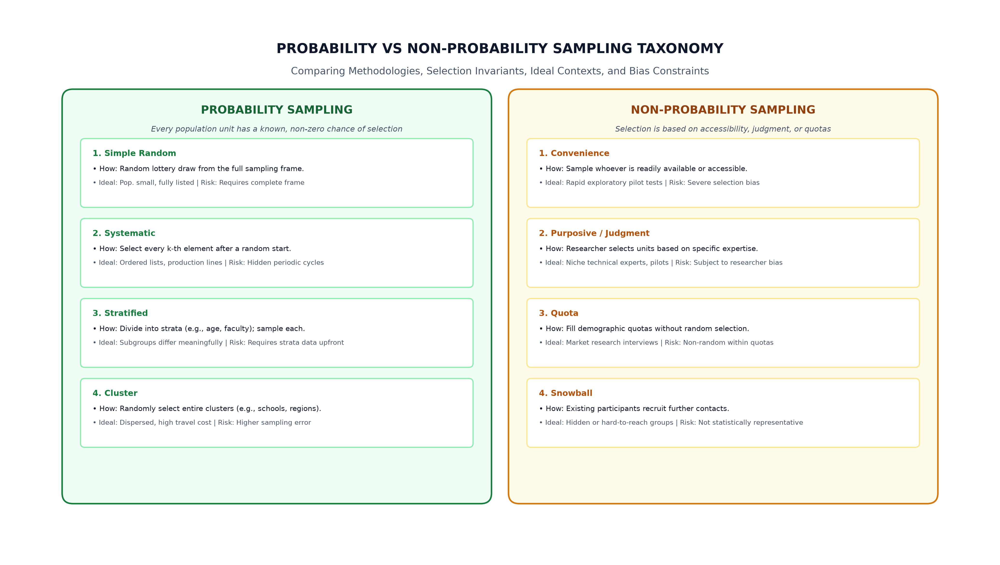
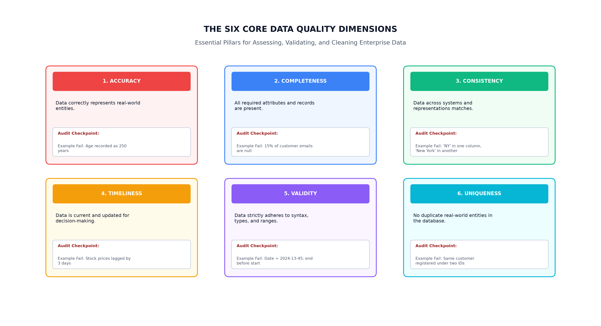
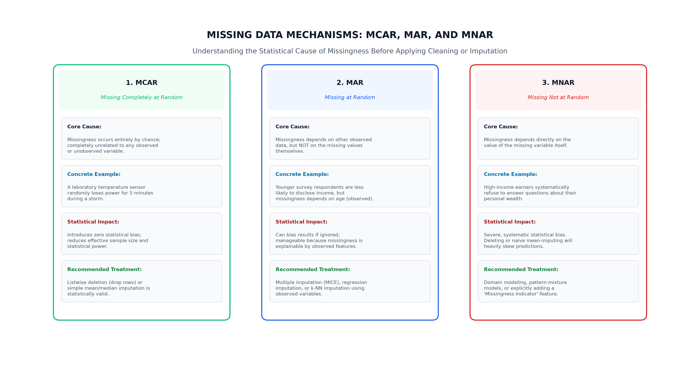
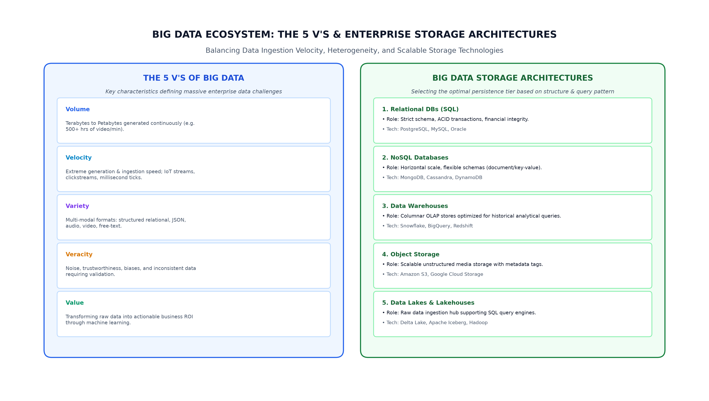

This topic note covers the systematic data collection process, probability and non-probability sampling theory, web scraping and REST API integration, the six dimensions of data quality, statistical mechanisms of missing data (MCAR, MAR, MNAR), feature transformation and dimensionality reduction, and Big Data storage and chunking architectures.

---

# 1. The Data Ingestion Landscape: Methods & Classifications

Data collection is the systematic process of gathering, measuring, and accurately conveying information on variables of interest to answer research questions, test empirical hypotheses, and evaluate outcomes. In data science, the choice of collection methodology directly dictates the quality, validity, and statistical power of subsequent machine learning models.

```
+---------------------------------------------------------------------------------------------------+
|                                 THE DATA INGESTION SPECTRUM                                       |
|                                                                                                   |
|   [ PRIMARY SOURCES: First-Hand Collection ]         [ SECONDARY SOURCES: Reused / Existing ]     |
|   - Laboratory Experiments & Randomized Trials       - Official Government Statistics (DCS)       |
|   - Field Surveys & Structured Questionnaires        - Curated Repositories (Kaggle, UCI ML)      |
|   - User Interviews & Qualitative Focus Groups       - Web Scraping & Open Data APIs (World Bank) |
|   - Direct IoT Sensor & Telemetry Readings           - Enterprise ERP & Transaction Logs          |
|                                                                                                   |
|   High control, customized fit, high cost/latency    Low cost, instant access, unknown bias/drift |
+---------------------------------------------------------------------------------------------------+
```

### 1.1 Observational vs. Transactional Data
- **Observational Data:** Collected through non-intrusive monitoring of real-world phenomena without researcher intervention or experimental manipulation.
  - *Context of Use:* Predominant in qualitative research, behavioral psychology, and environmental telemetry.
  - *Industry Examples:* Zoologists recording wildlife migration paths, traffic engineers tracking vehicular congestion at intersections, teachers monitoring classroom interaction dynamics.
- **Transactional Data:** Captures discrete events, financial exchanges, and user interactions within digital systems.
  - *Context of Use:* Inherently quantitative, highly structured, and timestamped; ideal for trend detection, anomaly recognition, and predictive modeling.
  - *Industry Examples:* Credit card purchases, e-commerce checkout clicks, healthcare appointment bookings, airline passenger check-in logs.

### 1.2 Primary vs. Secondary Data Trade-offs
- **Primary Data (First-Hand):**
  - *Advantages:* Tailored precisely to the investigative hypothesis; full administrative control over collection standards; completely current.
  - *Disadvantages:* High financial expenditure; long acquisition timelines; requires formal ethical clearances and instrument validation.
- **Secondary Data (Second-Hand):**
  - *Advantages:* Minimal or zero acquisition cost; instantaneous availability; provides vast longitudinal and historical baselines.
  - *Disadvantages:* May not cleanly align with analytical variables; unknown collection biases; potential schema drift and deprecation.
  - *Authoritative Repositories:* Kaggle Datasets, UCI Machine Learning Repository, Google Dataset Search, World Bank Open Data, data.gov, and the Department of Census and Statistics (DCS) Sri Lanka.

### 1.3 Survey Design & Implementation Best Practices
Surveys remain the primary empirical instrument in social science, healthcare, and market research. Rigorous survey methodology requires:
1. **Clear Objective Definition:** Formulate unambiguous research questions and strictly bound the target population.
2. **Structural Progression:** Begin with non-threatening, general demographic screening questions before advancing to complex, sensitive inquiries.
3. **Question Typology Balance:** Blend **closed-ended questions** (multiple-choice, Likert scales) for standardized quantitative metrics with **open-ended questions** for qualitative nuances.
4. **Cognitive Bias Mitigation:** Avoid leading, loaded, or double-barreled questions (e.g., asking *"Do you support better roads and higher taxes?"* confuses two distinct variables).
5. **Pilot Testing:** Administer the instrument to a small pilot cohort ($n = 15 - 30$) to detect semantic ambiguities and formatting friction prior to national distribution.

---

# 2. Sampling Theory: Probability vs. Non-Probability Techniques

Studying an entire population (a census) is often financially, logistically, or temporally impossible. **Sampling** is the statistical discipline of selecting a representative subset from a target population to infer properties of the whole group.



## 2.1 Probability Sampling (Every Unit Has a Known Selection Chance)
In probability sampling, every element within the sampling frame has a known, non-zero probability of being selected. This enables mathematically sound statistical inference and the calculation of standard errors and confidence intervals.

- **1. Simple Random Sampling (SRS):**
  - *Mechanics:* Every unit in the population has an identical selection probability $P(x_i) = \frac{1}{N}$. Selection is conducted via a pseudo-random number generator or lottery draw.
  - *Ideal Use:* Homogeneous populations with an exhaustive, accessible sampling frame.
  - *Limitation:* Requires a complete enumerated list; geographically dispersed units increase field collection costs.
- **2. Systematic Sampling:**
  - *Mechanics:* Given a population $N$ and desired sample size $n$, calculate sampling interval $k = \lfloor N / n \rfloor$. Select a random starting integer $r \in [1, k]$, then select every $k$-th unit: $\{r, r+k, r+2k, \dots\}$.
  - *Ideal Use:* Quality control on manufacturing assembly lines or ordered customer registries.
  - *Limitation:* **Periodicity Vulnerability:** If the list exhibits hidden periodic cycles that match $k$, severe systematic bias occurs (e.g., sampling every 7th day captures only Mondays).
- **3. Stratified Sampling:**
  - *Mechanics:* The heterogeneous population is partitioned into non-overlapping, mutually exclusive subgroups called **strata** (e.g., stratified by income tier, age group, or university faculty). Independent random samples are then drawn from each stratum.
  - *Proportional vs. Disproportional:* In proportional stratification, each stratum's sample size matches its population proportion ($n_h = n \cdot \frac{N_h}{N}$). In disproportional stratification, small critical subgroups are over-sampled to guarantee statistical reliability.
  - *Ideal Use:* Populations where variance between groups is large, but variance within groups is small (maximizes precision).
- **4. Cluster Sampling:**
  - *Mechanics:* The population is divided into heterogeneous natural clusters (e.g., school districts, geographic zones). A random sample of entire clusters is chosen; all individuals within chosen clusters are surveyed (single-stage) or sub-sampled (multi-stage).
  - *Ideal Use:* Populations widely dispersed across large geographic areas where travel costs dominate.
  - *Limitation:* Yields higher standard errors (**design effect**) than SRS because individuals within a cluster tend to be more similar to each other than to the wider population.

## 2.2 Non-Probability Sampling (Selection Based on Judgment or Access)
Units are chosen through non-random criteria; selection probabilities are unknown. While non-probability sampling cannot support formal parametric hypothesis testing, it is invaluable for exploratory studies and hard-to-reach cohorts.

- **1. Convenience Sampling:** Selecting individuals who are readily accessible to the researcher (e.g., surveying students walking outside the UCSC canteen). Highly prone to selection bias.
- **2. Purposive / Judgmental Sampling:** The researcher exercises domain expertise to deliberately select participants who satisfy specific criteria (e.g., interviewing senior cloud architects on Kubernetes migrations).
- **3. Quota Sampling:** The population is segmented into demographic quotas (e.g., 50% female, 30% rural), but units within each quota are selected non-randomly until the quota is filled.
- **4. Snowball (Chain-Referral) Sampling:** Existing study participants recruit future subjects from among their acquaintances. Essential for studying hidden or stigmatized populations (e.g., undocumented migrant workers, rare disease patients).

## 2.3 Sampling Comparative Synthesis

| Sampling Methodology | Selection Invariant | Operational Strengths | Critical Limitations | Common Use Cases |
| :--- | :--- | :--- | :--- | :--- |
| **Simple Random** | Equal chance: $P = 1/N$ | Unbiased; simple theory | Requires complete roster | Small academic surveys |
| **Systematic** | Every $k$-th unit | Rapid; spreads across list | Periodicity distortion | Assembly line auditing |
| **Stratified** | Sample within every stratum | Guarantees subgroup representation | Requires prior strata data | National political polling |
| **Cluster** | Randomly pick whole groups | Low geographic travel cost | Higher sampling variance | Rural healthcare audits |
| **Convenience** | Subject availability | Fast; zero setup expense | Extreme selection bias | Student classroom pilots |
| **Purposive** | Expert researcher judgment | Focuses on key informants | Heavy researcher subjectivity | Specialized B2B software |
| **Snowball** | Participant referrals | Accesses hidden networks | Zero statistical representativeness | Rare disease research |

> [!tip] Case Exercise: Retail Chain Satisfaction
> *Problem:* A national retailer operates 100 outlets across 9 provinces and wants an accurate, cost-effective customer satisfaction survey.
> *Optimal Approach:* **Multi-Stage Stratified Cluster Sampling.** First, stratify provinces by urban/semi-urban density. Second, randomly select clusters of stores within each stratum. Finally, systematically sample every $k$-th checkout customer at the selected locations. This balances geographic cost constraints with demographic representativeness.

---

# 3. Internet Data Harvesting: Web Scraping vs. REST APIs

Data scientists frequently harvest public datasets from web platforms using either programmatic web scraping or structured Application Programming Interfaces (APIs).

```
+---------------------------------------------------------------------------------------------------+
|                            WEB SCRAPING VS. API DATA HARVESTING                                   |
|                                                                                                   |
|   WEB SCRAPING ARCHITECTURE:                           REST API ARCHITECTURE:                     |
|                                                                                                   |
|   +------------+   HTTP GET (User-Agent)  +---------+  +------------+   HTTP GET (JSON Endpoint)  |
|   |   Python   | -----------------------> | Web     |  |   Python   | ------------------------->  |
|   |  Scraper   | <----------------------- | Server  |  |   Script   | <-------------------------  |
|   +------------+    Raw HTML Document     +---------+  +------------+    Structured JSON Payload  |
|         |                                                    |                                    |
|   Parse DOM via CSS/XPath                               pd.json_normalize()                       |
|   Fragile: Breaks on CSS redesign                       Stable: Governed by API contracts         |
+---------------------------------------------------------------------------------------------------+
```

### 3.1 Web Scraping Mechanics & Protocols
Web scrapers simulate browser interactions to retrieve and parse HTML source code:
1. **HTTP Request:** The scraper dispatches an HTTP `GET` request, supplying customized request headers (e.g., `User-Agent`, `Accept-Language`) to mimic real browser clients.
2. **DOM Tree Parsing:** Upon receiving the raw HTML string, parser libraries (such as **BeautifulSoup** or **lxml**) construct a hierarchical Document Object Model (DOM) tree.
3. **Element Extraction:** Target data fields (e.g., product titles, price tags, customer review ratings) are selected via CSS selectors (`div.product-card > span.price`) or XPath queries.
4. **Ethical & Legal Rules:**
   - **Check `robots.txt`:** Always inspect the domain's `robots.txt` file (e.g., `https://example.com/robots.txt`) to adhere to `Disallow` directives and `Crawl-delay` rate limits.
   - **Rate Limiting:** Implement randomized sleep intervals (`time.sleep(2 + random.random())`) to prevent Denial of Service (DoS) conditions on target servers.

### 3.2 REST APIs: The Modern Industry Standard
Application Programming Interfaces (APIs) provide a secure, predictable contract for data interchange. Unlike web scraping, APIs return machine-readable **JSON** or **XML** payloads governed by endpoint documentation.

```python
import requests
import pandas as pd

# Professional REST API Data Harvesting Pipeline
ENDPOINT_URL = "https://api.example.com/v1/store/orders"
HEADERS = {
    "Authorization": "Bearer SECURE_TOKEN_SAMPLE",
    "Accept": "application/json",
    "User-Agent": "UCSC-DataScience-Research/1.0"
}
PARAMS = {"status": "completed", "limit": 100}

try:
    response = requests.get(ENDPOINT_URL, headers=HEADERS, params=PARAMS, timeout=10)
    response.raise_for_status()  # Raises HTTPError for 4xx/5xx status codes
    
    payload = response.json()
    # Normalize nested JSON structure directly into a tabular DataFrame
    df_orders = pd.json_normalize(payload["data"])
    print(f"Successfully harvested {len(df_orders)} records.")
except requests.exceptions.RequestException as e:
    print(f"API Ingestion Failure: {e}")
```

---

# 4. The Six Dimensions of Data Quality & Preprocessing Stages

Raw data collected from real-world systems is notoriously dirty: incomplete, noisy, inconsistent, and duplicated.



## 4.1 The Six Preprocessing Lifecycle Stages
1. **Data Integration:** Merging heterogeneous data sources (e.g., combining SQL customer tables with CSV survey exports and MongoDB clickstream logs) into a unified dataset.
2. **Data Cleaning:** Detecting and resolving errors, missing values, duplicate observations, structural typos, and anomalous records.
3. **Data Transformation:** Converting features into formats suitable for statistical models (scaling numerical features, encoding categories, normalizing dates).
4. **Data Reduction:** Compressing dataset dimensionality (feature selection, Principal Component Analysis) while preserving informational variance.
5. **Data Discretization (Binning):** Grouping continuous variables into discrete categorical intervals (e.g., transforming numerical ages into age brackets).
6. **Data Sampling:** Subsetting massive datasets to enable tractable local exploration and rapid prototyping.

## 4.2 The Six Core Data Quality Dimensions
- **1. Accuracy:** The extent to which recorded values mirror true real-world facts.
  - *Audit Check:* Flagging implausible values (e.g., human `Age = 250` or `HeartRate = 0` for an active patient).
- **2. Completeness:** The proportion of required attributes and records present in the dataset.
  - *Audit Check:* Detecting that 15% of customer profiles have missing email addresses or postal codes.
- **3. Consistency:** Ensuring identical data points across tables and columns maintain uniform representations.
  - *Audit Check:* Eliminating semantic fragmentation (e.g., `"NY"`, `"N.Y."`, and `"New York"` representing the same state).
- **4. Timeliness:** The freshness and temporal relevance of the data for current decision-making.
  - *Audit Check:* Detecting price quotation tables that have not been refreshed in 72 hours.
- **5. Validity:** Strict adherence of data to predefined structural schemas, range boundaries, and data types.
  - *Audit Check:* Validating date syntax (`YYYY-MM-DD`) and ensuring logical sequences (`StartDate <= EndDate`).
- **6. Uniqueness:** The absence of duplicated real-world entities within the dataset.
  - *Audit Check:* Identifying customers registered twice with slightly differing email formats.

---

# 5. Statistical Missing Data Mechanisms: MCAR, MAR, and MNAR

Before applying imputation or dropping rows, a data scientist must diagnose the statistical mechanism driving the missingness. Blindly deleting rows can introduce devastating bias into machine learning models.



## 5.1 Formal Mathematical Taxonomy of Missingness
Let $Y = (Y_{\text{obs}}, Y_{\text{mis}})$ represent the complete data matrix, partitioned into observed and missing components, and let $M$ be a binary missingness indicator matrix where $M_{ij} = 1$ if $Y_{ij}$ is missing.

- **1. Missing Completely at Random (MCAR):**
  - *Definition:* The probability of missingness is completely independent of both observed and unobserved data:
    $$P(M \mid Y_{\text{obs}}, Y_{\text{mis}}) = P(M)$$
  - *Example:* A laboratory tube drops and shatters on the floor; a wireless weather sensor randomly loses power due to lightning.
  - *Statistical Impact:* The observed data remains an unbiased representative sample of the population. Listwise deletion reduces statistical power, but **does not introduce systemic bias**.
- **2. Missing at Random (MAR):**
  - *Definition:* The probability of missingness depends systematically on other observed variables, but is independent of the missing values themselves:
    $$P(M \mid Y_{\text{obs}}, Y_{\text{mis}}) = P(M \mid Y_{\text{obs}})$$
  - *Example:* In a public health survey, younger respondents are less likely to report their annual income. However, the probability of missingness depends on **Age** (an observed variable), not on the actual income value.
  - *Statistical Impact:* Dropping rows will bias model parameters. Imputation using observed features (e.g., Multiple Imputation by Chained Equations - MICE, $k$-NN imputation) successfully restores unbiased estimates.
- **3. Missing Not at Random (MNAR):**
  - *Definition:* The probability of missingness depends directly on the value of the missing variable itself:
    $$P(M \mid Y_{\text{obs}}, Y_{\text{mis}}) \neq P(M \mid Y_{\text{obs}})$$
  - *Example:* Individuals with very high wealth systematically refuse to disclose their net worth; patients with severe depression fail to show up for follow-up mental health score evaluations.
  - *Statistical Impact:* Introduces severe, non-correctable bias into statistical estimates. Naive mean imputation or row deletion yields distorted predictions. Must be treated using domain modeling, pattern-mixture models, or explicit **missingness indicator flags**.

## 5.2 Comparative Treatment Strategies

| Missing Mechanism | Root Statistical Cause | Listwise Deletion Viability | Recommended Imputation Strategy |
| :--- | :--- | :--- | :--- |
| **MCAR** | Random environmental accident | **Safe if missingness $< 5\%$** | Mean / Median / Mode or Simple Random Draw |
| **MAR** | Correlated with observed features | **Unsafe (Biases distribution)** | **MICE, MissForest, $k$-NN, Regression Imputation** |
| **MNAR** | Driven by the missing value itself | **Disastrous (Severe skew)** | **Domain modeling + Binary Missing Indicator Feature** |

---

# 6. Data Transformation, Feature Engineering & Reduction

Data transformation prepares clean variables for consumption by machine learning algorithms that require numerical, scaled, and non-collinear inputs.

## 6.1 Feature Scaling: Normalization vs. Standardization
Distance-based algorithms ($k$-NN, SVMs, $k$-Means) and gradient descent optimizers (Linear Regression, Neural Networks) are hypersensitive to feature scales:

- **Min-Max Normalization:** Rescales values into a fixed range (typically $[0, 1]$):
  $$x' = \frac{x - x_{\min}}{x_{\max} - x_{\min}}$$
  *Use Case:* Neural network input layers, image pixel arrays, and non-Gaussian distributions.
- **Z-Score Standardization:** Centers data around a mean of 0 with a standard deviation of 1:
  $$z = \frac{x - \mu}{\sigma}$$
  *Use Case:* Algorithms assuming normally distributed features (PCA, Logistic Regression); robust to moderate outliers.

## 6.2 Handling Skewed Distributions
Severely right-skewed numerical features (e.g., household incomes, transaction values) violate linear model normality assumptions. They are transformed using monotonic logarithmic or power functions:
$$y = \ln(x + 1) \quad \text{or} \quad y_{\text{Box-Cox}} = \begin{cases} \frac{x^\lambda - 1}{\lambda} & \text{if } \lambda \neq 0 \\ \ln(x) & \text{if } \lambda = 0 \end{cases}$$

## 6.3 Categorical Variable Encoding
- **Nominal Variables (No Order):** Converted using **One-Hot Encoding** (creating $k$ binary columns). To prevent the **dummy variable trap** (perfect multicollinearity in linear models), drop one column ($k-1$ degrees of freedom).
- **Ordinal Variables (Ordered):** Converted via integer mapping preserving semantic progression (e.g., `{"Low": 1, "Medium": 2, "High": 3}`).

## 6.4 Dimensionality Reduction: PCA
When datasets possess hundreds of correlated features, **Principal Component Analysis (PCA)** projects high-dimensional data onto orthogonal axes of maximum variance via eigenvalue decomposition of the covariance matrix:
$$\mathbf{\Sigma} = \frac{1}{n} \mathbf{X}^T \mathbf{X} \implies \mathbf{\Sigma} \mathbf{v}_i = \lambda_i \mathbf{v}_i$$
This preserves the majority of informational signal while eliminating multicollinearity and reducing model overfitting.

---

# 7. Big Data Foundations & Scalable Storage Architecture

As datasets expand beyond local workstation RAM, data science transitions into Big Data engineering.



## 7.1 The 5 V's of Big Data
- **1. Volume:** Immense magnitude of data generated continuously (ranging from terabytes to exabytes; e.g., YouTube processing 500+ hours of video uploads every minute).
- **2. Velocity:** The rate at which data is produced, streamed, and processed (e.g., real-time credit card fraud scoring, sensor telemetry).
- **3. Variety:** Structural heterogeneity across structured tables, semi-structured JSON documents, and unstructured audio/video files.
- **4. Veracity:** Uncertainty, noise, sensor glitches, and trustworthiness of raw ingested data.
- **5. Value:** The ultimate business ROI derived from turning raw signals into predictive models.
- *(Additional Dimensions:)* **Variability** (contextual drift over time) and **Visualization** (rendering massive data interpretable).

## 7.2 Data Compression Paradigms
- **Lossy Compression:** Permanently discards perceptually redundant information to achieve massive file size reductions ($>90\%$). Suited for media streams where slight quality loss is imperceptible (JPEG, MP3, MP4).
- **Lossless Compression:** Encodes data without discarding a single bit by identifying structural and statistical patterns. Fully reconstructs the original bitstream. Mandatory for text, code, financial tables, and scientific data (GZIP, ZIP, PNG, Apache Parquet).

## 7.3 Enterprise Storage Architecture Taxonomy

| Storage Architecture | Data Model | Scalability Model | Optimal Analytical Workload |
| :--- | :--- | :--- | :--- |
| **Relational (RDBMS)** | Strict relational tables (SQL) | Vertical (Scale Up) | ACID financial ledger transactions |
| **NoSQL (Document/Column)** | Flexible JSON / Key-Value | Horizontal (Scale Out) | Unstructured social feeds, clickstreams |
| **Data Warehouse (OLAP)** | Columnar schemas | Clustered OLAP | Historical BI reports, multi-table joins |
| **Object Storage** | Flat object blobs + metadata | Limitless Cloud Elasticity | Product images, audio datasets, backups |
| **Data Lake / Lakehouse** | Open formats (Parquet/Delta) | Distributed compute & store | Raw exploratory ML ingestion pipelines |

## 7.4 Data Chunking for Out-of-Core Processing
When a dataset exceeds workstation memory (RAM), attempting to load it via `pd.read_csv()` triggers an Out-Of-Memory (OOM) crash. **Data chunking** streams the dataset in discrete, manageable batches:

```python
import pandas as pd

# Chunking Pipeline: Processing a 50GB CSV file in 10,000-row batches
CHUNK_SIZE = 10000
total_revenue = 0.0

for chunk in pd.read_csv("massive_transactions.csv", chunksize=CHUNK_SIZE):
    # Process each batch independently in RAM
    valid_sales = chunk.loc[chunk["status"] == "COMPLETED", "amount"]
    total_revenue += valid_sales.sum()

print(f"Total Aggregated Revenue: ${total_revenue:,.2f}")
```

---

# 8. Hands-On Python Cleaning Pipeline with Pandas

The following script integrates the complete data preparation lifecycle into an automated, reproducible pipeline:

```python
import pandas as pd
import numpy as np

# 1. Ingest Raw Dataset
df = pd.read_csv("customers_raw.csv")

# 2. Inspect Structural Characteristics
print("Initial Missing Count:\n", df.isna().sum())
print("Initial Duplicates:", df.duplicated().sum())

# 3. Deduplication & Semantic Text Cleaning
df = df.drop_duplicates()
df["city"] = df["city"].astype(str).str.strip().str.title()
df["email"] = df["email"].str.strip().str.lower()

# 4. Standardizing Datetime & Enforcing Logical Validity
df["signup_date"] = pd.to_datetime(df["signup_date"], dayfirst=True, errors="coerce")

# 5. Outlier Detection & Range Validation (Domain Knowledge)
# Biological constraint: Human age must reside between 0 and 120 years
invalid_age_mask = ~df["age"].between(0, 120)
df.loc[invalid_age_mask, "age"] = np.nan

# 6. Statistical Imputation (MCAR / MAR)
# Median imputation is robust against lingering extreme values
median_age = df["age"].median()
df["age"] = df["age"].fillna(median_age)

# Categorical missingness: Impute with mode or designated sentinel
df["city"] = df["city"].fillna("Unknown")

# 7. Post-Cleaning Audit & Verification
assert df["age"].isna().sum() == 0, "Error: Null values persist in age!"
assert (df["age"] < 0).sum() == 0, "Error: Negative ages detected!"
print("Cleaning Pipeline Executed Successfully. Final Shape:", df.shape)
```

---

# Lecture Notes
![[IS2210 - 02. Data Collection & Preparation.pdf]]