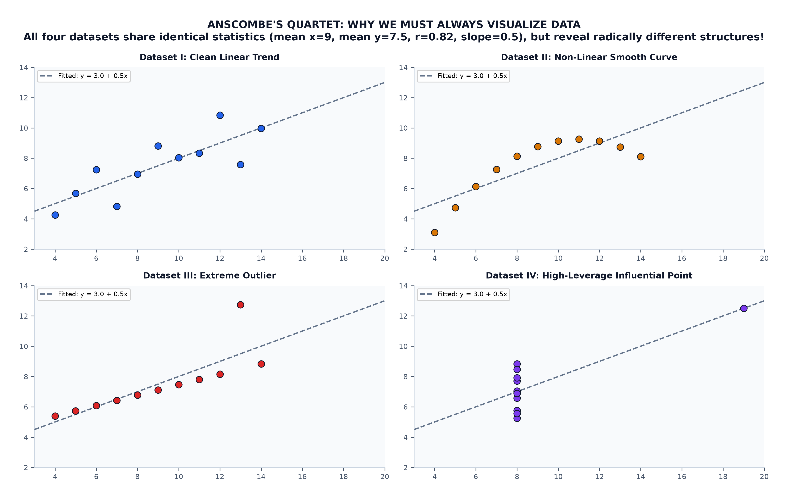
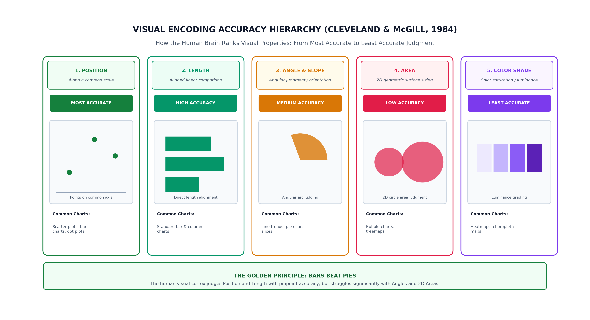
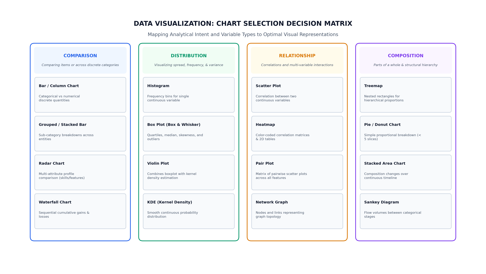
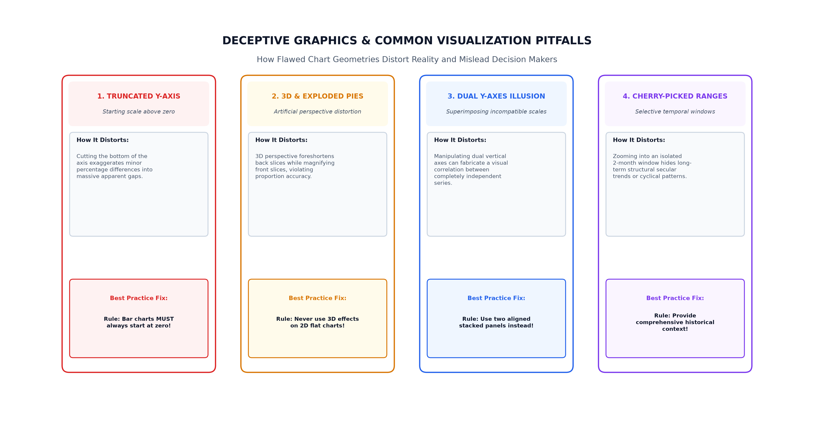

This topic note examines the principles, perceptual psychology, and implementation of data visualization, covering Anscombe's Quartet, the Cleveland-McGill visual encoding hierarchy, chart selection taxonomies, Tufte's data-ink ratio, deceptive chart pitfalls, and practical implementation across Matplotlib, Pandas, Seaborn, and Plotly.

---

# 1. The Purpose & Psychology of Data Visualization

Data visualization is the graphical representation of information and data using visual elements such as charts, plots, heatmaps, maps, and infographics. In modern data science, visualization is not an aesthetic afterthought; it is a critical instrument for exploratory discovery and decision-making.

> *"The purpose of visualization is insight, not pictures."*  
> — **Ben Shneiderman**, Computer Scientist & Human-Computer Interaction Pioneer

```
+---------------------------------------------------------------------------------------------------+
|                            THE TWO MODES OF DATA VISUALIZATION                                    |
|                                                                                                   |
|   EXPLORATORY VISUALIZATION (Data Discovery)         EXPLANATORY VISUALIZATION (Storytelling)     |
|   - Purpose: Discover hidden patterns & anomalies    - Purpose: Communicate one clear insight     |
|   - Audience: The Data Scientist / Analyst           - Audience: Executives, Clients, Public      |
|   - Polish: Fast, rough, high-density small multiples- Polish: Clean, heavily annotated, curated  |
|   - Scope: Plotting all features & distributions     - Scope: Single chart answering a business Q |
|   - Tools: Seaborn, Pandas .plot(), Pair Plots       - Tools: Plotly, Dash, Power BI, Tableau     |
+---------------------------------------------------------------------------------------------------+
```

### 1.1 Exploratory vs. Explanatory Visualization

| Analytical Aspect | Exploratory Visualization | Explanatory Visualization |
| :--- | :--- | :--- |
| **Primary Goal** | Hypothesis generation, anomaly detection | Communicating conclusions, driving action |
| **Target Audience** | Data scientists, machine learning engineers | Business stakeholders, executive leadership |
| **Speed & Polish** | Rapid, iterative, dozens of unpolished charts | High aesthetic polish, curated typography |
| **Visual Structure** | Faceted grids, histograms of every column | A single annotated chart with headline title |
| **Representative Code** | `sns.pairplot(df, hue='target')` | `px.scatter(..., title="Q3 Revenue Driver")` |

---

# 2. Why We Must Plot: The Proof of Anscombe's Quartet

A foundational tenet of empirical statistics is that **summary statistics can deceive**. In 1973, statistician Francis Anscombe constructed four synthetic datasets ($n=11$) to demonstrate the danger of calculating statistical aggregates without plotting the raw distribution.



## 2.1 The Mathematical Identity Paradox
Across all four datasets, numerical summary statistics are mathematically identical to two or three decimal places:

- **Sample Size ($n$):** $11$
- **Mean of $x$ ($\bar{x}$):** $9.0$
- **Sample Variance of $x$ ($s_x^2$):** $11.0$
- **Mean of $y$ ($\bar{y}$):** $7.50$
- **Sample Variance of $y$ ($s_y^2$):** $4.125$
- **Pearson Correlation ($r$):** $0.816$
- **Fitted OLS Linear Regression Line:**
  $$\hat{y} = 3.00 + 0.500x \quad (R^2 = 0.67)$$

## 2.2 The Visual Reality
Despite identical formulas, plotting the coordinates reveals four completely distinct phenomena:
- **Dataset I:** Exhibits a clean, genuine linear relationship with uniform scatter. A linear regression model is statistically valid.
- **Dataset II:** Exhibits a smooth, non-linear parabolic curve. The relationship is quadratic, meaning a linear model is mathematically misspecified.
- **Dataset III:** Features an almost perfect linear relationship ($r = 1.0$), except for a **single extreme outlier** that artificially pulls down the regression slope.
- **Dataset IV:** All points except one share an identical $x$-coordinate ($x=8$). A single **high-leverage influential point** at $(19, 12.5)$ single-handedly manufactures the regression line.

> [!important] The Analytical Takeaway
> Never evaluate a dataset through summary metrics (mean, standard deviation, correlation) alone. Numerical aggregates can hide severe non-linearities, clustering, and fatal leverage points. **Always visualize raw feature distributions before fitting predictive models.**

---

# 3. Visual Encoding & The Cleveland-McGill Perceptual Hierarchy

Every chart is an optical mapping that binds numeric variables to visual encodings: spatial position, line length, angular slope, 2D area, or color saturation. In 1984, William Cleveland and Robert McGill conducted empirical experiments measuring the perceptual error rate of the human visual cortex when decoding these graphical attributes.



## 3.1 The Cleveland-McGill Perceptual Ranking
Ranked from **highest decoding accuracy** (lowest cognitive error) to **lowest decoding accuracy**:

1. **Position Along a Common Aligned Scale:** The human brain decodes points aligned along a common Cartesian axis with near-zero perceptual error (e.g., standard dot plots, scatter plots, horizontal bar charts).
2. **Length:** Estimating differences in the length of linear segments with a common baseline (e.g., standard bar charts).
3. **Angle and Slope:** Judging angular deviation or directional inclination (e.g., slope charts, line trends, pie chart slices). Human error rates increase sharply when judging angles.
4. **Area:** Estimating the magnitude of two-dimensional geometric surfaces (e.g., circle radii in bubble charts, nested rectangles in treemaps). Humans systematically underestimate circular and irregular 2D areas.
5. **Color Shade and Saturation:** Estimating magnitude from color luminance or saturation (e.g., continuous heatmaps, choropleth maps). Subject to optical illusions caused by adjacent contrasting colors (**simultaneous contrast effect**).

> [!tip] The Golden Invariant: "Bars Beat Pies"
> A standard bar chart encodes information via **Length and Position** (Ranks 1 & 2 in perceptual accuracy). A pie chart encodes information via **Angle and 2D Area** (Ranks 3 & 4). Consequently, stakeholders can distinguish a $1\%$ difference on a bar chart instantly, but routinely fail to detect a $10\%$ difference between two pie chart wedges.

---

# 4. Chart Selection Decision Matrix: Typology & Use Cases

Selecting an appropriate visualization requires matching the **cardinality and data type** of variables to the analytical intent.



## 4.1 Taxonomy of Analytical Intents

### 1. Comparison (Contrasting Values Across Categories)
- **Standard Bar / Column Chart:** Discrete categorical groups versus a continuous numerical metric. Bars must always share a common baseline starting at zero.
- **Grouped / Stacked Bar Chart:** Comparing sub-categorical breakdowns across entities (e.g., sales volume across products grouped by retail region).
- **Radar (Spider) Chart:** Multi-attribute profile comparisons across a few discrete entities (e.g., comparing candidate competencies across 5 skill dimensions).
- **Waterfall Chart:** Demonstrating how sequential positive and negative incremental values build up to a cumulative net total (e.g., corporate profit bridges).

### 2. Distribution (Analyzing Spread, Skewness, and Density)
- **Histogram:** Bins continuous numerical values into uniform intervals and counts frequency. Essential for assessing Gaussian normality, skewness, and bimodal peaks.
- **Box Plot (Tukey Box & Whisker):** Summarizes a dataset through five key statistical numbers: Minimum, First Quartile ($Q_1$), Median ($Q_2$), Third Quartile ($Q_3$), and Maximum, plotting outliers beyond $1.5 \times \text{IQR}$.
- **Violin Plot:** Combines a box plot with a rotated, mirrored Kernel Density Estimation (KDE) plot, revealing multimodal distributions that box plots obscure.
- **Kernel Density Estimation (KDE):** A non-parametric method to estimate the continuous probability density function of a random variable.

### 3. Relationship (Evaluating Correlation and Multivariable Interaction)
- **Scatter Plot:** Displays the joint distribution of two continuous variables. Essential for diagnosing linear, polynomial, or clustered relationships.
- **Correlation Heatmap:** Color-coded matrix displaying pairwise Pearson or Spearman correlation coefficients ($r \in [-1, 1]$) across all numerical features.
- **Pair Plot (Scatterplot Matrix):** A grid of pairwise scatter plots for all features in a dataframe, with univariate histograms along the diagonal.
- **Network Graph:** Nodes and linking edges representing structural graph topologies, social networks, or telecommunication routing tables.

### 4. Composition (Visualizing Proportions and Hierarchical Structures)
- **Treemap:** Nested rectangles whose areas correspond to proportional magnitudes within a strict categorical hierarchy (e.g., national budget allocation by ministry).
- **Pie / Donut Chart:** Proportions of a whole. Acceptable only when displaying **fewer than 5 categories** with radically differing proportions.
- **Stacked Area Chart:** Shows cumulative totals and proportional compositional changes across a continuous timeline.
- **Sankey Diagram:** Flow diagrams where the width of connecting arrows is proportionally sized to flow volume between categorical stages (e.g., student enrollment funnels).

## 4.2 Data Type to Chart Mapping Guide

| Data Type Configuration | Primary Analytical Goal | Recommended Visualization |
| :--- | :--- | :--- |
| **1 Continuous Numerical** | Distribution & Spread | Histogram, KDE Plot, Box Plot |
| **1 Categorical** | Frequency Count | Horizontal Bar Chart |
| **2 Continuous Numerical** | Correlation & Covariance | Scatter Plot with OLS Trendline |
| **1 Categorical + 1 Continuous** | Subgroup Comparison | Bar Chart (Mean), Box / Violin Plot |
| **1 Time-Series + 1 Continuous** | Longitudinal Trend | Line Chart with Date Axis |
| **Multi-Feature Continuous** | Feature Correlation Matrix | Heatmap with Annotated Coefficients |
| **Hierarchical Categorical** | Proportional Share | Treemap, Sunburst Chart |
| **Geographic Coordinates** | Spatial Patterns | Choropleth Map, Bubble Map |

---

# 5. Design Principles & Pitfalls: Tufte's Data-Ink & Deceptive Charts

Data visualization requires rigorous design hygiene to prevent misleading stakeholders.

## 5.1 Edward Tufte's Data-Ink Ratio
Pioneered by Edward Tufte in *The Visual Display of Quantitative Information* (1983):

$$\text{Data-Ink Ratio} = \frac{\text{Data-Ink}}{\text{Total Ink Used to Print the Graphic}} = 1.0 - \text{Proportion of Chartjunk}$$

- **Core Rule:** Maximize the data-ink ratio. Every drop of ink on the graphic must serve to convey quantitative information.
- **Chartjunk Elimination:** Strip away heavy dark gridlines, redundant borders, 3D drop-shadows, decorative clipart, and duplicate data labels.

## 5.2 Scientific Palette Selection
- **Sequential Palettes:** For ordered, numeric data ranging from low to high (e.g., light blue to deep navy).
- **Diverging Palettes:** For data centered around a critical neutral midpoint (e.g., blue for positive growth, white at zero, red for negative deficit).
- **Categorical Palettes:** Distinct, unordered hues for nominal categories (e.g., blue, green, orange, purple). Limit to **5–6 colors** maximum; use neutral grey for contextual noise and a single vibrant color for the focal insight.
- **Avoid the Rainbow / Jet Colormap:** Rainbow palettes introduce artificial visual boundaries because human perception of hue luminance is non-linear. Use perceptually uniform colormaps (**Viridis**, **Plasma**, or **Cividis**), which remain accessible to color-blind viewers and render cleanly in greyscale print.

## 5.3 Deceptive Graphics & Common Pitfalls



- **1. Truncated Y-Axis:** Starting a bar chart's axis at a non-zero value (e.g., baseline at $95$ instead of $0$) exaggerates a minor $2\%$ fluctuation into an apparent $400\%$ surge.
  - *Golden Rule:* **Bar chart axes must ALWAYS start at zero.**
- **2. 3D Perspective Distortion:** Tilting a pie or bar chart into pseudo-3D perspective causes foreground elements to appear significantly larger than background elements due to optical foreshortening.
  - *Golden Rule:* **Never use 3D effects on 2D flat data.**
- **3. Dual Y-Axes Illusion:** Plotting two independent time series on dual vertical axes with different scales allows the author to manipulate axis ranges to fabricate visual correlations that have zero statistical significance.
  - *Golden Rule:* **Use two vertically stacked subplot panels sharing an x-axis instead.**
- **4. Cherry-Picked Temporal Horizons:** Arbitrarily zooming into an isolated 2-week window to show an upward trend while concealing an ongoing 3-year structural decline.
- **5. Confusing Correlation with Causation:** Implying that because variable $A$ tracks variable $B$ visually, $A$ causes $B$.

---

# 6. The Python Visualization Ecosystem

Python provides a layered visualization stack spanning low-level plotting engines, high-level statistical interfaces, and interactive web canvases.

| Library | Architectural Paradigm | Output Medium | Primary Strengths |
| :--- | :--- | :--- | :--- |
| **Matplotlib** | Procedural / Object-Oriented (`fig, ax`) | Static PNG/PDF/SVG | Complete control over every pixel; foundational engine |
| **Pandas (`.plot`)** | DataFrame Method Wrapper | Static Matplotlib | Instant exploratory charting directly from DataFrames |
| **Seaborn** | High-Level Statistical API | Static Matplotlib | Automated statistical estimation, themes, and small multiples |
| **Plotly Express** | Declarative JSON / WebGL | Interactive HTML | Interactive hover tooltips, zoom/pan, standalone HTML |
| **Plotnine** | Grammar of Graphics (`ggplot2`) | Static Matplotlib | Layered aesthetic mappings (`aes`) and faceted syntax |
| **Altair** | Declarative Vega-Lite Specification | Interactive Web | Elegant declarative grammar for statistical data |
| **Folium** | Leaflet.js Geographic Wrapper | Interactive Maps | Interactive tile layers, choropleths, geo-markers |
| **Missingno** | Matrix / Nullity Correlation | Static Matplotlib | Visualizing nullity distributions and missingness patterns |

---

# 7. Hands-On Python Plotting Implementation

## 7.1 Matplotlib: Object-Oriented Figure Anatomy
The Object-Oriented (OO) interface (`fig, ax = plt.subplots()`) provides robust control over publication-grade graphics:

```python
import matplotlib.pyplot as plt
import numpy as np

# Publication-grade Object-Oriented Plotting
fig, (ax1, ax2) = plt.subplots(1, 2, figsize=(10, 4.5), dpi=300)

x = np.linspace(0, 10, 100)
y_sales = 50 + 15 * np.sin(x) + x * 2

# Panel 1: Annotated Line Plot
ax1.plot(x, y_sales, color="#1D4ED8", linewidth=2.2, label="Actual Trajectory")
ax1.axhline(60, color="#DC2626", linestyle="--", label="Target Threshold")
ax1.annotate("Product Launch Surge", xy=(4.7, 75), xytext=(2.0, 85),
             arrowprops=dict(facecolor="#DC2626", shrink=0.08, width=1.5, headwidth=6),
             fontsize=8.5, fontweight="bold", color="#DC2626")
ax1.set_title("Revenue Trajectory Over Time", fontsize=10, fontweight="bold")
ax1.set_xlabel("Operational Weeks", fontsize=8.5)
ax1.set_ylabel("Gross Revenue ($K)", fontsize=8.5)
ax1.legend(loc="lower right", fontsize=7.8)
ax1.grid(True, linestyle=":", alpha=0.6)

# Panel 2: Distribution Bar Plot
categories = ["Q1", "Q2", "Q3", "Q4"]
units_sold = [120, 185, 140, 260]
bars = ax2.bar(categories, units_sold, color="#0D9488", edgecolor="#0F172A", linewidth=1.1)
ax2.bar_label(bars, fmt="%d units", padding=3, fontsize=8)
ax2.set_title("Quarterly Unit Volume", fontsize=10, fontweight="bold")
ax2.set_ylim(0, 300)

fig.suptitle("Executive Operations Summary", fontsize=12, fontweight="bold")
fig.tight_layout()
fig.savefig("executive_summary.png", dpi=300)
plt.close()
```

## 7.2 Pandas Native Data Exploration
Pandas simplifies quick exploratory data analysis (EDA):

```python
import pandas as pd

df = pd.DataFrame({
    "Dept": ["Engineering", "HR", "Engineering", "Marketing", "HR", "Engineering"],
    "Salary": [95000, 62000, 88000, 74000, 65000, 102000]
})

# One-line aggregation and horizontal bar visualization
avg_salary = df.groupby("Dept")["Salary"].mean().sort_values()
avg_salary.plot(kind="barh", color="#2563EB", title="Mean Annual Salary by Department")
```

## 7.3 Seaborn: Statistical Graphics & Small Multiples
Seaborn automates statistical aggregation and facet grids:

```python
import seaborn as sns
import matplotlib.pyplot as plt

# Load Iris statistical dataset
iris = sns.load_dataset("iris")

# Set theme
sns.set_theme(style="whitegrid", font="sans-serif")

# Correlation Heatmap
plt.figure(figsize=(6, 4.5), dpi=300)
corr_matrix = iris.drop(columns="species").corr()
sns.heatmap(corr_matrix, annot=True, cmap="YlGnBu", fmt=".2f", linewidths=1.0)
plt.title("Iris Feature Correlation Matrix", fontweight="bold")
plt.tight_layout()
plt.show()

# Faceted Small Multiples with relplot
tips = sns.load_dataset("tips")
g = sns.relplot(data=tips, x="total_bill", y="tip", hue="smoker",
                col="time", row="sex", height=3, aspect=1.2)
g.fig.suptitle("Tip Distribution by Shift and Gender", y=1.02, fontweight="bold")
plt.show()
```

## 7.4 Plotly Express: Interactive Web Graphics
Plotly creates responsive, interactive HTML visualizations supporting zoom, pan, hover tooltips, and dynamic series filtering:

```python
import plotly.express as px

# Ingest dataset
df_iris = px.data.iris()

# Construct interactive scatter plot
fig = px.scatter(
    df_iris,
    x="sepal_width",
    y="sepal_length",
    color="species",
    size="petal_length",
    hover_data=["petal_width"],
    title="Interactive Iris Classification: Sepal Geometry vs Petal Dimension"
)

# Export as standalone HTML artifact for web embedding
fig.write_html("iris_interactive_plot.html")
# fig.show() opens in default web browser
```

---

# Lecture Notes
![[IS2210 - 03. Data Visualization.pdf]]