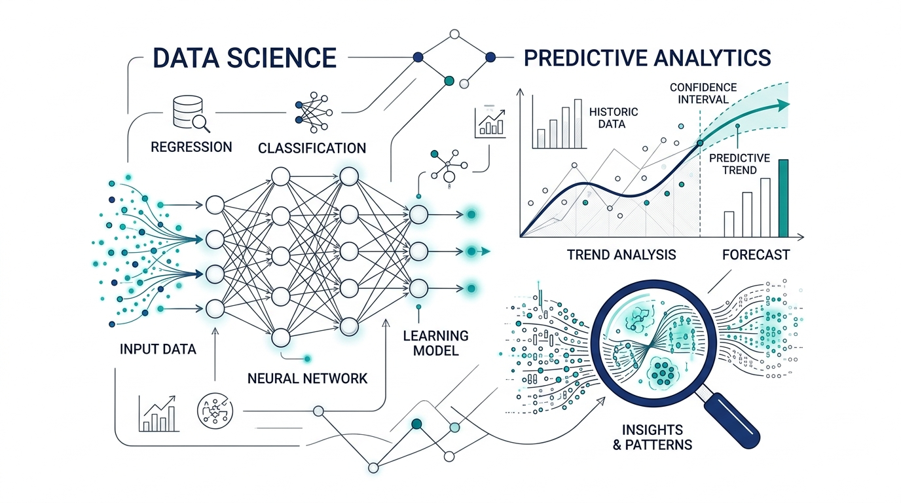
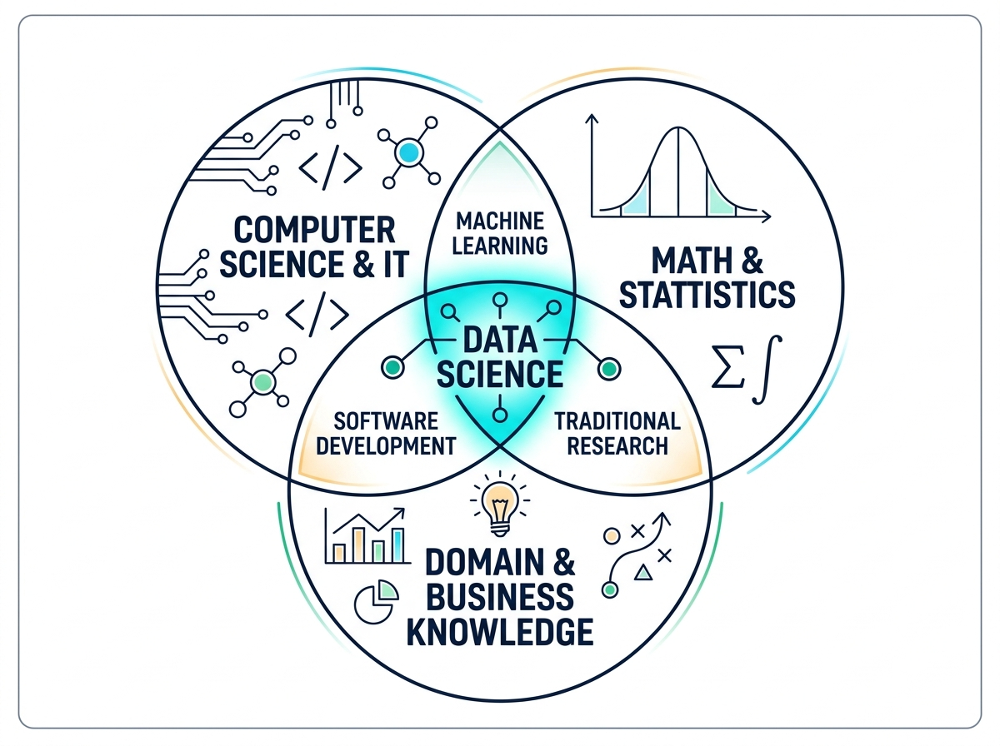
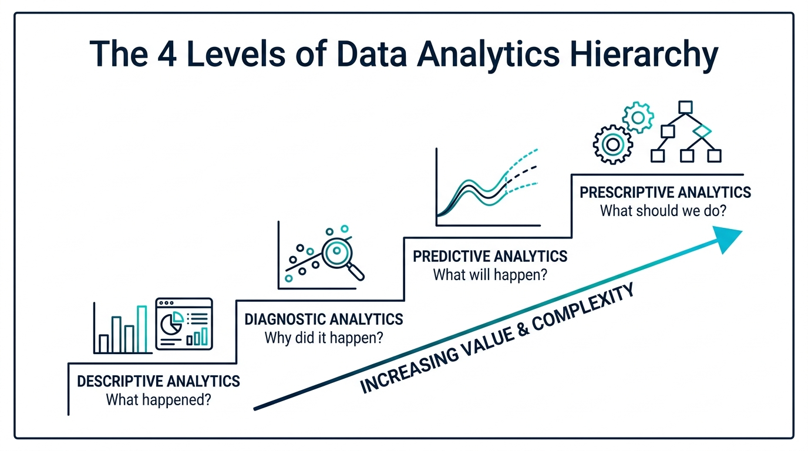
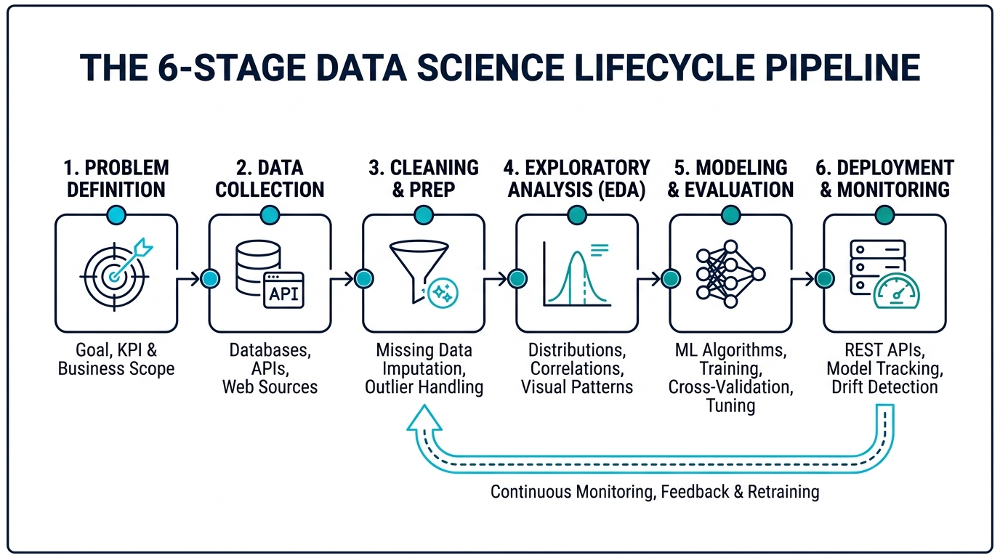
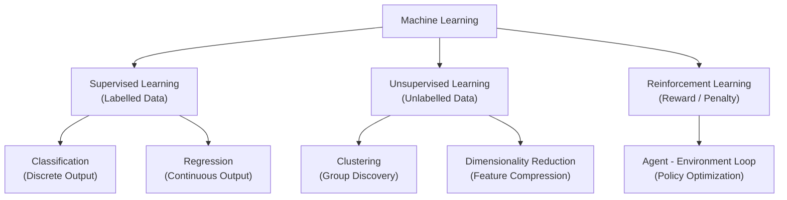

This topic covers the foundational principles of Data Science, taxonomy of data types, the historical evolution from statistical computing to modern AI, the four tiers of data analytics, the 6-stage data science lifecycle, machine learning paradigms, real-world predictive modeling workflows, and ethical/regulatory compliance frameworks.

---

# 1. Foundations of Data & Classification Taxonomy

At its core, **data** is the raw, unrefined form of information—an unorganized collection of facts, observations, figures, symbols, or signals representing real-world events and phenomena. 

> *"Data! Data! Data!" he cried impatiently. "I can’t make bricks without clay."*  
> — **Sir Arthur Conan Doyle**, *The Adventure of the Copper Beeches*

Without structured data processing, raw data remains uninformative. In data science, data is systematically classified along structural and statistical dimensions to determine appropriate analytical strategies.



### 1.1 Structural Taxonomy of Data
- **Structured Data:** Highly organized information conforming to a rigid, predetermined schema. Stored in relational tables with strictly typed rows and columns. Easily indexed and queried using Structured Query Language (SQL).
  - *Examples:* Relational database tables (e.g., student IDs, course marks, banking ledger transactions).
- **Semi-Structured Data:** Information that lacks a strict tabular schema but contains semantic markers, internal tags, or key-value hierarchies that separate data elements.
  - *Examples:* JSON payloads from REST APIs, XML files, NoSQL document stores (MongoDB), and server log files.
- **Unstructured Data:** Information that possesses no predefined conceptual model or organization. Comprises over 80% of modern enterprise data and requires specialized feature extraction or deep learning techniques for analysis.
  - *Examples:* Free-text customer reviews, audio recordings, video streams, emails, and satellite imagery.

### 1.2 Statistical Taxonomy of Data
- **Quantitative (Numerical) Data:** Measurable quantities with meaningful arithmetic properties:
  - **Discrete:** Countable values with distinct gaps (e.g., number of students enrolled in a lecture, number of server failures).
  - **Continuous:** Infinitely divisible measurements along a continuous scale (e.g., temperature, student height, transaction latency).
- **Qualitative (Categorical) Data:** Non-numerical characteristics representing groups or classifications:
  - **Nominal:** Categories with no intrinsic order or ranking (e.g., faculty department names, blood groups, eye color).
  - **Ordinal:** Categories possessing a clear, unambiguous ranking or progression, though intervals between levels are not strictly uniform (e.g., letter grades $\{A, B, C, D, F\}$, customer satisfaction ratings $\{1 \text{ (Poor)} \dots 5 \text{ (Excellent)}\}$).

---

# 2. What is Data Science & Its Historical Evolution

**Data Science** is an interdisciplinary domain that synthesizes statistical methodologies, computational algorithms, and domain expertise to extract actionable knowledge, hidden patterns, and predictive models from complex, noisy datasets.



### 2.1 The Interdisciplinary Venn Diagram
Data Science resides at the precise intersection of three major foundational disciplines:
1. **Computer Science & IT:** Software engineering, scalable data structures, database design, cloud infrastructure, and parallel processing algorithms.
2. **Mathematics & Statistics:** Linear algebra, multivariable calculus, probability distributions, statistical hypothesis testing, and optimization algorithms.
3. **Domain / Business Knowledge:** Contextual understanding of the specific business ecosystem, domain constraints, regulatory rules, and key performance indicators (KPIs).
- **Intersection Overlaps:**
  - *CS + Math/Stats = Machine Learning:* Algorithmic formulation of predictive statistical models.
  - *CS + Domain = Software Development:* Enterprise software engineering tailored to domain processes.
  - *Math/Stats + Domain = Traditional Research:* Classical empirical research and hypothesis testing without modern scalable software stacks.

### 2.2 Historical Evolution Across Four Eras
- **1960s (Data Analysis & Statistical Computing):** Computation was centered on mathematical statistics run on mainframe computers. Data collection was manual through physical surveys and lab experiments. Primary software included FORTRAN, SPSS, and SAS.
- **1990s (Database Systems & Business Intelligence):** Emergence of enterprise relational databases (RDBMS), SQL standardization, and enterprise Data Warehousing (EDW). Organizations leveraged early data mining algorithms to detect associations in historical business data (Oracle, IBM DB2, Microsoft SQL Server).
- **2000s (The Big Data Era):** The rapid expansion of the internet, web services, and mobile platforms led to data explosions exceeding the capabilities of traditional single-node RDBMS. This catalyzed distributed computing frameworks (Apache Hadoop, MapReduce) and non-relational distributed databases (NoSQL).
- **2010s–Present (AI & Machine Learning-Driven Data Science):** Commoditized cloud computing (AWS, GCP, Azure), GPU acceleration, and rich open-source programming ecosystems (Python, R, PyTorch, Scikit-Learn) transitioned Data Science from retrospective reporting to proactive predictive modeling and autonomous AI.

---

# 3. Roles in the Data Ecosystem: Data Scientists vs. Data Engineers

A successful enterprise data operation requires distinct technical specializations operating across the pipeline:

| Dimension | Data Engineer | Data Scientist | Machine Learning Engineer |
| :--- | :--- | :--- | :--- |
| **Primary Mission** | Ingest, transform, and maintain scalable data pipelines and storage architectures. | Formulate statistical models, analyze experiments, and extract business insights. | Deploy, optimize, and maintain production machine learning models and inference APIs. |
| **Focus Questions** | *"How do we reliably transport 10TB of clean data per hour?"* | *"What factors drive user churn, and can we predict it?"* | *"How do we serve predictions with $<20\text{ms}$ latency at scale?"* |
| **Key Deliverables** | Data lakes, ETL/ELT pipelines, distributed databases, streaming architectures. | Predictive models, exploratory reports, hypothesis test results, executive dashboards. | Scalable ML pipelines, model registries, containerized inference endpoints (Docker/K8s). |
| **Primary Skillset** | Distributed systems, database internals, pipeline orchestration, software engineering. | Advanced statistics, exploratory data analysis, algorithm prototyping, predictive modeling. | Model optimization, MLOps, CI/CD for ML, latency tuning, software architecture. |
| **Common Stack** | SQL, Apache Spark, Kafka, Airflow, Hadoop, Snowflake, dbt. | Python, R, Pandas, NumPy, Scikit-Learn, Jupyter, Tableau. | Python, C++, TensorFlow, PyTorch, Docker, Kubernetes, MLflow. |

> [!important] The Pipeline Synergy Rule
> Data Scientists cannot extract insights from data that has not been captured, and Data Engineers build infrastructure whose ultimate value is realized through the insights and models formulated by Data Scientists.

---

# 4. The Four Levels of Data Analytics

Data analytics capabilities evolve across four distinct levels of increasing technical complexity and organizational value:



1. **Descriptive Analytics (*"What happened?"*):**
   - **Mechanism:** Aggregates and summarizes historical raw data to illustrate past performance and identify baseline patterns.
   - **Typical Tooling:** SQL queries, enterprise dashboards, business intelligence reporting tools (Power BI, Tableau).
   - **Concrete Example:** *"Undergraduate course completion rates declined by 8% during Semester 01."*
2. **Diagnostic Analytics (*"Why did it happen?"*):**
   - **Mechanism:** Employs drill-down analysis, statistical correlations, and data mining to identify root causes and contributing factors.
   - **Typical Tooling:** Correlation matrices, multidimensional OLAP cubes, anomaly detection algorithms.
   - **Concrete Example:** *"Completion rates dropped because 65% of failing students experienced schedule conflicts between lab sessions."*
3. **Predictive Analytics (*"What will happen?"*):**
   - **Mechanism:** Leverages statistical modeling, historical patterns, and supervised machine learning algorithms to forecast future probabilities and outcomes.
   - **Typical Tooling:** Linear and Logistic Regression, Time-Series Forecasting (ARIMA), Decision Tree Ensembles (Random Forest, XGBoost).
   - **Concrete Example:** *"Based on week 4 LMS activity, student $S_{102}$ has an 82% probability of failing the midterm exam."*
4. **Prescriptive Analytics (*"What should we do?"*):**
   - **Mechanism:** Integrates predictive outputs with mathematical optimization, simulation modeling, and business logic to recommend specific automated decisions.
   - **Typical Tooling:** Linear programming (LP), Monte Carlo simulations, heuristic optimization, reinforcement learning.
   - **Concrete Example:** *"Automatically assign student $S_{102}$ to mandatory peer tutoring and reschedule their conflicting lab slot."*

---

# 5. The End-to-End Data Science Lifecycle

The execution of data science initiatives follows a structured, iterative 6-stage lifecycle:



1. **Problem Definition:** Articulating the technical problem, translating business goals into measurable analytical targets, identifying required data sources, and establishing success metrics (e.g., target classification Recall $\ge 85\%$).
2. **Data Collection & Ingestion:** Gathering data from diverse sources including operational databases, third-party APIs, web scrapers, IoT sensors, and public repositories (Kaggle, UCI ML Repository).
3. **Data Cleaning & Preparation:** Addressing real-world data imperfections: imputing or removing missing values, identifying outliers, deduplicating records, standardizing datetime/unit schemas, and feature normalization.
4. **Exploratory Data Analysis (EDA):** Generating visual summaries and calculating descriptive statistics to detect distributions, skewness, collinearity, and hidden structures (e.g., verifying Anscombe's Quartet before modeling).
5. **Modeling & Evaluation:** Selecting appropriate algorithms, splitting datasets into training/testing partitions ($80/20$ split), tuning hyperparameters, and evaluating performance using rigorous mathematical metrics (ROC-AUC, F1-Score, RMSE).
6. **Communication, Deployment & Monitoring:** Exporting the trained model into a production environment (REST API microservice), building stakeholder dashboards, and continuously monitoring for **Data Drift** and **Concept Drift**.

> [!tip] The Feedback Loop Invariant
> The data science lifecycle is not a one-way pipeline; it is an iterative feedback loop. Production monitoring often reveals model performance decay, requiring teams to revisit Data Cleaning or Feature Selection.

---

# 6. Machine Learning Paradigms within Data Science

Machine Learning (ML) is the computational core of modern data science, providing algorithms that learn empirical patterns directly from data rather than relying exclusively on hand-coded procedural rules.

```
┌─────────────────────────────────────────────────────────────┐
│                 ARTIFICIAL INTELLIGENCE (AI)                │
│  Systems simulating rational, human-like intelligence.      │
│  ┌───────────────────────────────────────────────────────┐  │
│  │               MACHINE LEARNING (ML)                   │  │
│  │  Statistical algorithms that learn patterns from data. │  │
│  │  ┌─────────────────────────────────────────────────┐  │  │
│  │  │                DEEP LEARNING (DL)               │  │  │
│  │  │  Multi-layer artificial neural networks (ANNs). │  │  │
│  │  └─────────────────────────────────────────────────┘  │  │
│  └───────────────────────────────────────────────────────┘  │
└─────────────────────────────────────────────────────────────┘
```

### 6.1 The Three Core Learning Paradigms



- **Supervised Learning:** Algorithms are provided with input features $\mathbf{X}$ alongside ground-truth labels $\mathbf{y}$. The model learns an approximation function $f: \mathbf{X} \to \mathbf{y}$ minimizing prediction error:
  - **Classification:** Predicts discrete class labels ($y \in \{0, 1\}$ or multi-class).
    - *Algorithms:* Logistic Regression, Support Vector Machines (SVM), Random Forests.
  - **Regression:** Predicts continuous, quantitative values ($y \in \mathbb{R}$).
    - *Algorithms:* Ordinary Least Squares (OLS) Linear Regression, Ridge/Lasso, Gradient Boosting Regressors.
- **Unsupervised Learning:** Algorithms receive unlabelled input data $\mathbf{X}$ and must discover intrinsic structural geometries, clusters, or distributions without external guidance:
  - **Clustering:** Partitioning data points into cohesive groups based on distance metrics (e.g., $k$-Means, DBSCAN).
  - **Dimensionality Reduction:** Compressing high-dimensional feature spaces into lower-dimensional representations while preserving maximal variance (e.g., Principal Component Analysis — PCA).
- **Reinforcement Learning (RL):** An autonomous **Agent** operates within a dynamic **Environment**, taking **Actions** to transition between **States** with the objective of maximizing a cumulative scalar **Reward** signal via trial-and-error exploration.

---

# 7. Practical Demonstration & Case Study: Student Dropout Prediction

To bridge theoretical concepts with production implementation, consider an educational data science application: **Predicting Undergraduate Student Dropout Risk**.

### 7.1 Problem Definition & Metric Choice
- **Goal:** Predict whether a university student is at risk of dropping out ($y=1$) or continuing ($y=0$).
- **Features ($\mathbf{X}$):** LMS portal login frequency, assignment submission punctuality rate, midterm examination marks, and fee payment status.
- **Evaluation Metric Trade-off:** Raw accuracy is dangerously misleading under class imbalance (e.g., only 5% of students drop out). A naive model predicting "No Dropout" for everyone achieves 95% accuracy but fails its mission completely. We prioritize **Recall (Sensitivity)**:

$$\mathbf{\text{Recall} = \frac{TP}{TP + FN}}$$

Where a **False Negative (FN)** (failing to identify an at-risk student) carries a significantly higher real-world cost than a **False Positive (FP)** (offering extra academic counseling to a student who does not strictly need it).

### 7.2 Python Scikit-Learn Implementation
```python
import numpy as np
import pandas as pd
from sklearn.model_selection import train_test_split
from sklearn.preprocessing import StandardScaler
from sklearn.linear_model import LogisticRegression
from sklearn.metrics import classification_report, confusion_matrix

# 1. Synthesize educational cohort dataset
np.random.seed(42)
n_samples = 500

lms_logins = np.random.normal(loc=45, scale=15, size=n_samples).clip(5, 100)
assignment_rate = np.random.uniform(0.2, 1.0, size=n_samples)
midterm_marks = np.random.normal(loc=62, scale=18, size=n_samples).clip(10, 100)

# Latent probability of dropout based on low engagement and marks
dropout_logits = - (0.05 * lms_logins + 3.0 * assignment_rate + 0.04 * midterm_marks - 5.0)
dropout_prob = 1 / (1 + np.exp(-dropout_logits))
dropout_labels = (dropout_prob > 0.5).astype(int)

df = pd.DataFrame({
    'lms_logins': lms_logins,
    'assignment_rate': assignment_rate,
    'midterm_marks': midterm_marks,
    'dropout': dropout_labels
})

# 2. Partition into Train (80%) and Test (20%) sets
X = df[['lms_logins', 'assignment_rate', 'midterm_marks']]
y = df['dropout']
X_train, X_test, y_train, y_test = train_test_split(X, y, test_size=0.20, random_state=42, stratify=y)

# 3. Feature Scaling (Zero-mean, unit-variance)
scaler = StandardScaler()
X_train_scaled = scaler.fit_transform(X_train)
X_test_scaled = scaler.transform(X_test)

# 4. Model Training: Logistic Regression
model = LogisticRegression(class_weight='balanced', random_state=42)
model.fit(X_train_scaled, y_train)

# 5. Model Evaluation
y_pred = model.predict(X_test_scaled)
print("Classification Report:\n", classification_report(y_test, y_pred))
print("Confusion Matrix:\n", confusion_matrix(y_test, y_pred))
```

---

# 8. Ethics, Governance, and Legal Regulations in Data Science

Modern data science carries profound ethical, societal, and legal responsibilities. Unchecked analytical models can reinforce systematic societal biases, violate human rights, and breach statutory laws.

### 8.1 Key Ethical & Regulatory Pillars
- **Privacy & Consent (Statutory Compliance):** Organizations must collect only data for which explicit, informed consent has been provided:
  - **GDPR (European Union):** Mandates data minimization, the right to erasure ("Right to be Forgotten"), and purpose limitation.
  - **Sri Lanka Personal Data Protection Act (PDPA) No. 9 of 2022:** Establishes comprehensive legal obligations for data controllers and processors, requiring lawful basis for processing, strict safeguards on cross-border data transfers, and designating institutional Data Protection Officers (DPOs).
- **Algorithmic Bias & Fairness:** Machine learning models learn patterns present in historical training data. If historical data reflects historical societal biases, the model automates and amplifies that discrimination:
  - *Industry Case Study (Amazon Recruitment Tool):* In 2018, Amazon disbanded an experimental automated resume-screening AI after discovering it penalized resumes containing the word *"women's"* (e.g., "women's chess club captain") because the model was trained on historical technical resumes submitted over the preceding decade—which were predominantly male.
- **Explainability & Transparency (XAI):** High-stakes predictive systems (credit approval, criminal sentencing, medical triage) must avoid inscrutable "black-box" decisions. Regulators require actionable justifications explaining which features contributed to adverse outcomes.
- **Accountability & Security:** Organizations remain legally and ethically accountable for outcomes generated by autonomous algorithms. Technical controls such as **Differential Privacy**, **k-Anonymity**, and secure cryptographic hashing must safeguard training datasets against model inversion and reconstruction attacks.

---

# Lecture Notes
![[IS2210 - 01. Introduction to Data Science.pdf]]
