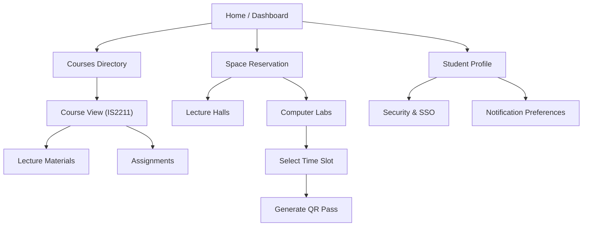

Information Architecture (IA) and interaction flows establish the structural blueprint, taxonomy, and operational pathways through which users navigate, locate content, and accomplish digital tasks. This guide details organizational architectures, open and closed card sorting protocols, wayfinding and navigation systems, and resilient user flow engineering.

---

# 1. Foundations of Information Architecture (IA)

Information Architecture is the structural design of shared information environments—the synthesis of organization, labeling, search, and navigation systems within digital products to support intuitive findability and usability.

- **The Information Architecture Triad (Rosenfeld & Morville):** Effective IA emerges at the precise intersection of three structural forces:
	- **Users:** Information-seeking behaviors, cognitive tasks, vocabulary, and mental models.
	- **Content:** Document types, volume, formats, structural metadata, ownership, and dynamism.
	- **Context:** Business objectives, technological constraints, regulatory mandates, and brand strategy.
- **The Findability Axiom:** If users cannot locate a product, feature, or knowledge article, it effectively does not exist. Good visual aesthetics cannot compensate for defective structural architecture.
- **Information Foraging Theory (Pirolli & Card):** Users navigate digital interfaces like predators hunting for prey, evaluating the "information scent" (proximal cues such as link labels and icons) to estimate whether pursuing a particular navigational path will lead to their target with minimal cognitive expenditure.

```
                     ┌───────────────────────┐
                     │        CONTEXT        │
                     │  (Goals, Tech Stack,  │
                     │   Business Viability) │
                     └──────────┬────────────┘
                                │
                                ▼
         ┌──────────────────────┴──────────────────────┐
         │          INFORMATION ARCHITECTURE           │
         │           (Taxonomies, Sitemaps,            │
         │             Navigation, Flows)              │
         └──────────────┬──────────────┬───────────────┘
                        │              │
                        ▼              ▼
     ┌───────────────────────┐    ┌───────────────────────┐
     │        CONTENT        │    │         USERS         │
     │  (Volume, Semantics,  │    │  (Mental Models,      │
     │   Metadata, Schemas)  │    │   Information Scent)  │
     └───────────────────────┘    └───────────────────────┘
```

---

# 2. Structural Architecture Models

As articulated in Patrick J. Lynch and Sarah Horton’s *Web Style Guide*, the structural organization of digital content dictates how easily users can form mental models of a product's spatial boundaries.

![[ia_structural_architectures.png]]

### 2.1 Comparative Analysis of Core Architectural Models

| Architectural Model | Structural Topology | Primary Strengths | Primary Weaknesses | Production Best Fit |
| :--- | :--- | :--- | :--- | :--- |
| **Hierarchical Tree** | Top-down parent-child branching from a single root | Familiar mental model; easy to compartmentalize into menus | Deep hierarchies hide content; breadth-depth trade-offs | Enterprise intranets, SaaS settings, e-commerce |
| **Sequential (Linear)** | Strict, step-by-step unilinear progression | Eliminates choice paralysis; guarantees prerequisite completion | Zero navigational flexibility; frustrating for experts | Multi-step checkouts, student registration, KYC onboarding |
| **Matrix / Faceted Web** | Non-linear relational mesh linked by tags and metadata | Maximum user autonomy; dynamic multi-attribute filtering | High risk of disorientation; weak mental wayfinding | Large-scale retail catalogs (Amazon), wikis (Wikipedia) |

### 2.2 The Breadth vs. Depth Trade-Off in Hierarchical Trees

When designing hierarchical tree structures, information architects must balance the width of the navigation against the number of vertical levels:

- **Flat / Broad Hierarchies (High Breadth, Low Depth):**
	- Presents numerous options at top levels ($10 - 15+$ categories) across $1 - 2$ tiers.
	- *Advantage:* Users can view a wide range of options at a glance without burying content.
	- *Risk:* Breaches Hick’s Law and Miller’s Law ($7 \pm 2$), triggering cognitive choice overload on home dashboards.
- **Deep Hierarchies (Low Breadth, High Depth):**
	- Constrains top-level options to $4 - 6$ categories, but nests content across $5+$ cascading sub-levels.
	- *Advantage:* Clean, minimalist initial screens.
	- *Risk:* Creates excessive navigational friction; users lose track of where they are in the tree and abandon their search path.
- **The Empirical Rule of Thumb:** Design for a maximum depth of **3 to 4 clicks/taps** from the root to any terminal destination, organizing top-level categories into $5 - 7$ distinct, mutually exclusive buckets.

---

# 3. Content Organization & Card Sorting Methodologies

Taxonomy creation requires mapping content items into categories that align with user psychology rather than internal organizational charts.

![[card_sorting_open_vs_closed.png]]

## 3.1 Taxonomy Classification Schemes

- **Exact Organization Schemes:** Group information according to objective, mutually exclusive criteria where boundaries are unambiguous:
	- **Alphabetical:** Dictionaries, product brand indexes, campus staff directories.
	- **Chronological:** Event schedules, transaction histories, blog archives.
	- **Geographical:** Store locators, campus facility maps, regional tax regulations.
- **Ambiguous (Subjective) Schemes:** Divide information into subjective categories that require interpretation:
	- **Topical / Subject-Based:** Grouping university courses by academic discipline (Computer Science, Business).
	- **Task-Oriented:** Grouping by user actions (*"Pay Fees"*, *"Reserve Hall"*, *"Download Transcript"*).
	- **Audience-Specific:** Segmenting by role (*"Prospective Students"*, *"Enrolled Undergraduates"*, *"Faculty"*).

## 3.2 Card Sorting Execution Protocols

Card sorting is an empirical research technique where participants organize individual cards representing content items into logical clusters.

- **Open Card Sorting (Generative Discovery):**
	- Participants group cards based on their own conceptual criteria and are explicitly instructed to **write their own category names** for each group.
	- *Purpose:* Used early in the *Define* phase to discover how users naturally think about the domain and what vernacular they use.
	- *Data Synthesis:* Analyzed using hierarchical cluster analysis and **dendrograms** to reveal consensus groupings.
- **Closed Card Sorting (Evaluative Validation):**
	- Participants are provided with **predefined category buckets** established by the design team and must assign each card into an existing category.
	- *Purpose:* Used in late validation phases to measure category comprehension and detect ambiguous or orphaned items.
	- *Data Synthesis:* Analyzed via agreement percentage matrices (e.g., if $40\%$ of users sort *"Syllabus"* into *"Academics"* and $60\%$ sort it into *"Administration"*, the labeling requires remediation).
- **Hybrid Card Sorting:** Participants are provided with an initial set of established categories but retain the freedom to create new categories if existing buckets feel unnatural.

---

# 4. Wayfinding, Navigation Systems, & Information Scent

Wayfinding is the cognitive process of determining one’s current location, establishing destination pathways, and maintaining spatial orientation within an information space.

## 4.1 The Four Core Navigation Layers

1. **Global Navigation (Persistent Header):** Present uniformly across every screen of the application. Contains top-level structural links, global search, and utility actions (Profile, Notifications, Cart).
2. **Local (Sub-) Navigation:** Exposes the sibling and child nodes within the user's active branch (e.g., a left sidebar within an *"Account Settings"* portal displaying *"Security"*, *"Billing"*, and *"Preferences"*).
3. **Contextual Navigation (Inline Hyperlinks):** Embedded directly within page copy or card components, pointing users to related articles, references, or prerequisite workflows.
4. **Utility Navigation:** Houses secondary actions that transcend specific content hierarchies (e.g., Legal terms, Privacy policy, Help & documentation, Language pickers).

## 4.2 Breadcrumb Trails & Spatial Orientation

Breadcrumbs provide secondary navigational scaffolding, revealing the user's current location relative to the system root.

- **Location-Based Breadcrumbs (Hierarchy):** Reflect the permanent structural taxonomy of the site regardless of how the user arrived there:
  `Home > Faculty of Computing > Year 02 > IS2211 - UI-UX Design`
- **Attribute-Based Breadcrumbs (Faceted Search):** Reflect the dynamic metadata filters applied by the user in an e-commerce catalog:
  `Laptops > Screen: 15-inch > RAM: 16GB > OS: Linux`
- **Path-Based Breadcrumbs (History):** Function as an internal browser history trace. (Generally discouraged in modern UX because it duplicates the native browser back button).

> [!tip] WCAG 2.2 Navigation Invariants
> - Breadcrumb trails must utilize the HTML5 `<nav aria-label="Breadcrumb">` wrapper with an ordered list `<ol>`.
> - The terminal breadcrumb item (representing the current page) must include `aria-current="page"` and should not be a clickable hyperlink.

---

# 5. Sitemaps & Semantic Content Inventories

Before authoring screens in Figma, information architects assemble content inventories and structural sitemaps.

## 5.1 Content Inventory vs. Content Audit

- **Content Inventory:** A quantitative catalog of all digital assets (URLs, page titles, document types, metadata tags, authors, and last modified dates) tracked in a structured spreadsheet.
- **Content Audit:** A qualitative evaluation of each cataloged asset against key performance indicators (accuracy, relevance, brand voice, SEO performance, and accessibility compliance).

## 5.2 Hierarchical Sitemap Architecture

A visual sitemap illustrates the parent-child relationships and access levels across a digital product.



---

# 6. Interaction Modeling: User Flows vs. Task Flows vs. Wireflows

While Information Architecture defines the static topology of content, interaction flow modeling defines the dynamic behavioral paths users take to accomplish their goals.

![[user_flow_vs_task_flow_diagram.png]]

## 6.1 Task Flows vs. User Flows

- **Task Flows (The Linear Ideal):**
	- Represents a single, idealized happy-path workflow for a specific task.
	- Assumes that all users enter at the identical starting point, experience zero cognitive hesitation, and encounter zero system errors.
	- *Use Case:* High-level engineering alignment on standard business logic (e.g., standard login sequence).
- **User Flows (The Real-World Journey):**
	- Models the complete, resilient experience of a specific persona navigating toward a goal.
	- Incorporates diverse entry points (push notifications, deep links, organic search), **decision diamonds** (`if/else` logic), form validation rejections, network error states, and recovery loops.
	- *Use Case:* Designing fault-tolerant interactive interfaces in Figma and architecting error-handling states for frontend engineering.

## 6.2 Standard User Flow Diagramming Syntax

| Node Shape | Flow Semantics | Meaning in Interaction Architecture |
| :---: | :--- | :--- |
| **Oval / Pill** | Start / Terminal State | Entry point into the flow (e.g., App Launch) or final terminal outcome (e.g., QR Pass Issued). |
| **Rectangle** | Screen / Action Step | A concrete visual interface state or user action (e.g., Fill Credit Card Form). |
| **Diamond** | Decision Branch | A logical branching condition with multiple exits (e.g., *"Is Passcode Correct?"* $\rightarrow$ Yes / No). |
| **Arrowed Line** | Directional Vector | The sequential path of interaction moving the user across states. |

## 6.3 Wireflows (Bridging Flows & Spatial Wireframes)

Pioneered by the Nielsen Norman Group, a **Wireflow** replaces abstract flow-chart boxes with low-fidelity wireframe screen sketches, connecting UI elements directly to subsequent screens with directional arrows.

- **Spatial Context:** Developers and stakeholders can simultaneously evaluate both the page layout (spatial element hierarchy) and the overall system logic (temporal interaction transitions) in a single visual deliverable.
- **State Transition Tracing:** Specifically illustrates micro-states such as modal overlays, dropdown activations, tooltip warnings, and empty states that pure flowcharts omit.

---

# 7. Production Case Study: Campus Resource Booking Architecture

To understand how IA and interaction flows combine in production, consider the architecture for the UCSC Campus Room Reservation system:

```
[ Unauthenticated User ]
       │
       ▼
(1. Single Sign-On Gateway) ──[ Invalid UCSC ID ]──► [ Display Auth Error Banner ]
       │                                                      │
 [ Valid OAuth2 Token ]                                      ▼
       │                                             [ Password Reset Flow ]
       ▼
(2. Room Directory Matrix)
  ├── Filter: Hall Type (Lab / Seminar / Quiet Study)
  ├── Filter: Time Window (Immediate / Afternoon)
  └── Filter: Amenities (Projector / AC / Power Sockets)
       │
       ▼
(3. Room Detail & Availability Grid)
  ├── [ Slot Occupied ] ──────► [ Add to Waitlist ] ──► [ Push Notification Subscribed ]
  └── [ Slot Vacant ]
       │
       ▼
(4. Reservation Confirmation Modal)
  ├── Display Policy Reminder (Max 2 hours, no food/drink)
  └── Tap "Confirm Reservation"
       │
       ▼
(5. Terminal State: Digital Wallet Pass)
  ├── Encrypted Dynamic QR Code (Scannable at physical door lock)
  ├── "Add to Google/Apple Calendar" CTA
  └── "Share Invitation to WhatsApp Group" CTA
```

---

# Lecture Notes
![[IS2211 - 04. Information Architecture & User Flows.pdf]]
