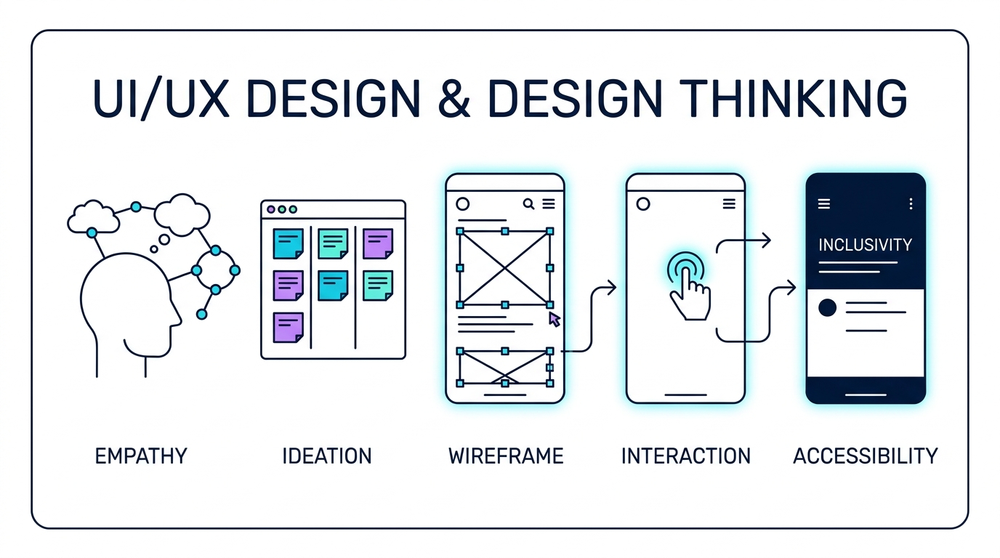
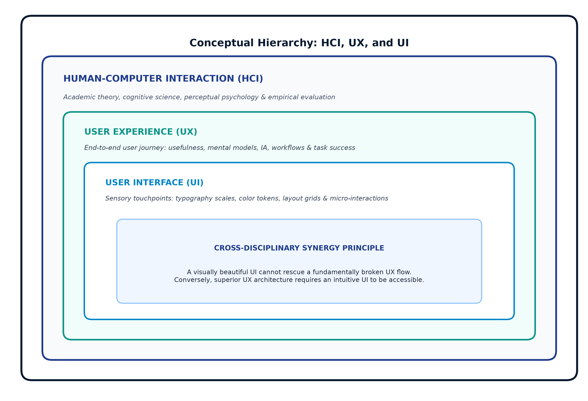
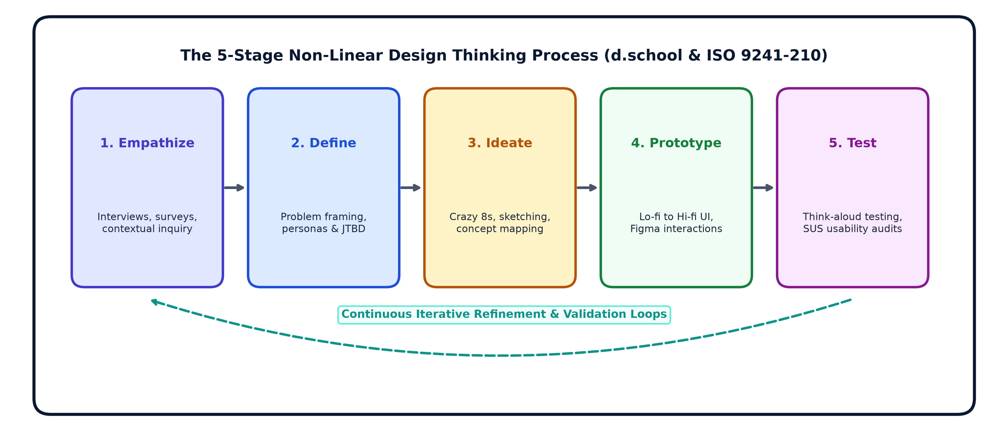
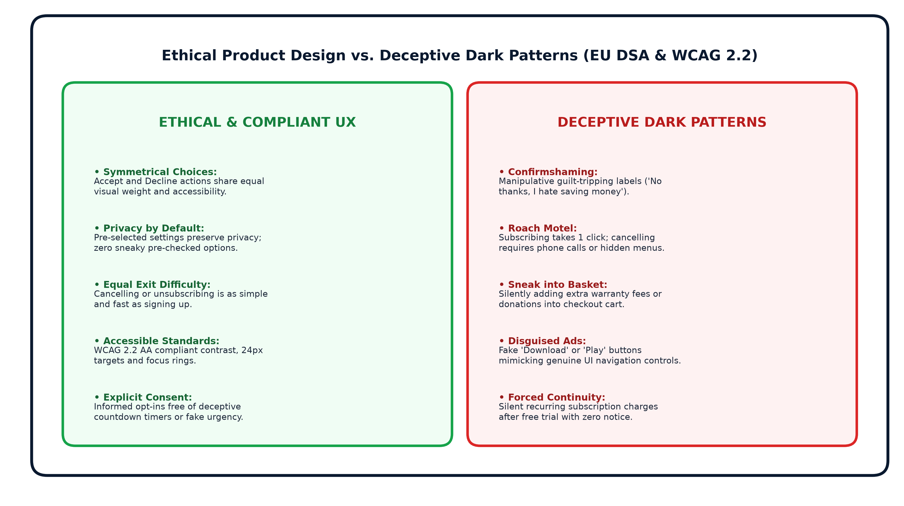

This topic covers the conceptual boundaries separating HCI, UX, and UI, the 5-stage non-linear Design Thinking methodology, ISO 9241-210 Human-Centered Design principles, the historical evolution of interaction paradigms, mandatory WCAG 2.2 accessibility standards, and the ethical elimination of deceptive dark patterns under modern regulatory frameworks.

---



# 1. Conceptual Foundations: HCI, UX, and UI

Modern digital product design requires a clear understanding of the distinctions and synergies between **Human-Computer Interaction (HCI)**, **User Experience (UX)**, and **User Interface (UI)**.



### 1.1 Defining the Disciplines
- **Human-Computer Interaction (HCI):** The academic and empirical foundation. An interdisciplinary field combining cognitive psychology, computer science, ergonomics, and perceptual science to study how humans interact with computational artifacts. HCI generates foundational theories (e.g., Fitts's Law, mental models, Norman's Gulfs) that UX designers operationalize in commercial software.
- **User Experience (UX):** The holistic journey. UX encompasses every touchpoint an individual experiences with a company, system, or service—spanning **before, during, and after** active interaction. UX evaluates usefulness, ease of use, learnability, emotional desirability, task completion efficiency, and long-term retention.
- **User Interface (UI):** The sensory touchpoint surface. The specific visual, tactile, and auditory layer through which a user directly communicates with an application. UI governs visual hierarchy, typography scales, color palettes, responsive spatial grids, component states (default, hover, active, disabled), and micro-interactions.

> [!important] The Transit App Principle
> A mobile transit app may feature breathtaking visual aesthetics, flawless typography, and smooth micro-animations (**Superb UI**). However, if its routing algorithm fails to alert commuters to delays, crashes during payment, or buries ticket retrieval behind five obscure menus, the product is a catastrophic failure (**Poor UX**). UI is a vital component of UX, but visual polish cannot rescue broken interaction architecture.

### 1.2 Comparative Artifacts and Cross-Functional Synergies

| Dimension | User Experience (UX) | User Interface (UI) | Human-Computer Interaction (HCI) |
| :--- | :--- | :--- | :--- |
| **Primary Domain** | System utility, user journeys, workflows, mental models. | Visual language, aesthetics, component states, layout systems. | Empirical science, cognitive limits, ergonomic models. |
| **Key Questions** | *"What problem does the user have, and how do they solve it?"* | *"How should this button look, animate, and indicate focus?"* | *"What is the cognitive processing latency for this visual cue?"* |
| **Deliverables** | User personas, empathy maps, task flows, sitemaps, usability test reports. | Figma design systems, UI components, typography tokens, motion specs. | Academic research papers, formal interaction models, heuristic guidelines. |
| **Core Tooling** | Miro, FigJam, Notion, UserTesting, Maze, Google Analytics. | Figma, Sketch, Adobe XD, Illustrator, Framer. | Eye-tracking labs, EEG/GSR sensors, statistical modeling packages. |

---

# 2. The 5-Stage Non-Linear Design Thinking Process

**Design Thinking** is an iterative, human-centered problem-solving framework that balances user desirability, technological feasibility, and business viability. Developed and popularized by Stanford's d.school and IDEO, it progresses through five distinct phases:



### 2.1 The Five Stages Breakdown
1. **Empathize (Divergent Research):**
   - **Objective:** Developing a deep, non-judgmental understanding of target users, their context of use, emotional motivations, and unarticulated friction points.
   - **Primary Methods:** Semi-structured user interviews, contextual inquiry, field observation, diary studies, and qualitative surveys.
2. **Define (Convergent Synthesis):**
   - **Objective:** Synthesizing research observations to identify core user needs and formulating an actionable, human-centered **Problem Statement** (Point of View / POV) and **Jobs-to-be-Done (JTBD)**.
   - **Deliverables:** User personas, empathy maps, affinity diagrams, and measurable key performance indicators (KPIs).
3. **Ideate (Divergent Exploration):**
   - **Objective:** Brainstorming a broad spectrum of creative solutions without immediate feasibility constraints.
   - **Techniques:** "How Might We" (HMW) questions, Crazy Eights sketching, visual storyboards, and morphological matrices.
4. **Prototype (Convergent Construction):**
   - **Objective:** Transforming abstract concepts into tangible, testable artifacts to validate assumptions cheaply and rapidly.
   - **Evolutionary Fidelity:** Paper sketches $\to$ Low-fidelity (lo-fi) grayscale wireframes $\to$ High-fidelity (hi-fi) interactive clickable Figma prototypes with realistic content.
5. **Test (Evaluative Feedback):**
   - **Objective:** Evaluating prototype interactions with representative users to identify points of confusion, task completion failures, and cognitive hurdles.
   - **Deliverables:** Think-aloud test recordings, System Usability Scale (SUS) scores, task success rates, and prioritized defect logs.

> [!tip] Non-Linear Iteration Invariant
> Design thinking is **never a linear waterfall pipeline**. Testing an ideated feature often reveals misunderstandings about the user's root problem, forcing teams to jump back from Stage 5 directly to Stage 2 (Redefine) or Stage 1 (Re-empathize).

---

# 3. Human-Centered Design (HCD) & ISO 9241-210 Principles

**Human-Centered Design (HCD)** is the formal design philosophy ensuring systems are optimized around human capabilities, cognitive limitations, and emotional needs rather than forcing humans to adapt to technology.

### 3.1 The Six ISO 9241-210 Mandates
International standard **ISO 9241-210 (Ergonomics of human-system interaction — Human-centred design for interactive systems)** defines six foundational principles:

1. **Context of Use:** The design must explicitly account for the characteristics of the users, their primary tasks, and the physical, organizational, and technical environment.
2. **User Involvement Throughout Lifecycle:** Real users must actively participate across all phases of requirements gathering, concept development, and iterative evaluation.
3. **Driven by User-Centered Evaluation:** User feedback is the sole authoritative validation mechanism for determining design quality.
4. **Iterative Process:** Multi-cycle refinement is mandatory; assumptions must be repeatedly tested and revised.
5. **Whole User Experience Addressed:** Design scope extends beyond usability to include accessibility, emotional satisfaction, and brand perception.
6. **Multidisciplinary Team Competencies:** HCD requires cross-functional perspectives integrating software engineering, domain experts, psychologists, and visual designers.

---

# 4. Historical Evolution of UX Design Paradigms

Interaction design has evolved across four major technological epochs, shifting from hardware-centric constraints to ubiquitous, AI-mediated interfaces:

```
┌─────────────────┐     ┌─────────────────┐     ┌─────────────────┐     ┌─────────────────┐
│   1980s–1990s   │ ──► │   2007–2015     │ ──► │   2016–2020     │ ──► │ 2021–Present    │
│ Desktop GUI Era │     │ Mobile-First    │     │ Design Systems  │     │ Modern Ethical  │
└─────────────────┘     └─────────────────┘     └─────────────────┘     └─────────────────┘
```

- **1980s–1990s (The Desktop GUI & Usability Lab Era):** Focused on transitioning from Command-Line Interfaces (CLI) to Graphical User Interfaces (GUI). Dominated by desktop monitors, physical mice, keyboards, and formal usability laboratory experiments measuring raw error rates.
- **2007–2015 (Mobile-First & Responsive Web Design):** Catalyzed by the smartphone revolution (iPhone launch in 2007). Designers abandoned fixed-pixel desktop layouts for fluid responsive grids, capacitive touch gestures (pinch-to-zoom, swipe, tap), thumb-zone ergonomics, and mobile-first content prioritization.
- **2016–2020 (Scalable Design Systems & Motion Design):** Transition from isolated page layouts to modular component architectures. Teams engineered unified design systems (Google Material Design, Apple Human Interface Guidelines), tokenized styles, atomic UI hierarchies, and purposeful micro-interactions providing instant cognitive feedback.
- **2021–Present (Accessibility by Default, Privacy UX & AI Copilots):** Global legal mandates prohibiting manipulative design patterns, the formal adoption of WCAG 2.2 AA accessibility standards, privacy-preserving consent UX, and designing interfaces for probabilistic, conversational AI copilots and multi-modal voice/vision experiences.

---

# 5. Accessibility (A11y) as a Non-Negotiable Standard: WCAG 2.2

Web accessibility ensures digital products are usable by everyone, including people with auditory, cognitive, neurological, physical, speech, and visual impairments.

### 5.1 The Four POUR Principles
Under the **Web Content Accessibility Guidelines (WCAG)**, all interfaces must satisfy four foundational pillars:
- **Perceivable:** Information and UI components must be presentable to users in ways they can sense (e.g., text alternatives for non-text content, color contrast ratios $\ge 4.5:1$ for body text).
- **Operable:** UI components and navigation must be operable via diverse inputs (e.g., complete keyboard navigability without mouse dependency, zero keyboard traps).
- **Understandable:** Information and operation of the UI must be clear (e.g., predictable navigation, clear error identification and plain-language recovery instructions).
- **Robust:** Content must be robust enough to be reliably interpreted by a wide variety of user agents, including assistive screen readers.

### 5.2 Key WCAG 2.2 AA Updates (Published Oct 2023)
- **Minimum Target Size (Criterion 2.5.8):** Interactive touch targets (buttons, icon links) must meet a minimum size of **$24 \times 24\text{ CSS pixels}$** or provide sufficient surrounding spacing to prevent accidental mis-taps.
- **Focus Appearance (Criterion 2.4.11 / 2.4.13):** When navigating via keyboard (`Tab` key), the focused element must display a high-contrast, visually unmistakable focus ring with a minimum $3:1$ contrast ratio against the background.
- **Redundant Entry (Criterion 3.3.7):** Systems must auto-populate or allow users to select previously entered data in multi-step checkout or registration flows to reduce cognitive strain.
- **Dragging Movements (Criterion 2.5.7):** Any functionality relying on dragging (e.g., sliders, drag-and-drop sortable lists) must provide a single-pointer alternative (e.g., increment buttons, dropdown selection).

---

# 6. Deceptive Dark Patterns & Regulatory Risk

A **Dark Pattern** (deceptive design pattern) is a user interface carefully crafted to trick or manipulate users into taking actions they might not otherwise choose (e.g., buying recurring subscriptions, surrendering private data).



### 6.1 Common Deceptive Dark Patterns
- **Roach Motel:** A subscription or account that is trivial to enter (one-click signup) but deliberately labyrinthine and painful to exit (requiring phone calls during business hours or hidden multi-step cancelation flows).
- **Confirmshaming:** Manipulating the user through emotional guilt or shame when declining an offer (e.g., labeling the cancel button *"No thanks, I hate saving money"*).
- **Pre-selection / Sneak into Basket:** Automatically checking optional paid add-ons (travel insurance, recurring memberships) by default, forcing users to manually uncheck them.
- **Disguised Advertisements:** Designing commercial advertisements to mimic navigational interface elements or organic system download buttons.
- **Obstruction & Price Comparison Prevention:** Intentionally suppressing price per unit or critical terms to impair informed decision-making.

### 6.2 Regulatory Landscape & The Design Ethics Checklist
Under modern statutory frameworks—most notably the **European Union Digital Services Act (EU DSA)** enacted in 2024—the deployment of deceptive design patterns carries severe legal liability and financial penalties.

> [!warning] The Product Ethics Compliance Checklist
> 1. **Symmetry of Choice:** Are the "Accept" and "Decline" choices presented with equal visual weight, contrast, and click latency?
> 2. **Beneficial Defaults:** Is the pre-selected default option the one that directly benefits the user's privacy and financial autonomy?
> 3. **Equivalence of Exit:** Is the cognitive and operational effort required to cancel or unsubscribe strictly equal to the effort required to join?

---

# 7. The Role of a UI/UX Designer in the Tech Industry

A contemporary UI/UX designer is not merely an artist crafting mockups; they are an empirical problem-solver operating at the intersection of business, technology, and human behavior across five core lifecycle responsibilities:

```
┌─────────────┐     ┌─────────────┐     ┌─────────────┐     ┌─────────────┐     ┌─────────────┐
│  DISCOVER   │ ──► │   DESIGN    │ ──► │  VALIDATE   │ ──► │    SHIP     │ ──► │   SUSTAIN   │
│ Research &  │     │ IA, Wire-   │     │ Usability   │     │ Design QA   │     │ Metrics &   │
│ Synthesis   │     │ frames, UI  │     │ Testing     │     │ & Specs     │     │ Compliance  │
└─────────────┘     └─────────────┘     └─────────────┘     └─────────────┘     └─────────────┘
```

1. **Discover:** Planning generative user research, conducting stakeholder interviews, analyzing competitive landscapes, and defining evidence-based problem statements.
2. **Design:** Structuring information architectures, drafting interactive user journeys, building responsive wireframes, and engineering tokenized design systems in **Figma**.
3. **Validate:** Authoring usability testing protocols, facilitating think-aloud evaluation sessions, measuring quantitative task completion rates, and synthesizing defect registers.
4. **Ship:** Creating detailed component specifications, collaborating with software engineers during implementation, and performing rigorous **Design QA** to prevent visual/interaction regressions.
5. **Sustain:** Auditing ongoing accessibility compliance (WCAG 2.2 AA), monitoring product analytics (funnel drop-offs, churn rates), and iteratively eliminating UX friction points.

---

# Lecture Notes
![[IS2211 - 01. Introduction to UI-UX & Design Thinking.pdf]]
