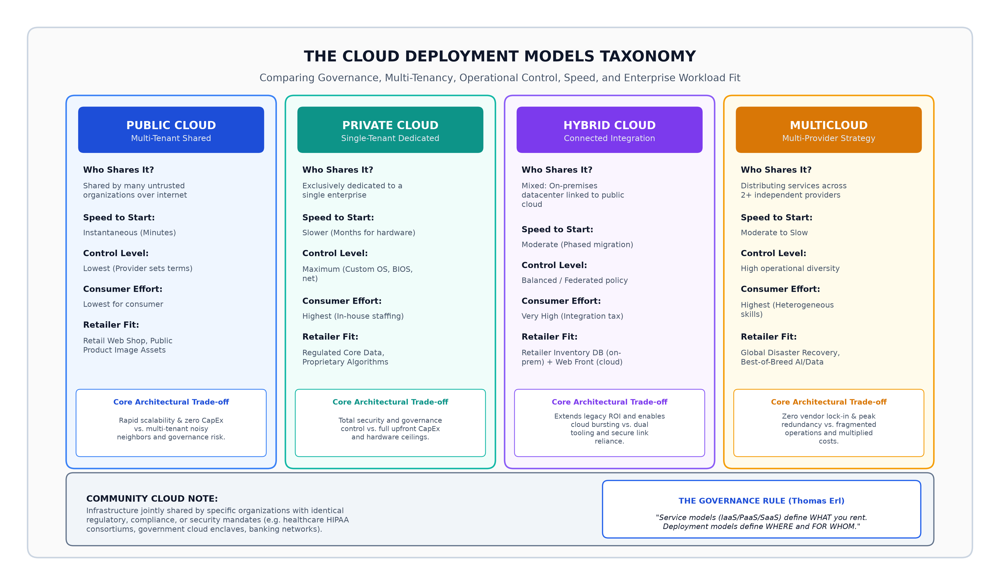
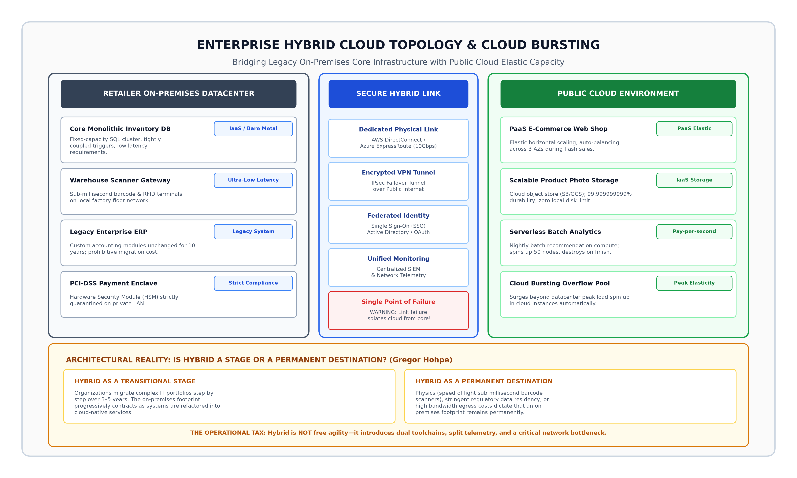
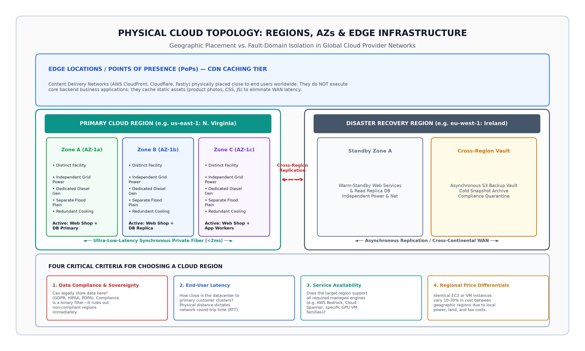
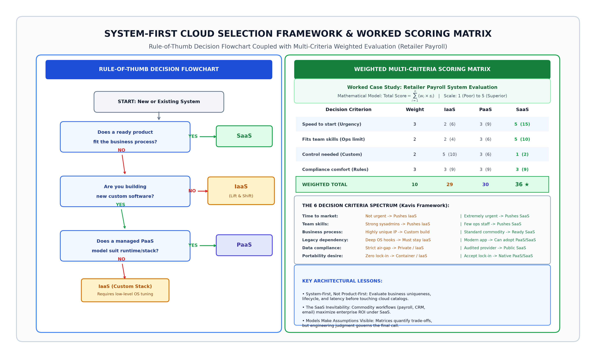
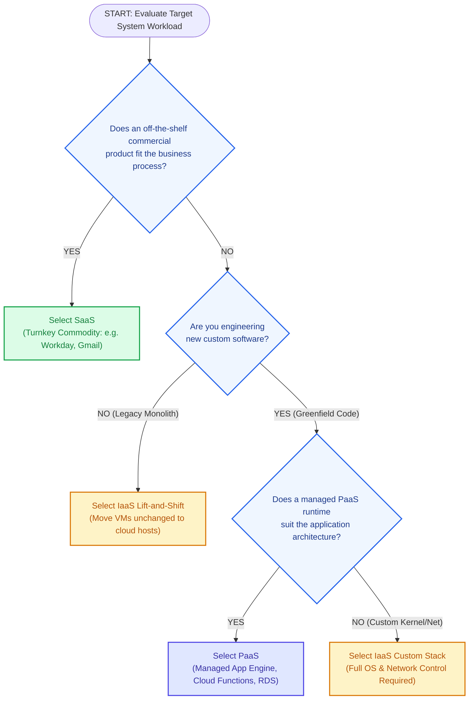

This topic note establishes the architectural taxonomy of cloud deployment models—Public, Private, Hybrid, Multicloud, and Community clouds—coupled with physical infrastructure topologies (Regions, Availability Zones, and Edge Locations), multi-criteria decision frameworks, and strategic enterprise workload placement.

---

# 1. Architectural Distinction: Service Models vs. Deployment Models

In enterprise cloud architecture, systems engineering begins by separating functional abstraction from physical governance. While cloud service models classify the depth of the software abstraction stack consumed, deployment models classify resource tenancy, operational custody, and infrastructure location.



> [!important] The Governance Axiom (Thomas Erl Framework)
> - **Service Models (IaaS, PaaS, SaaS):** Define **WHAT** capability you rent (raw virtual hardware, execution runtimes, or turnkey business applications).
> - **Deployment Models (Public, Private, Hybrid, Multicloud):** Define **WHERE** the physical infrastructure sits, **WHO** shares it, and **FOR WHOM** access is permitted.

No single deployment model is universally optimal. Every enterprise deployment model embodies an engineering trade-off across three primary axes:
1. **Speed to Market:** Elapsed time from architectural conception to production readiness.
2. **Operational Control:** Authority over low-level hypervisor tuning, network routing, firmware updates, and physical hardware placement.
3. **Internal Consumer Effort:** Engineering staff hours required to operate, monitor, patch, and secure the underlying infrastructure.

---

# 2. Deep Dive: The Cloud Deployment Models Taxonomy

```
+---------------------------------------------------------------------------------------------------+
|                                  THE DEPLOYMENT MODEL SPECTRUM                                    |
|                                                                                                   |
|  [ PUBLIC CLOUD ]            [ HYBRID CLOUD ]           [ MULTICLOUD ]           [ PRIVATE CLOUD ]|
|  - Multi-tenant shared       - Connected mix            - Multi-provider mix     - Single-tenant  |
|  - Provider-owned premises   - On-prem + Public Cloud   - AWS + Azure + GCP      - Enterprise-owned|
|  - Instantaneous elasticity  - Federated governance     - Zero vendor lock-in    - Total control  |
|  - Zero CapEx                - Integration tax          - Tooling sprawl         - Maximum CapEx  |
|  <----------------------------------------------------------------------------------------------> |
|  MAXIMUM CONVENIENCE & AGILITY                                            MAXIMUM GOVERNANCE & CUSTODY
+---------------------------------------------------------------------------------------------------+
```

## 2.1 Public Cloud Architecture & Multi-Tenancy
- **Definition & Governance:** Infrastructure owned, operated, and maintained by a commercial cloud provider (e.g., Amazon Web Services, Google Cloud Platform, Microsoft Azure) and delivered to multiple external organizations over the public internet.
- **Multi-Tenancy Mechanics:** Multiple distinct enterprise consumers share the same pool of physical servers, storage arrays, and network switches. Logical isolation is strictly enforced via hypervisor boundaries, CPU hardware rings, and Software-Defined Networking (SDN) Virtual Private Clouds (VPCs).
- **Economic & Operational Profile:** Eliminates all upfront Capital Expenditure (CapEx) in favor of pay-as-you-go Operational Expenditure (OpEx). Delivers near-infinite elasticity and automated self-service.
- **Architectural Trade-offs:** The enterprise yields governance of the physical host and underlying hypervisor. Vulnerable to "noisy neighbor" performance contention (unpredictable CPU/IOPS jitter) and regulatory cross-border data constraints.
- **Enterprise Retailer Fit:** Ideal for the customer-facing E-Commerce Web Store (absorbing erratic flash-sale traffic spikes) and public product image catalogs.

## 2.2 Private Cloud Architecture & Single-Tenancy
- **Definition & Governance:** Cloud-style infrastructure (providing automated self-service, elasticity, and virtual resource pooling) operated exclusively for a single organization. It may be hosted on-premises within the company's datacenter or outsourced to a dedicated third-party colocation provider.
- **Single-Tenancy Invariant:** No foreign tenant workloads ever execute on the physical processors, storage controllers, or network backbones.
- **Governance & Customization:** Grants unrestricted authority over operating system kernels, BIOS settings, hardware security modules (HSMs), network topologies, and physical security parameters.
- **What In-House Private Cloud Does NOT Change:** Migrating an in-house datacenter to an internal private cloud (via VMware vSphere, OpenStack, or Nutanix) solves self-service speed, but leaves traditional datacenter physics intact:

| Traditional Datacenter Limitation | Solved by In-House Private Cloud? | Architectural Justification |
| :--- | :--- | :--- |
| **Self-Service & Provisioning Speed**| **Partially Solved** | Internal cloud platforms automate VM spinning via APIs, eliminating manual ticketing delays. |
| **Fixed Hardware Capacity Ceilings** | **Not Solved** | The total compute pool remains bound to the physical servers purchased. Capacity exhaustion still causes outages. |
| **Upfront Capital Spending (CapEx)**| **Not Solved** | Racks, blade chassis, SAN storage arrays, and network cores must still be procured months in advance. |
| **Datacenter Facilities Burden** | **Not Solved** | Power, UPS battery maintenance, chilled water HVAC, generator fueling, and TIA-942 compliance remain in-house responsibilities. |

- **Enterprise Retailer Fit:** Strictly reserved for workloads subject to stringent regulatory isolation (e.g., customer payment tokenization enclaves, proprietary fraud-detection models).

## 2.3 Hybrid Cloud Architecture: Mechanics & Workload Bursting

Hybrid cloud is a composed computing environment combining two or more distinct deployment infrastructures (typically an on-premises enterprise datacenter and one or more public cloud providers) bound together by standardized network and data integration technologies.



### Motivations for Hybrid Cloud Adoption
- **Legacy System Inertia:** Monolithic transactional systems (e.g., AS/400 mainframes, legacy ERP suites) cannot be moved without multimillion-dollar rewrites.
- **Regulatory Compliance & Data Residency:** Strict financial or medical statutes may require customer financial records to reside within domestic borders on dedicated hardware, while the presentation tier runs in the public cloud.
- **Low-Latency Edge Dependencies:** Operations that require sub-millisecond physical response times (e.g., barcode scanners and RFID terminals in retail fulfillment centers) cannot tolerate WAN round-trip latency to a distant cloud region.
- **Phased Cloud Migration:** Large enterprises de-risk migrations by moving peripheral workloads first, retaining critical state on-premises while team competencies mature.
- **Cloud Bursting (Peak Capacity Elasticity):** Workloads execute on-premises during baseline demand periods; when traffic surpasses physical datacenter capacity, the application automatically bursts additional stateless compute instances into the public cloud.

### The Operational Tax: What Makes Hybrid Cloud Difficult
> [!warning] The Hybrid Operational Complexity Tax
> Hybrid cloud is frequently mischaracterized as "the best of both worlds." In reality, hybrid cloud introduces distinct architectural friction:
> - **Dual Tooling & Operational Sprawl:** Engineering teams must maintain two distinct toolchains—traditional datacenter management suites (VMware, Cisco, SAN controllers) alongside cloud-native tooling (Terraform, AWS Console, Kubernetes).
> - **Synchronized Identity & Security (IAM):** Enforcing uniform Role-Based Access Control (RBAC) across Active Directory on-prem and cloud-native IAM roles requires complex SAML/OAuth federation bridges.
> - **Network Link Dependency:** The secure WAN link (AWS DirectConnect or IPsec VPN) becomes a critical single point of failure and latency bottleneck.
> - **Data Egress Cost Asymmetry:** While moving data into the public cloud is free, continuously synchronizing large datasets back to the local datacenter incurs continuous cloud provider data transfer egress fees.

### Stage vs. Destination: The Gregor Hohpe Framework
- **Hybrid as a Transitional Stage:** The enterprise adopts hybrid purely as a temporary migration stepping stone (3–5 years). The on-premises footprint progressively contracts as legacy applications are refactored into cloud-native microservices.
- **Hybrid as a Permanent Destination:** Sunk infrastructure investments, physical laws (speed-of-light network latency to warehouse hardware), or permanent legal constraints establish hybrid as the permanent steady-state operational architecture.

## 2.4 Multicloud & Community Cloud Frameworks
- **Multicloud Deployment:** The deliberate distribution of enterprise digital assets across two or more independent public cloud providers (e.g., running front-end compute on AWS while hosting analytical pipelines on Google Cloud BigQuery and identity on Microsoft Azure).
  - *Motivations:* Complete mitigation of single-vendor lock-in, commercial bargaining leverage during contract renewals, disaster recovery across independent vendor failure domains, and best-of-breed capability consumption.
  - *Architectural Cost:* Significant cognitive load on engineering teams, conflicting API surfaces, multiplied security auditing burdens, and exorbitant inter-cloud data egress fees.
- **Community Cloud:** Infrastructure shared exclusively among a defined consortium of organizations with identical security mandates, regulatory statutes, or shared mission objectives.
  - *Industry Examples:* U.S. Federal Government cloud enclaves (AWS GovCloud), global healthcare networks adhering to HIPAA/HITRUST frameworks, and inter-bank international settlement networks.

## 2.5 Comparative Analysis of Deployment Models

| Dimension | Public Cloud | Private Cloud | Hybrid Cloud | Multicloud |
| :--- | :--- | :--- | :--- | :--- |
| **Infrastructure Owner** | Cloud Provider | Enterprise or Colo Host | Mixed (Enterprise + Provider) | Multiple Cloud Providers |
| **Tenancy Structure** | Multi-Tenant Shared | Single-Tenant Dedicated | Segmented by Tier | Multi-Tenant Across Providers |
| **Deployment Speed** | Minutes (Immediate) | Months (Procurement) | Moderate (Phased integration)| Moderate to Slow |
| **Governance & Control**| Lowest (Provider policies)| Maximum (Total authority) | Mixed / Federated | Highly complex governance |
| **Operational Effort** | Lowest (Provider ops) | Highest (In-house staff) | Very High (Integration tax)| Highest (Tooling sprawl) |
| **Financial Model** | 100% OpEx (Pay-by-use) | High Upfront CapEx | Blended CapEx + OpEx | Blended OpEx across bills |
| **Primary Trade-off** | Zero CapEx vs. Shared Risk | Total Control vs. CapEx Limits | Legacy ROI vs. Integration Debt| Zero Lock-in vs. High Complexity|

---

# 3. Physical Cloud Topology: Regions, Availability Zones & Edge Infrastructure

Cloud abstraction does not eliminate physical reality. Public cloud providers operate vast physical footprints structured into hierarchical fault-isolation and latency domains.



## 3.1 Geographic Regions: Placement & Disaster Boundaries
- **Definition:** A distinct geographic location across the globe (e.g., `us-east-1` in Northern Virginia, `eu-west-1` in Dublin, Ireland, `ap-southeast-1` in Singapore).
- **Physical Isolation:** Regions are entirely separate from one another, disconnected in terms of power grids, physical landmasses, water supplies, and network backbones.
- **Disaster Independence:** Catastrophic regional failure (hurricanes, earthquake-induced grid collapse, civil unrest) in one region is structurally engineered not to impact neighboring regions.
- **The Province vs. District Analogy:** A Cloud Region acts like an administrative Province; within that Province sit multiple discrete Districts (Availability Zones), each operating independent local utilities.

## 3.2 Availability Zones (AZs): Fault Isolation Domains
- **Definition & Composition:** An Availability Zone is an isolated location within a region composed of one or more discrete, physically separated datacenters.
- **Physical Hardening:** Each AZ features:
  - Independent high-voltage electrical grid substations.
  - Dedicated onsite backup diesel power generators with multi-day fuel reserves.
  - Separate flood plains and localized seismic dampening.
  - Independent chillers, HVAC, and fire suppression systems.
- **Inter-AZ Low-Latency Network Ring:** All AZs within a single region are interconnected via private, high-capacity, dedicated dark fiber optic loops delivering round-trip latency under 2 milliseconds ($< 2\text{ ms}$).
- **Fault Containment Invariant:** A physical catastrophe (localized fire, power transformer explosion, cable backhoe severance) destroying an entire AZ will not cascade into adjacent AZs within the same region.
- **High-Availability (HA) Design:** Resilient applications run stateless web nodes and active-passive database replicas across at least two or three AZs within a region.

## 3.3 Edge Locations & Content Delivery Networks (CDNs)
- **Definition:** Small, highly distributed points of presence (PoPs) deployed in major urban centers and internet exchange points globally (e.g., AWS CloudFront, Cloudflare).
- **Functional Boundary:** Edge locations do **NOT** execute full enterprise backend applications or complex transactional databases; their primary mission is caching static assets (e.g., high-resolution retailer product photos, JavaScript bundles, stylesheets, media assets) directly adjacent to end users.
- **Latency Elimination:** By terminating TLS handshakes and serving cached assets from the edge, users experience sub-50ms response times without transmitting requests across continental WAN backbones.

## 3.4 The Four Criteria for Choosing a Cloud Region

Selecting the optimal geographic region for an enterprise workload requires evaluating four sequential constraints:

| Evaluation Factor | Core Technical Question | Architectural Impact & Constraint Level |
| :--- | :--- | :--- |
| **1. Compliance & Data Sovereignty** | *May this data legally reside in this geographic jurisdiction?* | **Binary Elimination Filter:** Overrides all other concerns. GDPR, HIPAA, or Sri Lanka Personal Data Protection Act (PDPA) immediately disqualify non-compliant jurisdictions regardless of cost or latency. |
| **2. End-User Latency** | *How close is the physical facility to our primary customer base?* | **Performance Driver:** Governed by the speed of light in fiber optics ($~5\text{ ms per } 1000\text{ km}$). Placing servers close to users minimizes network round-trip time (RTT). |
| **3. Service Availability** | *Does this target region offer every required cloud managed service?* | **Capability Boundary:** Newer or specialized services (e.g., AWS Bedrock, specific GPU instance types, Google Cloud Spanner) are not deployed uniformly across all regions. |
| **4. Regional Price Differentials** | *Do infrastructure unit prices differ across target candidate regions?* | **Financial Optimizer:** Identical VM and storage instances can vary by 10% to 30% between regions due to localized real estate, labor, corporate taxation, and green power costs. |

---

# 4. System-First Cloud Decision Framework & Multi-Criteria Evaluation

Cloud strategy fails when technology leaders pick a cloud vendor or product first. Architectural methodology dictates beginning with the specific system workload, isolating its operational characteristics, and working outward to the appropriate service and deployment model.



## 4.1 System-First Architectural Methodology (Kavis Principle)
To select the appropriate deployment and service model, systems architects must evaluate four sequential questions:
1. **Workload Mission & Uniqueness:** What business capability does the system deliver, and how uniquely does it differentiate the enterprise? (Is it a unique competitive advantage, or a generic operational commodity?)
2. **Lifecycle State:** Is this greenfield custom software, or a legacy monolithic codebase already operating in production?
3. **Enterprise Constraints:** What are the non-negotiable boundaries regarding data compliance, internal team technical skills, budget limits, and time-to-market urgency?
4. **Model Mapping:** Which service model (IaaS, PaaS, SaaS) and deployment model (Public, Private, Hybrid) satisfies the constraints with minimum operational friction?

## 4.2 The Six Decision-Driving Criteria (Kavis Framework)

When deciding between high-control models (IaaS / Private Cloud) and high-convenience models (SaaS / Public Cloud), six operational criteria govern the decision:

| Decision Criterion | Pushes Toward Control (IaaS / Private Cloud) | Pushes Toward Convenience (SaaS / Public Cloud) |
| :--- | :--- | :--- |
| **1. Time to Market** | Flexible timeline; custom engineering preferred. | Highly urgent launch; cannot afford development cycles. |
| **2. Team Engineering Skills** | Strong in-house sysadmins, DBAs, and networking staff. | Limited operations personnel; focus is on business code. |
| **3. Business Process Uniqueness**| Proprietary, highly customized core business IP. | Standardized industry commodity (e.g., payroll, billing). |
| **4. Legacy Dependencies** | Deep OS-level hooks, custom drivers, specific binary builds. | Modern application stack or open to commercial SaaS adoption.|
| **5. Data & Compliance Risk** | Absolute custody required; air-gapped regulatory mandate.| Audited third-party certifications (SOC2, ISO 27001) suffice.|
| **6. Portability vs. Lock-in** | Mandate to avoid lock-in; requires container portability. | Willingness to accept vendor lock-in for rapid productivity. |

## 4.3 Rule-of-Thumb Decision Flowchart



## 4.4 Multi-Criteria Weighted Decision Matrix: Retailer Payroll Worked Example

When multiple stakeholders debate architectural placement, emotional opinions can stall modernization. A weighted decision matrix translates subjective architectural concerns into transparent mathematical criteria:

$$\text{Total Score} = \sum_{i=1}^n (w_i \times s_i)$$

Where:
- $w_i \in [1, 10]$ represents the organizational **Weight** (relative importance) assigned to criterion $i$, with $\sum w_i = 10$.
- $s_i \in [1, 5]$ represents the architectural **Score** evaluated for that model (where $1 = \text{Poor Fit}$ and $5 = \text{Superior Fit}$).

### Worked Case Evaluation: Retail Enterprise Payroll System
The retail enterprise must modernize its employee payroll computation system. The systems architecture committee establishes the following scoring matrix:

| Evaluation Criterion | Assigned Weight ($w_i$) | IaaS Fit ($s_i$) | IaaS Weighted ($w_i \times s_i$) | PaaS Fit ($s_i$) | PaaS Weighted ($w_i \times s_i$) | SaaS Fit ($s_i$) | SaaS Weighted ($w_i \times s_i$) | Architectural Rationalization |
| :--- | :---: | :---: | :---: | :---: | :---: | :---: | :---: | :--- |
| **Speed to Start (Urgency)** | **3** | 2 | $3 \times 2 = 6$ | 3 | $3 \times 3 = 9$ | 5 | $3 \times 5 = 15$ | Payroll must launch before fiscal year-end. SaaS is immediate. |
| **Fits Team Skills (Ops Limit)**| **2** | 2 | $2 \times 2 = 4$ | 3 | $2 \times 3 = 6$ | 5 | $2 \times 5 = 10$ | Internal IT team is small; cannot afford full-time payroll server maintenance. |
| **Operational Control Needed** | **2** | 5 | $2 \times 5 = 10$| 3 | $2 \times 3 = 6$ | 1 | $2 \times 1 = 2$ | Enterprise needs zero low-level OS tuning for payroll processing. |
| **Compliance Comfort (Audit)** | **3** | 3 | $3 \times 3 = 9$ | 3 | $3 \times 3 = 9$ | 3 | $3 \times 3 = 9$ | All candidate tiers provide certified SOC2 / tax compliance. |
| **TOTAL WEIGHTED SCORE** | **10** | — | **29** | — | **30** | — | **36 ★** | **SaaS Emerges as the Decisive Winner** |

> [!tip] The True Role of Scoring Matrices
> Numerical scoring does not replace human engineering judgement. The true power of a weighted matrix is **making implicit assumptions explicit**. When stakeholders see that SaaS scored 36 vs IaaS 29, the debate shifts from vague preferences to concrete parameters: *"Are we willing to delay market launch by 6 months just to retain root SSH access to a payroll server?"*

---

# 5. Common Cloud Adoption Patterns & Workload Archetypes

According to Bernard Kavis, certain enterprise workload archetypes naturally lend themselves to early cloud adoption:

- **1. Ephemeral Development & Testing Environments:**
  - *Pattern:* Development teams require sandbox environments to test features and execute integration tests. In a traditional datacenter, procurement takes months.
  - *Cloud Advantage:* Developers spin up on-demand VPCs and container clusters in minutes, running them for hours and terminating them immediately, paying only for the exact compute seconds consumed.
- **2. Elastic Web Applications with Highly Variable Traffic:**
  - *Pattern:* Workloads characterized by violent traffic fluctuations (e.g., Black Friday e-commerce sales, tax filing deadlines, ticket sales).
  - *Cloud Advantage:* Auto-scaling policies automatically spawn hundreds of stateless application instances behind an elastic load balancer, collapsing the fleet back to zero when demand subsides.
- **3. Backup, Disaster Recovery & Archival Storage:**
  - *Pattern:* Storing offsite database dumps, snapshot backups, and regulatory archives.
  - *Cloud Advantage:* Eliminates physical magnetic tape rotations. Cloud object stores (AWS S3, Google Cloud Storage) offer 11 nines ($99.999999999\%$) of annual data durability at fractions of a cent per gigabyte.
- **4. Batch Analytics & High-Performance Compute (HPC):**
  - *Pattern:* Running machine learning recommendation models, financial risk simulations, or product image optimizations overnight.
  - *Cloud Advantage:* Workloads spin up massive compute clusters (e.g., 100 GPU-backed instances), process terabytes of data in 45 minutes, write results back to object storage, and shut down.
- **5. Turnkey Back-Office Enterprise Collaboration:**
  - *Pattern:* Email, document editing, video conferencing, customer relationship management (CRM), and HR.
  - *Cloud Advantage:* Delivered exclusively via SaaS (Google Workspace, Microsoft 365, Salesforce). Zero competitive differentiation in hosting an internal mail transfer agent.

---

# 6. Real-World Case Study: NOAA Enterprise SaaS Migration

The United States National Oceanic and Atmospheric Administration (NOAA) provides a definitive case study in large-scale enterprise cloud adoption (Kavis, Chapter 1).

```
+---------------------------------------------------------------------------------------------------+
|                            NOAA CLOUD MIGRATION: 3-QUESTION FRAMEWORK                             |
|                                                                                                   |
|   1. WHAT WAS THE PRESSURE?       2. WHAT DID THE CLOUD REMOVE?    3. WHAT DID THE CLOUD NOT SOLVE?|
|   - 25,000 fragmented mailboxes   - In-house server maintenance    - Data migration complexity    |
|   - Aging on-prem hardware        - OS patching & spam filtering   - 25,000 staff change management|
|   - Massive fiscal overhead       - Upfront refresh CapEx          - Verification of security SLA |
+---------------------------------------------------------------------------------------------------+
```

## 6.1 Agency Background & Drivers
- **Organizational Scale:** Over 25,000 government scientists, meteorologists, and administrative staff distributed across global research stations.
- **The Core Problem:** The agency operated a fragmented federation of over 100 disparate, aging, on-premises email and collaboration systems that had reached the end of their operational lifecycle.
- **Procurement & Execution:** In January 2011, NOAA issued a Request for Proposals (RFP). In June 2011, a \$11.5 million, 3-year contract was awarded to migrate to Google Apps for Government (a public multi-tenant SaaS solution). The full migration completed in December 2011.
- **Financial Return:** NOAA documented that the cloud SaaS deployment cut operational costs by approximately **50%** compared to refreshing their in-house datacenter mail clusters.

## 6.2 The Kavis 3-Question Analytical Framework
Analyzing the NOAA case through structured systems engineering yields three high-yield lessons:

| Analytical Question | Case Study Evidence & Architectural Interpretation |
| :--- | :--- |
| **What was the organizational pressure?** | Severely fragmented, unpatched, end-of-life email servers draining IT budgets and creating severe security vulnerabilities. |
| **What did the cloud remove?** | The operational burden of provisioning bare-metal hardware, maintaining storage area networks, patching email daemons, and updating spam filter signatures. |
| **What did the cloud NOT solve?** | Migrating petabytes of historical mail archives, user retraining and change management across 25,000 personnel, and the ongoing legal mandate to audit and verify third-party security assurances. |

> [!important] The Case Study Rule of Thumb
> Commodity enterprise utilities (email, messaging, payroll) that offer **zero proprietary business differentiation** should almost universally be acquired via **SaaS on Public Cloud**. Engineering effort should be aggressively redirected toward core customer-facing systems that create competitive advantage.

---

# 7. Strategic Workload Placement: The Retailer Case Study Matrix

Applying our complete decision framework to the retail enterprise's system portfolio yields a definitive strategic deployment roadmap:

| Retailer System / Workload | Optimal Service Model | Optimal Deployment Model | Concrete Architectural Justification |
| :--- | :--- | :--- | :--- |
| **Public E-Commerce Web Shop** | **PaaS** *(or IaaS Auto-Scaling)* | **Public Cloud** *(Multi-AZ)* | Highly variable traffic spikes (Black Friday); requires rapid continuous deployment pipelines and automated scaling across multiple AZs without OS management. |
| **Core Monolithic Inventory System**| **IaaS** | **Hybrid Cloud** *(On-Premises First)* | Tightly coupled legacy SQL database. Must remain in the local datacenter adjacent to warehouse barcode scanners and RFID terminals to preserve sub-millisecond latency. |
| **Enterprise Payroll System** | **SaaS** | **Public Cloud** | Standardized corporate business commodity. Building or hosting custom payroll infrastructure delivers zero competitive differentiation. |
| **Customer Payment & Cardholder Vault**| **Specialist SaaS or Quarantined IaaS**| **Dedicated Compliance Enclave** | Governed by PCI-DSS Level 1 compliance. Requires Hardware Security Modules (HSMs) or specialized tokenization gateways (e.g., Stripe, Adyen). Decided with legal and security audit teams. |
| **Customer Recommendation & Analytics**| **IaaS or PaaS Batch Engine** | **Public Cloud** | High-compute, short-duration nightly batch processing. Spins up large clusters for 45 minutes, processes recommendations, and immediately shuts down to minimize OpEx. |
| **Public Product Photo Catalog** | **IaaS Object Storage (S3)** | **Public Cloud + Global Edge CDN** | Massive, monotonically growing volume of static image files. Served via globally distributed Edge Location CDNs to minimize customer page-load latency worldwide. |

---

# Lecture Notes
![[IS2212 - 04. Cloud Deployment Models.pdf]]
