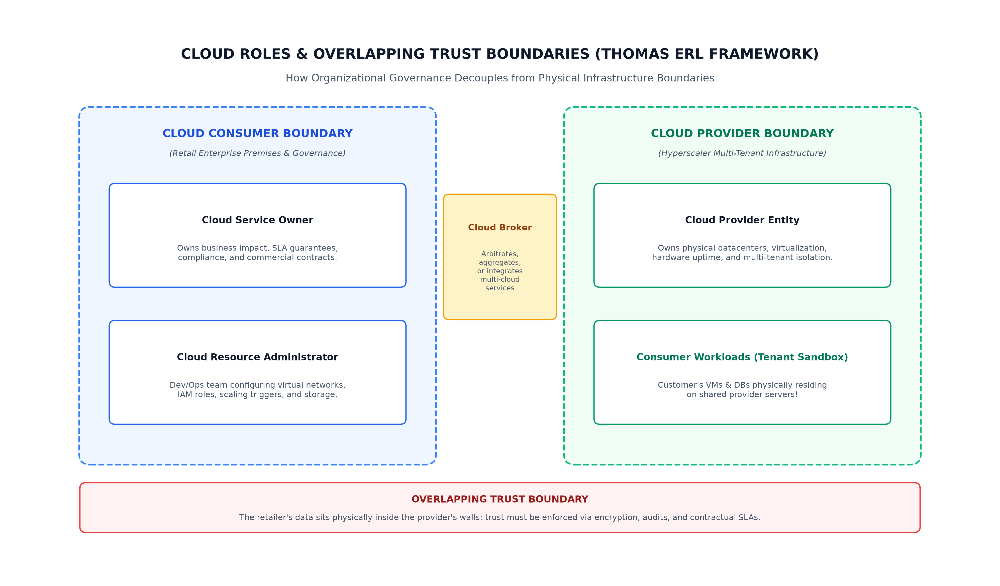
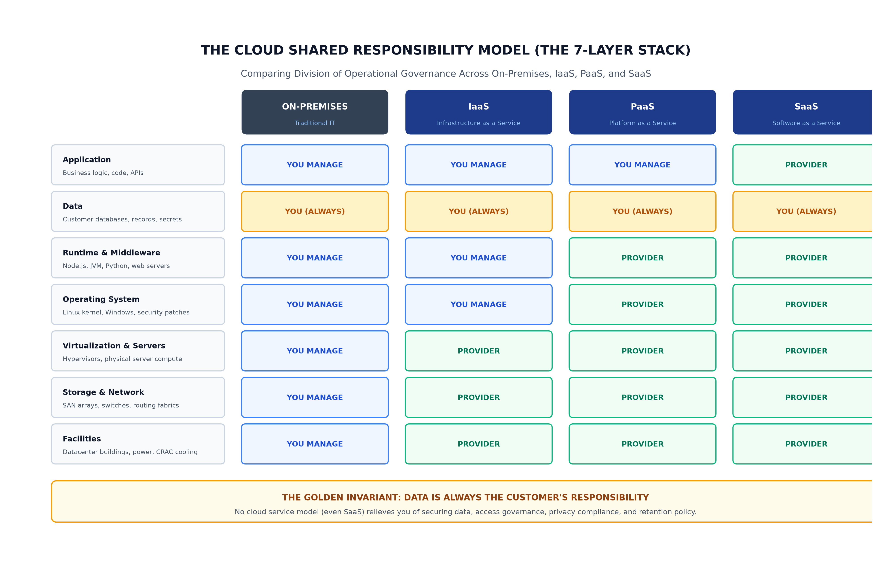
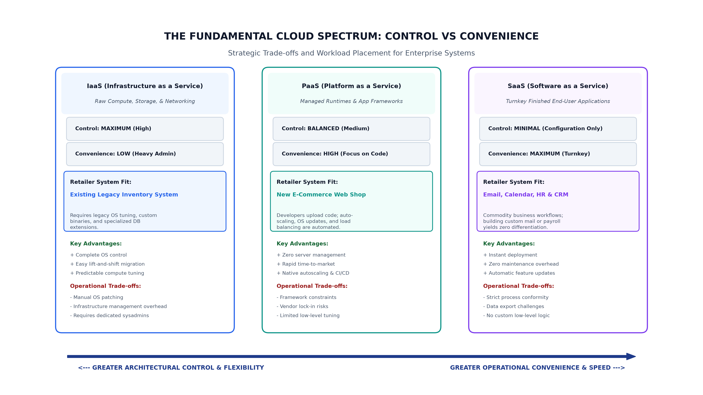

This topic note establishes the architectural taxonomy of cloud delivery models—Infrastructure as a Service (IaaS), Platform as a Service (PaaS), and Software as a Service (SaaS)—evaluating trust boundaries, the 7-layer application stack, the shared responsibility model, and strategic workload placement.

---

# 1. Cloud Roles, Relationships & Governance Boundaries

In enterprise cloud computing, governance and operational ownership are defined through formal architectural roles established by the Thomas Erl and NIST frameworks.



## 1.1 The Primary Cloud Roles
- **Cloud Provider:** The organization that owns the physical and virtual cloud infrastructure, operates the datacenters, and delivers services to consumers under defined Service Level Agreements (SLAs) (e.g., Amazon Web Services, Microsoft Azure, Google Cloud Platform).
- **Cloud Consumer:** The organization or individual that procures, configures, and consumes cloud services to run enterprise workloads (in our narrative: the retail enterprise).
- **Cloud Broker:** An intermediary entity that acts as an independent arbitrator, aggregator, or integrator across multiple cloud providers. A broker helps consumers select optimal pricing, manage multi-cloud deployments, and bridge identity federation.
- **Cloud Service Owner:** The legal or organizational party that owns a particular cloud service. A provider can be a service owner (e.g., AWS owning S3), or a consumer can be a service owner (e.g., the retailer owning its hosted e-commerce API delivered to end consumers).
- **Cloud Resource Administrator:** The technical person or engineering team responsible for administering specific cloud resources (configuring Virtual Private Clouds, provisioning IAM role permissions, setting auto-scaling policies, and managing database instances).

## 1.2 Organizational Boundaries vs. Trust Boundaries
A fundamental security challenge in cloud migration is the structural decoupling of physical premises from governance:

- **Organizational Boundary:** The physical and legal perimeter enclosing the assets, staff, and facilities owned and directly governed by an organization.
- **Trust Boundary:** The logical perimeter within which an organization enforces security policies, data confidentiality, and access controls that it trusts.

```
+---------------------------------------------------------------------------------------------------+
|                            THE OVERLAPPING TRUST BOUNDARY PARADOX                                 |
|                                                                                                   |
|   ON-PREMISES DATACENTER:                          CLOUD ENVIRONMENT:                             |
|   Organizational Boundary == Trust Boundary        Trust Boundary Overlaps Provider Premises      |
|                                                                                                   |
|   +---------------------------------------+        +-------------------+    +-------------------+ |
|   |  ORGANIZATIONAL BOUNDARY              |        | CONSUMER BOUNDARY |    | PROVIDER BOUNDARY | |
|   |  +---------------------------------+  |        | +---------------+ |    | +---------------+ | |
|   |  | TRUST BOUNDARY                  |  |        | | Consumer      | |    | | Shared Hosts  | | |
|   |  | In-house Servers & Storage      |  |        | | Governance    | |    | | Multi-Tenant  | | |
|   |  +---------------------------------+  |        | +-------+-------+ |    | | Facilities    | | |
|   +---------------------------------------+        +---------|---------+    +-------|-----------+ |
|                                                              +------- OVERLAP ------+             |
|                                                              | Retailer Data & VMs  |             |
|                                                              | inside Provider Rack |             |
|                                                              +----------------------+             |
+---------------------------------------------------------------------------------------------------+
```

> [!warning] The Overlapping Trust Boundary
> In the cloud, **organizational and trust boundaries no longer align**. The retailer's sensitive customer credit card data and proprietary algorithms physically execute inside a multitenant facility owned and staffed by a third-party provider. Consequently, security cannot rely on physical locked doors; it must be enforced cryptographically through **end-to-end encryption, Zero-Trust access control, continuous automated compliance telemetry, and binding contractual SLAs**.

---

# 2. The 7-Layer Application Stack & The Shared Responsibility Model

Every digital application consists of seven discrete architectural layers. A cloud delivery model is fundamentally an architectural decision regarding **where the dividing line of operational ownership is drawn**.



## 2.1 The Seven Architectural Layers
1. **Application:** Business logic, source code, microservice APIs, algorithms, and end-user interfaces.
2. **Data:** Relational database records, customer identities, sensitive financial transactions, object stores, and encryption keys.
3. **Runtime & Middleware:** Application execution frameworks (Node.js engine, Java Virtual Machine, Python runtime, WebSphere, Apache Tomcat).
4. **Operating System:** Operating system kernel (Linux distributions, Windows Server), device drivers, system binaries, and security patches.
5. **Virtualization & Servers:** Hypervisor software (KVM, ESXi), virtual machine managers, physical server hardware, ECC memory, and CPUs.
6. **Storage & Network:** Physical disk arrays (SAN/NAS), RAID controllers, Top-of-Rack switches, routers, firewalls, and fiber cabling.
7. **Facilities:** Datacenter real estate, utility electrical feeds, backup generators, CRAC thermal cooling, and physical security.

## 2.2 Responsibility Allocation Matrix

| Architectural Stack Layer | On-Premises Traditional | Infrastructure as a Service (IaaS) | Platform as a Service (PaaS) | Software as a Service (SaaS) |
| :--- | :--- | :--- | :--- | :--- |
| **Application** | **You (Customer)** | **You (Customer)** | **You (Customer)** | Provider |
| **Data** | **You (Customer)** | **You (Customer)** | **You (Customer)** | **You (Customer)** |
| **Runtime & Middleware** | **You (Customer)** | **You (Customer)** | Provider | Provider |
| **Operating System** | **You (Customer)** | **You (Customer)** | Provider | Provider |
| **Virtualization & Servers** | **You (Customer)** | Provider | Provider | Provider |
| **Storage & Network** | **You (Customer)** | Provider | Provider | Provider |
| **Facilities (Power/Cooling)**| **You (Customer)** | Provider | Provider | Provider |

> [!important] The Golden Invariant of Cloud Computing
> **DATA IS ALWAYS THE CUSTOMER'S RESPONSIBILITY.**
> Across every cloud delivery model—including turnkey SaaS applications—the customer permanently retains ultimate legal, regulatory, and ethical accountability for their data. The provider guarantees infrastructure availability and isolation, but the customer is solely responsible for data classification, role-based access control (RBAC), data loss prevention, privacy compliance (GDPR, PCI-DSS, HIPAA), and backup retention policies.

---

# 3. Infrastructure as a Service (IaaS)

## 3.1 Core Architecture & Capabilities
In Infrastructure as a Service (**IaaS**), the cloud provider delivers raw, unconfigured virtual computing building blocks: virtual machine instances (e.g., AWS EC2, Azure VMs, Google Compute Engine), block storage volumes (e.g., AWS EBS, Google Persistent Disk), and software-defined virtual private networks (VPCs).

- **Provider Scope:** Manages datacenter facilities, physical hardware, host hypervisors, and core networking backbones.
- **Consumer Scope:** The consumer selects the operating system, provisions disk partitions, configures network security groups (firewalls), installs runtime dependencies, patches OS vulnerabilities, and deploys applications.

## 3.2 Operational Decisions for the IaaS Consumer
When operating an IaaS environment, the customer's operations team must determine:
- **Instance Typology & Sizing:** Selecting optimal ratios of vCPU to RAM (e.g., compute-optimized, memory-optimized, or GPU instances).
- **Operating System Baseline:** Selecting and hardening base machine images (e.g., Red Hat Enterprise Linux vs Ubuntu Minimal AMI).
- **Network Topology & Segmentation:** Architecting private and public subnets, NAT gateways, route tables, and Internet Gateways within a Virtual Private Cloud (VPC).
- **State Persistence & Backup Mechanics:** Configuring automated snapshot lifecycle policies, RAID striping across block volumes, and off-site replication.
- **Scaling Triggers:** Defining threshold rules (e.g., "Add 2 instances when average CPU utilization exceeds $75\%$ for 5 consecutive minutes").

## 3.3 Strategic Advantages & Operational Trade-offs

```
+---------------------------------------------------------------------------------------------------+
|                                     IaaS TRADE-OFF MATRIX                                         |
+---------------------------------------------------------------------------------------------------+
|  ADVANTAGES                                       OPERATIONAL TRADE-OFFS                          |
|  - Maximum architectural control & tuning         - High management overhead (OS patching, etc.)  |
|  - Easiest "Lift-and-Shift" migration path       - Requires specialized sysadmin & DevOps talent |
|  - Compatibility with legacy binary drivers       - Software architecture remains monolithic      |
|  - Full visibility into OS network sockets        - Slowest deployment velocity among cloud models|
+---------------------------------------------------------------------------------------------------+
```

- **Enterprise Retailer Fit:** **The Legacy Inventory Management System.** Built on custom C++ daemons and specialized database extensions, the inventory system cannot easily run on modern serverless or container platforms. Migrating it to IaaS virtual servers preserves the application configuration exactly while eliminating on-premises hardware maintenance.

---

# 4. Platform as a Service (PaaS)

## 4.1 Core Architecture & Capabilities
Platform as a Service (**PaaS**) provides a fully managed application development and deployment environment. The provider abstracts away the operating system, storage arrays, runtime installation, and server management.

- **Provider Scope:** Manages facilities, physical hardware, hypervisors, operating systems, runtime middleware (e.g., Node.js, Python, Java, .NET), automated scaling controllers, and OS security patches.
- **Consumer Scope:** Developers simply write application code, manage database schemas, and define service configurations.
- **Representative Implementations:** AWS Elastic Beanstalk, Google App Engine, Heroku, Microsoft Azure App Services, Firebase App Hosting.

## 4.2 The PaaS Operational Workflow
Instead of provisioning servers and configuring SSH keys, the developer's deployment workflow is streamlined:

```bash
# Modern PaaS Deployment Workflow (Developer Experience)
git add .
git commit -m "Deploy Black Friday checkout optimization"
git push production main
# The PaaS platform detects the runtime, builds dependencies,
# executes unit tests, rolls out containers across healthy nodes,
# performs zero-downtime health checking, and routes traffic.
```

## 4.3 Strategic Advantages & Operational Trade-offs

```
+---------------------------------------------------------------------------------------------------+
|                                     PaaS TRADE-OFF MATRIX                                         |
+---------------------------------------------------------------------------------------------------+
|  ADVANTAGES                                       OPERATIONAL TRADE-OFFS                          |
|  - Extreme velocity: developers focus on code     - Framework & runtime version constraints       |
|  - Built-in zero-config autoscaling               - Risk of proprietary vendor lock-in            |
|  - Zero OS patching or maintenance overhead       - No access to low-level OS kernel parameters   |
|  - Automated SSL/TLS and health checking          - Pricing premium over raw IaaS compute nodes   |
+---------------------------------------------------------------------------------------------------+
```

- **Enterprise Retailer Fit:** **The New E-Commerce Web Storefront.** Built as a modern Node.js and React application, the web store benefits from PaaS automatic horizontal scaling, instant deployment rollbacks, and automated SSL termination, allowing software engineers to iterate features rapidly without operational distractions.

---

# 5. Software as a Service (SaaS)

## 5.1 Core Architecture & Capabilities
Software as a Service (**SaaS**) delivers complete, ready-to-use business software applications hosted and operated entirely by the cloud provider, accessed by end-users via web browsers or mobile apps.

- **Provider Scope:** Responsible for everything: facilities, infrastructure, virtualization, OS, runtimes, database management, high availability, code development, security auditing, and feature releases.
- **Consumer Scope:** Managing user accounts, role-based authorization policies, application configuration parameters, and business data.
- **Representative Implementations:** Google Workspace (Gmail, Docs), Microsoft 365, Salesforce CRM, Workday, ServiceNow.

## 5.2 Strategic Decisions in SaaS Selection
When adopting SaaS, the enterprise shifts from an engineering mindset to a business process evaluation:
- **Configuration vs. Customization:** Can the enterprise adapt its internal business workflows to match the out-of-the-box capabilities of the SaaS platform? Customizing a SaaS product via custom extensions is expensive, fragile, and difficult to maintain across provider upgrade cycles.
- **Data Portability & API Integration:** Does the SaaS vendor provide comprehensive REST/GraphQL APIs and bulk data export capabilities? Can the retailer extract customer data if it decides to terminate the contract?
- **Identity Federation:** Does the platform integrate seamlessly with enterprise Identity Providers via open standards (**SAML 2.0, OpenID Connect, OAuth 2.0**)?

- **Enterprise Retailer Fit:** **Corporate Email, Calendar, HR, and Payroll.** Running an in-house Microsoft Exchange email server or building custom payroll software provides zero competitive market advantage. Consuming these as SaaS commodities frees up engineering talent to focus on core retail differentiation.

---

# 6. The Fundamental Trade-off: Control vs. Convenience

Choosing among IaaS, PaaS, and SaaS is not an all-or-nothing proposition; it represents a strategic calibration along the **Control vs. Convenience continuum**.



## 6.1 The Spectrum Dynamics
- **Control (Flexibility & Tuning):** $\text{IaaS (Highest)} \longrightarrow \text{PaaS (Medium)} \longrightarrow \text{SaaS (Lowest)}$
- **Operational Convenience (Velocity):** $\text{SaaS (Instant)} \longrightarrow \text{PaaS (High)} \longrightarrow \text{IaaS (Low / Heavy Admin)}$
- **Management Effort:** $\text{IaaS (Heavy Ops)} \longrightarrow \text{PaaS (Developer Ops)} \longrightarrow \text{SaaS (Administrative Only)}$

## 6.2 Multi-Model Service Composition in Modern Enterprises
Modern enterprise architectures rarely standardize on a single service model. Instead, mature organizations compose all three delivery models into a cohesive hybrid ecosystem:

```
+---------------------------------------------------------------------------------------------------+
|                           THE RETAILER'S MULTI-MODEL CLOUD TOPOLOGY                               |
|                                                                                                   |
|     +-------------------------+     +-------------------------+     +-------------------------+   |
|     |     SaaS COMMODITIES    |     |      PaaS INNOVATION    |     |      IaaS FOUNDATION    |   |
|     |                         |     |                         |     |                         |   |
|     |  - Google Workspace     |     |  - Customer Web Store   |     |  - Core Inventory DB    |   |
|     |  - Salesforce CRM       | <-> |  - Mobile Backend APIs  | <-> |  - Raw Object Storage   |   |
|     |  - Workday HR/Payroll   |     |  - Checkout Pipeline    |     |    (Product Catalog Img)|   |
|     +-------------------------+     +-------------------------+     +-------------------------+   |
|      Turnkey Commodity Workflows     Differentiating Business Code    Legacy Systems & Raw Storage |
+---------------------------------------------------------------------------------------------------+
```

---

# 7. Enterprise Scenario Mapping: Retailer Migration Decisions

Applying our theoretical models to the retailer's IT portfolio yields a definitive strategic migration roadmap:

| System / Workload | Optimal Cloud Model | Architectural Justification |
| :--- | :--- | :--- |
| **Existing Inventory System** | **IaaS** | Legacy monolith requiring custom OS tuning, specific database binaries, and low-level network access. Preserved via lift-and-shift. |
| **New E-Commerce Web Shop** | **PaaS** | Modern web application requiring rapid feature deployments, native CI/CD pipelines, and automated horizontal scaling during traffic spikes. |
| **Corporate Email & Calendar**| **SaaS** | Standard business commodity. Zero competitive value in managing mail transfer agents or spam filtering servers in-house. |
| **Product Photo Catalog** | **IaaS (Object Storage)**| Massive collection of unstructured image assets best served via highly durable, scalable, low-cost cloud object storage (e.g., S3). |

---

# Lecture Notes
![[IS2212 - 03. Cloud Service Models (IaaS, PaaS, SaaS).pdf]]