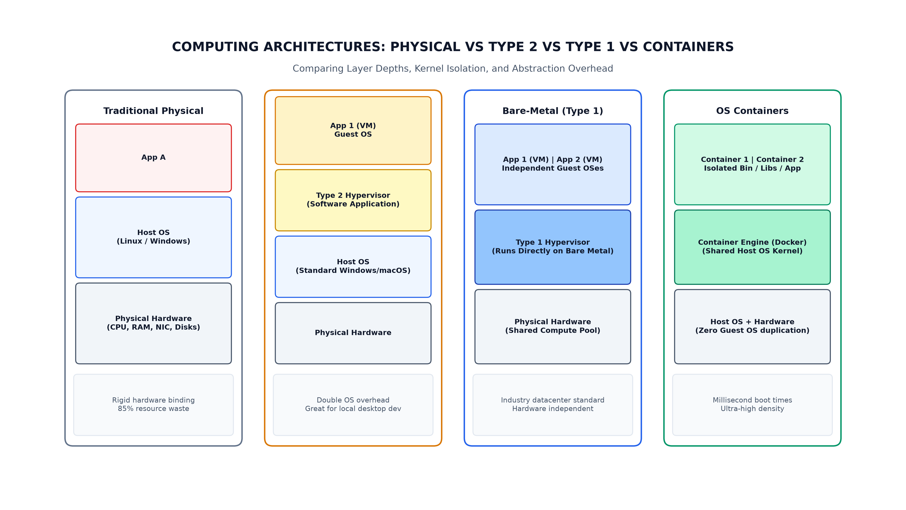
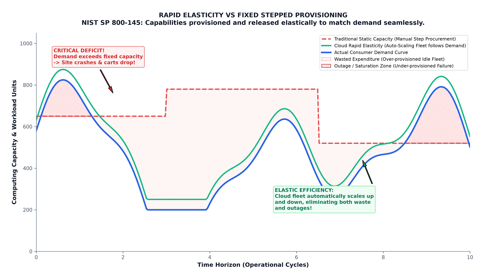
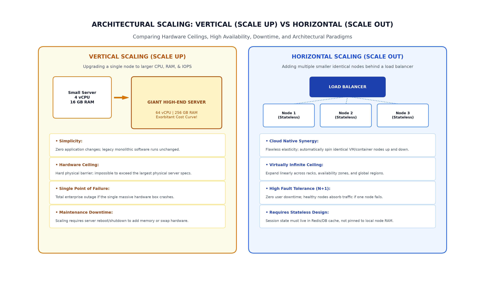

This topic note explores the evolution from physical computing to hypervisor-based virtualization, analyzes why virtual machines alone did not constitute cloud computing, and examines the NIST SP 800-145 cloud standard, rapid elasticity, horizontal scaling, and the operational paradigm shift.
---
# 1. The Virtualization Breakthrough: Solving Server Sprawl

In the traditional datacenter, the operational standard dictated that **one physical server hosted exactly one application workload**. This design pattern prevented dependency conflicts between applications (e.g., conflicting runtime libraries or operating system kernel requirements), but resulted in severe economic inefficiency: most servers operated at single-digit CPU utilization outside peak hours.

```
+---------------------------------------------------------------------------------------------------+
|                            THE HYPERVISOR ABSTRACTION BREAKTHROUGH                                |
|                                                                                                   |
|   BEFORE: 1 Workload per Physical Box              AFTER: Multiple Virtual Machines Sharing 1 Box |
|                                                                                                   |
|   +-----------+  +-----------+  +-----------+     +---------------------------------------------+ |
|   |   App A   |  |   App B   |  |   App C   |     |  [VM 1: App A]   [VM 2: App B]   [VM 3: App C]  |
|   +-----------+  +-----------+  +-----------+     +---------------------------------------------+ |
|   |  Host OS  |  |  Host OS  |  |  Host OS  |     |             HYPERVISOR LAYER                | |
|   +-----------+  +-----------+  +-----------+     +---------------------------------------------+ |
|   | Hardware  |  | Hardware  |  | Hardware  |     |         PHYSICAL HARDWARE (SHARED POOL)     | |
|   +-----------+  +-----------+  +-----------+     +---------------------------------------------+ |
|    15% Util       12% Util       10% Util                     CONSOLIDATED UTILIZATION: 50%       |
+---------------------------------------------------------------------------------------------------+
```

## 1.1 Core Architectural Properties of Virtualization
Virtualization introduces an abstraction layer between the physical hardware and the operating system:

- **Hardware Independence:** Virtual machines (VMs) are fully encapsulated in software configuration files and virtual disk images (e.g., `.vmdk`, `.qcow2`, `.vhd`). The guest OS communicates with standardized virtual devices rather than vendor-specific motherboards, chipsets, or network interface cards. Consequently, a VM can be migrated across heterogeneous physical hardware without reinstallation.
- **Server Consolidation:** Multiple lightly loaded, isolated virtual servers run simultaneously on a single high-capacity physical host. This consolidates compute cycles and eliminates idle capacity.
- **Resource Replication & Portability:** Provisioning a new server no longer requires unboxing physical electronics; administrators can clone a golden master template or snapshot a running instance in seconds.

## 1.2 The Economics of Server Consolidation: Worked Calculation
Consider an enterprise managing an un-virtualized fleet of physical servers:

### Baseline Inventory:
- **Fleet Size ($N_{\text{phys}}$):** $10\text{ physical servers}$.
- **Average Workload Utilization ($U_{\text{avg}}$):** $15\%$ CPU and RAM utilization per server during normal operations.

### Mathematical Consolidation Analysis:

1. **Calculate Total Compute Workload:**
   $$W_{\text{total}} = N_{\text{phys}} \times U_{\text{avg}} = 10 \times 0.15 = 1.5\text{ physical servers' worth of continuous computation}$$

2. **Consolidate Workloads onto Target Host Fleet:**
   The enterprise installs a bare-metal hypervisor cluster comprising $N_{\text{hosts}} = 3\text{ physical servers}$ to run all 10 virtual machines.

3. **Calculate Consolidated Host Utilization:**
   $$U_{\text{consolidated}} = \frac{W_{\text{total}}}{N_{\text{hosts}}} \times 100\% = \frac{1.5}{3} \times 100\% = 50\%$$

> [!important] The Efficiency Dividend
> By consolidating 10 lightly used servers onto 3 physical hypervisor nodes, the enterprise **retires 7 physical machines** while maintaining healthy $50\%$ host utilization (leaving ample headroom for burst traffic). This yields an immediate **$70\%$ reduction** in physical rack space, power consumption, heat dissipation, and cabling complexity.

---
# 2. Virtualization Taxonomy: Hypervisors vs. Containers

Computing virtualization exists in three distinct architectures, differing in their abstraction boundary and performance characteristics.



## 2.1 Type 2 (Hosted) Hypervisors
- **Architectural Mechanics:** The hypervisor runs as a standard user-space application on top of an existing host operating system (e.g., Windows, macOS, or Linux).
- **Representative Implementations:** Oracle VirtualBox, VMware Workstation, Parallels Desktop.
- **Overhead & Suitability:** Introduces two full operating system layers (the host OS and the guest OS), resulting in duplicated memory overhead, device driver translation delays, and context switching. Ideal for local software development, student labs, and cross-platform desktop testing; **unsuitable for enterprise production datacenters**.

## 2.2 Type 1 (Bare-Metal) Hypervisors
- **Architectural Mechanics:** The hypervisor software installs directly onto the physical server hardware, acting as a lightweight, purpose-built operating kernel. It manages CPU scheduling, memory partitioning, and I/O bus access directly.
- **Representative Implementations:** VMware ESXi, Microsoft Hyper-V, KVM (Kernel-based Virtual Machine in Linux), Citrix XenServer.
- **Overhead & Suitability:** Leverages hardware-assisted virtualization extensions built directly into modern CPUs (**Intel VT-x** and **AMD-V**) and memory management units (**SLAT / EPT / NPT**). Achieves near-native execution performance ($>98\%$ of bare-metal speed). **This is the foundational computing engine of enterprise datacenters and modern cloud providers.**

## 2.3 Operating-System-Level Virtualization (Containers)
- **Architectural Mechanics:** Containers eliminate the hypervisor and guest operating systems altogether. Multiple isolated user-space environments run directly on top of a single shared host OS kernel.
- **Underlying Linux Kernel Technologies:**
  - **Namespaces:** Provide process isolation across process IDs (`pid`), networking routing tables and ports (`net`), filesystem mount points (`mnt`), inter-process communication (`ipc`), and hostnames (`uts`).
  - **Control Groups (cgroups):** Enforce strict quantitative limits on resource consumption (capping CPU cores, memory megabytes, disk I/O, and network bandwidth per container).
- **Representative Implementations:** Docker engine, containerd, orchestrated across clusters via **Kubernetes**.
- **Overhead & Suitability:** Containers boot in milliseconds, have near-zero memory footprint overhead, and achieve $100\%$ bare-metal execution performance.

## 2.4 Architectural Comparison Matrix

| Architectural Feature | Bare-Metal Physical | Hosted Hypervisor (Type 2) | Bare-Metal Hypervisor (Type 1) | OS Containers (Docker) |
| :--- | :--- | :--- | :--- | :--- |
| **Abstraction Level** | Hardware | Software Application | Direct Bare Hardware | Operating System Kernel |
| **Guest OS Duplication** | None | Full Guest OS required | Full Guest OS required | **None (Shares Host Kernel)** |
| **Startup / Boot Time** | Minutes (Cold POST) | 30 – 60 Seconds | 15 – 45 Seconds | **Milliseconds** |
| **Storage & Memory Footprint** | Gigabytes | Tens of Gigabytes per VM | Tens of Gigabytes per VM | **Megabytes per Image** |
| **Security & Isolation** | Physical Airgap | Strong (Software emulated) | **Strongest (Hardware MMU)** | Moderate (Shared Kernel) |
| **Performance Overhead** | $0\%$ (Baseline) | High ($10\% - 25\%$) | Ultra-Low ($1\% - 3\%$) | **Negligible ($< 0.5\%$)** |
| **Primary Use Case** | Legacy High-IOPS DBs | Desktop dev & testing | Enterprise Datacenters & Cloud | Cloud-Native Microservices |

---
# 3. What Virtualization Solved — And What It Left Broken

While virtualization revolutionized server density, it did **not** create cloud computing. Enterprise IT leaders frequently mistook an internal ESXi cluster for a private cloud.

```
+---------------------------------------------------------------------------------------------------+
|                        AUDITING THE IMPACT OF ENTERPRISE VIRTUALIZATION                           |
+---------------------------------------------------------------------------------------------------+
|  1. Idle Hardware Waste        -->  PARTIALLY RESOLVED: Consolidated multiple VMs onto fewer hosts|
|  2. Server Portability         -->  FULLY RESOLVED: VMs can migrate across hosts via vMotion      |
|  3. Upfront Capital Spending   -->  UNRESOLVED: Enterprise still bought giant physical ESXi boxes |
|  4. Long Provisioning Times    -->  UNRESOLVED: Developers still filed tickets to request VMs     |
|  5. True Fleet Elasticity      -->  UNRESOLVED: Total capacity strictly capped by bought physicals|
|  6. In-House Facilities Burden -->  UNRESOLVED: Power, cooling, and UPS battery banks stayed ours |
+---------------------------------------------------------------------------------------------------+
```

> [!warning] The Illusion of the "Virtual Datacenter"
> A virtualized datacenter is still an on-premises datacenter. If a developer needed a new virtual server, they filed an IT ticket. An operations engineer reviewed the ticket, validated available RAM on the ESXi cluster, provisioned the VM, assigned a static IP, and updated the spreadsheet. The procurement cycle dropped from **6 weeks to 3 days**, but the process remained **manual, bureaucratic, static, and internally constrained**.

---
# 4. Defining Cloud Computing: The NIST SP 800-145 Framework

According to the National Institute of Standards and Technology (**NIST SP 800-145**):

> *"Cloud computing is a model for enabling ubiquitous, convenient, on-demand network access to a shared pool of configurable computing resources (e.g., networks, servers, storage, applications, and services) that can be rapidly provisioned and released with minimal management effort or service provider interaction."*



## 4.1 The Six Essential Cloud Characteristics
A system is not a cloud simply because it runs virtual machines. To be classified as a true cloud infrastructure, a platform must satisfy six core criteria:

1. **On-Demand Self-Service:** Consumers provision compute, storage, and networking unilaterally through an automated API, command-line interface (CLI), or web portal without requiring human interaction with the service provider.
2. **Ubiquitous (Broad) Network Access:** Capabilities are available over the standard internet and accessible through standardized mechanisms across heterogeneous thick and thin clients (laptops, workstations, mobile smartphones, tablets).
3. **Multitenancy & Resource Pooling:** The provider's physical and virtual computing resources are pooled to serve multiple consumer tenants simultaneously. Physical resources are dynamically assigned and reassigned according to consumer demand, with strict cryptographic and memory isolation.
4. **Rapid Elasticity:** Capabilities can be elastically provisioned and released—often automatically—to scale outward and inward in precise synchronization with demand. To the consumer, available capacity appears infinite.
5. **Measured Service (Pay-per-Use):** Resource usage is automatically monitored, controlled, reported, and billed based on fine-grained metrics (e.g., active instance-seconds, gigabytes of storage per month, gigabytes of network egress).
6. **Resiliency & Fault Tolerance:** The cloud infrastructure is engineered with automated self-healing mechanisms. If a physical host, rack power supply, or network switch suffers hardware failure, virtualization controllers automatically recreate the customer's instances on healthy hardware without interrupting service.

## 4.2 Virtualized Datacenter vs. True Cloud Infrastructure

| Operational Dimension | Virtualized Internal Datacenter | True Cloud Platform (AWS, Azure, GCP) |
| :--- | :--- | :--- |
| **Hardware Ownership** | Enterprise owns, powers, and cools hardware | Cloud provider owns and maintains infrastructure |
| **Resource Acquisition** | Manual ticket filed to internal Operations team | **Self-service automated provisioning via API / Web** |
| **Scalability Horizon** | Hard limit bounded by purchased physical servers | **Virtually limitless pool across global regions** |
| **Elasticity Mechanics** | Slow manual resizing; cannot shrink below zero | **Automated auto-scaling groups (seconds to minutes)** |
| **Financial Accounting** | Upfront CapEx (Depreciation over 3-5 years) | **100% OpEx (Metered utility billing per second)** |
| **Failure Responsibility** | In-house sysadmins must physically swap parts | **Provider replaces hardware automatically behind SLA** |

---
# 5. Architectural Scaling: Vertical (Scale Up) vs. Horizontal (Scale Out)

As workloads expand, infrastructure architects must choose between two distinct dimensional strategies for handling increased transaction throughput.



## 5.1 Vertical Scaling (Scale Up)
- **Concept:** Taking an existing compute node and replacing it with a physically larger machine possessing more CPU cores, larger RAM capacity, higher network bandwidth, and faster NVMe storage.
- **Architectural Advantage:** Conceptual simplicity. Monolithic applications, traditional relational databases (e.g., Oracle, SQL Server), and legacy enterprise systems can scale vertically with **zero code modifications**.
- **Severe Constraints:**
  - **Hardware Ceiling:** Every physical server motherboard has a hard hardware ceiling (e.g., maximum 128 cores, 4 TB RAM). Once reached, the system cannot scale further.
  - **Cost Asymmetry:** The pricing curve for extreme high-end server hardware is exponential rather than linear.
  - **Single Point of Failure (SPOF):** If the monolithic giant server experiences a motherboard or memory controller fault, the entire enterprise goes down.
  - **Downtime Requirement:** Resizing a virtual machine vertically almost always requires stopping the instance, reallocating resources, and rebooting.

## 5.2 Horizontal Scaling (Scale Out)
- **Concept:** Distributing application workload across a large cluster of smaller, identical, commodity computing instances operating behind a reverse proxy or network load balancer.
- **Architectural Advantage:**
  - **Native Cloud Alignment:** Perfect match for cloud auto-scaling. When demand spikes, the orchestration engine spins up 10 additional identical nodes; when demand subsides, it terminates them.
  - **Virtually Infinite Scaling:** Not bound by single-chassis hardware limits; systems can scale to thousands of nodes across multiple Availability Zones.
  - **High Availability ($N+1$ Redundancy):** If Node 4 suffers a catastrophic kernel panic, the load balancer detects health check failures and routes traffic to healthy nodes. Zero user-perceptible downtime.
- **Architectural Requirement (Statelessness):** Horizontal scaling requires applications to be **stateless**. User session tokens, shopping cart state, and file uploads cannot be saved to local server memory or local disk; they must be offloaded to external distributed state stores (e.g., Redis, Memcached, Amazon S3, or relational/NoSQL databases).

---
# 6. The Mindset Revolution: From Procurement to the First Derivative

Adopting cloud computing is fundamentally an organizational and mental shift, not merely an infrastructure migration. Enterprise strategist Gregor Hohpe defines this transformation across two foundational principles:

> [!important] 1. "Cloud Isn't IT Procurement; It's a Lifestyle Change"
> In traditional IT, hardware decisions were rare, monumental, and irrevocable. An architect committed millions of dollars to a server vendor and lived with that decision for five years. In the cloud, infrastructure decisions are frequent, reversible, and small. If a chosen virtual machine size or architecture is suboptimal, it can be terminated and replaced in five minutes.

> [!tip] 2. "Cloud Thinks in the First Derivative"
> In mathematics, the function $f(t)$ represents position, while the first derivative $f'(t) = \frac{df}{dt}$ represents velocity (the rate of change).
> - **Traditional IT** designed for $f(t)$: "How much total capacity do we need today?"
> - **Cloud Architecture** designs for $f'(t)$: "How quickly can our infrastructure adapt to changes in load, deployment frequency, and failure conditions?"

```
+---------------------------------------------------------------------------------------------+
|                                THE THREE-DIMENSIONAL SHIFT                                  |
|                                                                                             |
|   DIMENSION       TRADITIONAL IT PROCUREMENT               CLOUD SERVICE CONSUMPTION        |
|   ---------       --------------------------               -------------------------        |
|   People          Hardware technicians, racking specialists Automated SREs & cloud architects|
|   Process         6-month Change Advisory Boards (CAB)     Automated CI/CD pipelines         |
|   Money           Multi-million dollar upfront CapEx       Per-second operational utility   |
+---------------------------------------------------------------------------------------------+
```

---
# 7. Scenario Analysis: "Is This Cloud?"

To test conceptual clarity, evaluate these three enterprise scenarios against the NIST characteristics:

- **Scenario 1:** *An IT department purchases 5 blade servers, installs VMware ESXi, and consolidates 30 workloads. To get a new virtual machine, a developer files a Jira ticket, which is reviewed by a Change Board and provisioned 4 days later.*
  - **Classification:** **Virtualization Only.** It possesses hardware abstraction, but lacks on-demand self-service, rapid elasticity, and pay-per-use billing. The company still carries all hardware CapEx and facilities burden.
- **Scenario 2:** *A software engineer logs into an AWS web console, clicks "Launch Instance," selects an Ubuntu AMI, attaches an EBS SSD volume, and deploys code 90 seconds later, billed at $\$0.0464$ per hour.*
  - **Classification:** **True Cloud.** Demonstrates on-demand self-service, broad network access, resource pooling, rapid elasticity, and metered usage.
- **Scenario 3:** *An enterprise leases a dedicated physical rack server from a managed provider under a 24-month fixed contract with guaranteed 4-hour hardware replacement SLAs.*
  - **Classification:** **Managed Hosting.** The provider owns and repairs the physical hardware, but the capacity is static, non-elastic, locked to long-term contracts, and lacks automated self-service APIs.

---
# Lecture Notes
![[IS2212 - 02. From Virtual Machines to the Cloud.pdf]]