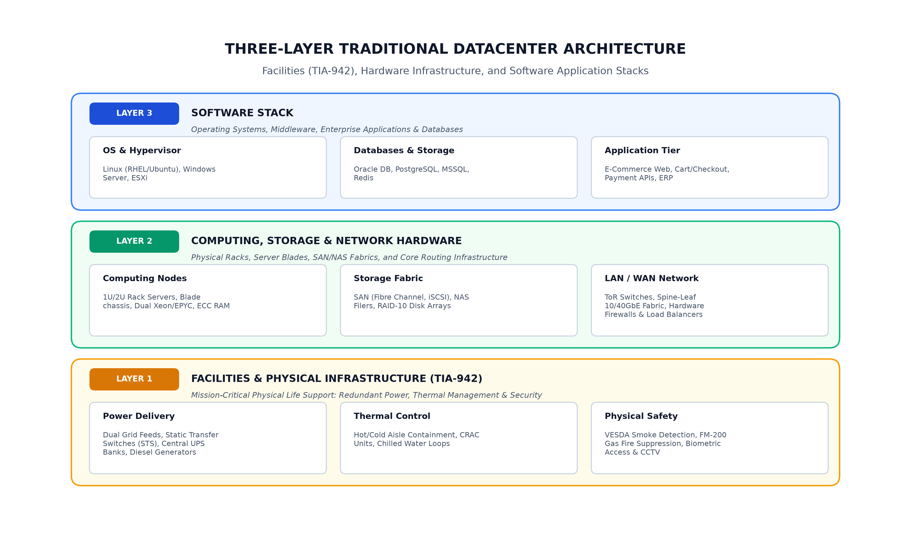
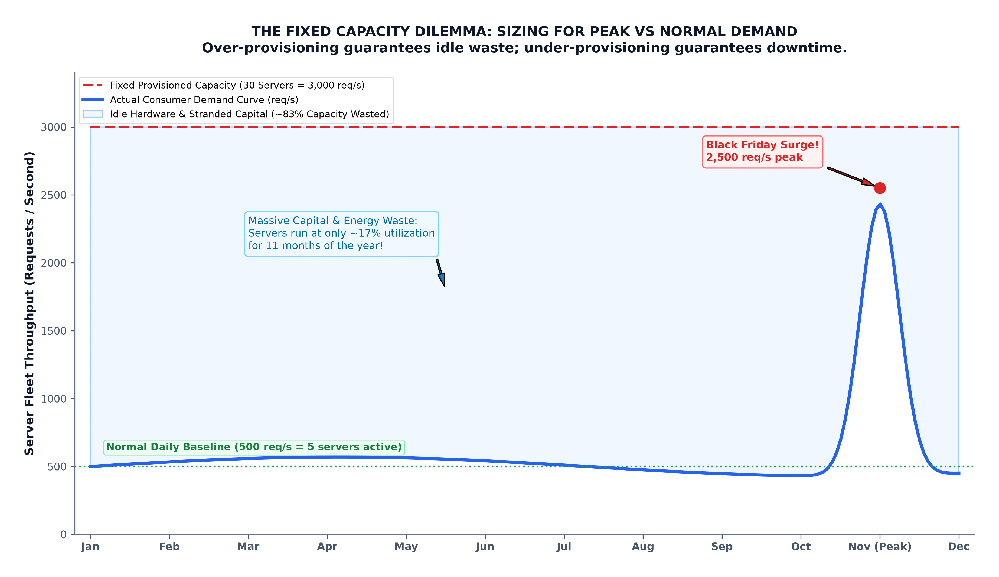
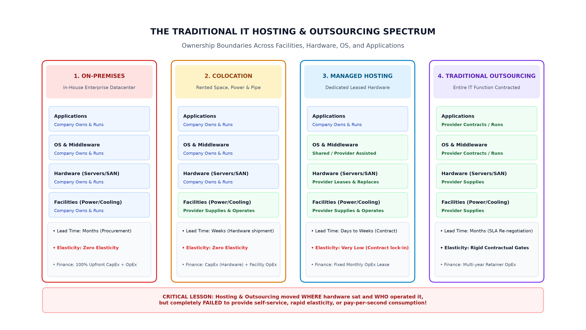

This topic note examines the architectural, operational, and financial realities of enterprise IT within traditional on-premises datacenters prior to the cloud era, tracing the foundational constraints of facilities, physical hardware, organizational silos, and fixed-capacity planning.
---
# 1. The Enterprise Dilemma & The Black Friday Outage

Enterprise IT infrastructure before the cloud was anchored to physical real estate and long-term capital investments. To understand why cloud computing represents an architectural paradigm shift rather than merely an operational convenience, we examine the baseline challenges through a representative mid-sized omnichannel retail enterprise.

```
+---------------------------------------------------------------------------------------------------+
|                                 THE RETAILER'S ON-PREMISES STACK                                   |
|                                                                                                   |
|  [ E-Commerce Storefront ]    [ Inventory System ]    [ Payment Gateway ]    [ Warehouse Analytics ] |
|  Apache / PHP Monolith        Java EE WebSphere       C++ Daemon / HSM       Oracle 11g RAC DB    |
+---------------------------------------------------------------------------------------------------+
|  PHYSICAL INFRASTRUCTURE: In-house datacenter room, 30 rack servers, Fibre Channel SAN, Core LAN |
+---------------------------------------------------------------------------------------------------+
```

### The Anatomy of a Systemic Failure
On the biggest sales event of the year (Black Friday), marketing launches a nationwide campaign. The sequence of systemic failure unfolds along a deterministic physical trajectory:

1. **Traffic Surge:** Inbound customer requests jump rapidly from a normal baseline of $500\text{ req/s}$ to beyond $2,500\text{ req/s}$.
2. **Web Tier Saturation:** The front-facing Apache web servers exhaust their maximum worker thread pools (`MaxRequestWorkers`). CPU utilization surges to 100%, and incoming TCP connection queues fill to capacity.
3. **Database Connection Starvation:** Application threads awaiting responses from the central database hold database connections open. The connection pool reaches its ceiling, triggering thread deadlocks and cascading query timeouts.
4. **Cascading Drop-off & Site Outage:** Network load balancers mark unresponsive backend servers as dead. The remaining servers absorb the entire load, instantly collapsing under the surge. The website displays `504 Gateway Timeout` and `503 Service Unavailable` errors.

> [!warning] The Procurement Wall
> When an on-premises datacenter crashes due to server saturation, the engineering team **cannot simply add more servers**. In traditional infrastructure, adding compute capacity is a logistical and physical procurement pipeline requiring quotes, executive budget approval, vendor delivery, physical unboxing, rack mounting, power cabling, network patching, OS installation, and configuration—a lead time typically spanning **6 to 12 weeks**.

---
# 2. The Three-Layer Datacenter Architecture

A enterprise-grade datacenter is structured across three tightly coupled tiers: Facilities, Hardware Infrastructure, and the Software Stack. Every layer below the application requires dedicated engineering expertise, capital expenditure, and physical space.



## 2.1 Layer 1: Facilities & Mission-Critical Infrastructure (TIA-942)
Datacenter facilities provide physical life support to electronic hardware. If the physical environment fails, all computing, networking, and software services immediately collapse.

- **Dual Utility Power Feeds:** Datacenters draw power from two separate electrical utility sub-stations to prevent total failure if one grid circuit suffers a blackout.
- **Uninterruptible Power Supply (UPS) Banks:** Giant rooms filled with lead-acid or lithium-ion battery banks that condition utility power and bridge the critical 15-to-60 second gap between a utility grid outage and generator startup.
- **Diesel Backup Generators:** Heavy industrial diesel engines equipped with on-site fuel storage tanks designed to supply continuous power for days during prolonged regional electrical blackouts.
- **Thermal Management (HVAC & CRAC):** Electronic servers convert nearly 100% of consumed electrical wattage directly into heat. Computer Room Air Conditioning (CRAC) units and Computer Room Air Handlers (CRAH) circulate chilled air through raised floor plenums using **Hot Aisle / Cold Aisle Containment** geometries to prevent thermal throttling.
- **Fire Suppression (Clean Agent Systems):** Water sprinklers destroy electronic servers. Datacenters utilize Very Early Smoke Detection Apparatus (**VESDA**) coupled with clean gaseous fire suppression systems (such as **FM-200** or **Novec 1230**) that extinguish combustion by chemical heat absorption without damaging electrical components or suffocating personnel.
- **Physical Security & Access Control:** Biometric retinal/fingerprint scanners, mantrap doors (two-door airlocks preventing tailgating), continuous CCTV surveillance, and 24/7 on-site security guards.

> [!important] The TIA-942 Datacenter Standard
> The Telecommunications Industry Association (**TIA-942**) classifies datacenters into four distinct tiers of operational availability:
> - **Tier I (Basic Site Infrastructure):** Single path for power and cooling; no redundant components; 99.671% availability (28.8 hours downtime/year).
> - **Tier II (Redundant Component Site):** Single path with redundant components ($N+1$); 99.741% availability (22.7 hours downtime/year).
> - **Tier III (Concurrently Maintainable):** Multiple power and cooling paths, but only one active; redundant components ($N+1$); equipment maintainable without shutdown; 99.982% availability (1.6 hours downtime/year).
> - **Tier IV (Fault Tolerant Site):** Multiple active, independent, physically isolated power and cooling paths ($2(N+1)$); automatic fault containment; 99.995% availability (0.4 hours downtime/year).

## 2.2 Layer 2: Computing, Storage, and Networking Hardware
Physical infrastructure houses the servers, storage arrays, and network backbones that execute workloads.

- **Computing Nodes (Racks & Blades):** High-density 19-inch rack-mounted servers (1U, 2U, or 4U form factors) or blade enclosures sharing common power and fan modules. In traditional non-virtualized datacenters, **one physical server ran exactly one operating system and workload** to avoid dependency conflicts.
- **Storage Hardware (SAN vs NAS):**
  - **Storage Area Network (SAN):** A dedicated, high-speed block-level network connecting servers to shared disk arrays via **Fibre Channel (FC)** switches or **iSCSI**. Presents raw block storage directly to the OS as if it were a local hard drive.
  - **Network-Attached Storage (NAS):** File-level storage accessible over the standard local area network using protocols such as **NFS** (Unix/Linux) or **SMB/CIFS** (Windows).
  - **Enterprise RAID Arrays:** High-reliability disk enclosures using **RAID 10** (striped mirrors) or **RAID 6** (dual parity) to survive simultaneous physical drive failures.
- **Networking Fabric & Appliances:**
  - **Top-of-Rack (ToR) Switches:** Fast Layer 2/3 switches located inside each rack cabinet aggregating server network interfaces (1GbE / 10GbE).
  - **Spine-Leaf Architecture:** Modern non-blocking switching fabric providing predictable east-west bandwidth between compute racks.
  - **Perimeter Appliances:** Dedicated enterprise hardware appliances for border routing (BGP), stateful inspection firewalls, and hardware load balancers (e.g., F5 BIG-IP).
- **Carrier Links & Internet Transit:** Dedicated leased line circuits (MPLS, Dark Fiber) provisioned from tier-1 telecom carriers providing WAN interconnectivity.

## 2.3 Layer 3: Software and Operating Systems
The software layer comprises enterprise operating systems (Red Hat Enterprise Linux, Windows Server), relational database engines (Oracle RAC, Microsoft SQL Server, PostgreSQL), runtime middleware (Java Virtual Machines, WebSphere, IIS), and custom monolithic enterprise codebases.

---
# 3. Organizational Silos & The Dev/Ops Operational Wall

In the traditional datacenter, organizational structure directly mirrored the physical hardware boundaries. Each discipline operated within an isolated administrative silo.

```
+---------------------------------------------------------------------------------------------+
|                                    THE WALL OF CONFUSION                                    |
|                                                                                             |
|   DEVELOPMENT TEAM                              OPERATIONS SILOS                            |
|   - Goal: Maximize Change & Velocity            - Goal: Maximize Stability & Uptime         |
|   - Metric: New Features Shipped                - Metric: Mean Time Between Failures (MTBF) |
|                                                                                             |
|                     [ Release Request Ticket / Change Advisory Board ]                      |
|             -----------------------------------------------------------------               |
|                                             |                                               |
|                      +----------------------+----------------------+                        |
|                      |                      |                      |                        |
|             [ Systems Admins ]      [ Network Engineers ]   [ DBAs & Storage ]              |
|             OS, Kernel, Patches     VLANs, IPs, Firewalls   LUNs, Backups, Schemas          |
+---------------------------------------------------------------------------------------------+
```

- **Incentive Misalignment:** Software developers were evaluated based on the speed and volume of feature delivery. Operations engineers were evaluated strictly on system uptime and SLA adherence ($99.99\%$). Because change is the primary cause of outages, operations naturally resisted deployments.
- **Ticket-Driven Bureaucracy:** Provisioning a simple staging environment required filing individual tickets across Systems, Network, Storage, and Security teams. Handoffs accumulated days of latency at each queue boundary.
- **Configuration Drift ("Snowflake Servers"):** Servers configured manually over years developed idiosyncratic quirks, undocumented patches, and unique library versions. Software that worked in development routinely crashed when deployed to production.

---
# 4. Capacity Planning & The Economics of Fixed Provisioning

Capacity planning in a physical datacenter is an exercise in long-range speculation. Because hardware procurement takes months, leadership must forecast user demand **one to three years in advance**.



## 4.1 The Two Ways to Fail
The traditional procurement model forces an organization to choose which catastrophic mistake to make:

```
                  +-------------------------------------------------------+
                  |         TRADITIONAL CAPACITY PLANNING DILEMMA         |
                  +-------------------------------------------------------+
                                     /                         \
                                    /                           \
                                   v                             v
                   [ SIZING FOR THE AVERAGE ]           [ SIZING FOR THE PEAK ]
                   - Cheaper upfront investment         - Immune to traffic spikes
                   - Guaranteed outage during surges    - 80%+ idle capacity year-round
                   - Lost revenue & damaged brand       - Massive capital & power waste
```

## 4.2 Mathematical Capacity Sizing: Worked Example
Consider our mid-sized retail enterprise preparing for the annual Black Friday shopping event.

### Given Parameters:
- **Baseline Demand ($D_{\text{base}}$):** $500\text{ requests per second (req/s)}$ on an average day.
- **Peak Multiplier ($M$):** Marketing forecasts Black Friday traffic at $5\times$ baseline.
- **Server Capacity ($C_{\text{server}}$):** One physical server stably processes $100\text{ req/s}$ at $70\%$ CPU utilization.
- **Safety Headroom ($H$):** Executive policy mandates a $20\%$ spare capacity buffer ($H = 0.20$).

### Mathematical Calculation:

1. **Calculate Anticipated Peak Load:**
   $$\text{Peak Demand } (D_{\text{peak}}) = D_{\text{base}} \times M = 500\text{ req/s} \times 5 = 2,500\text{ req/s}$$

2. **Calculate Minimum Raw Servers for Peak:**
   $$N_{\text{raw}} = \frac{D_{\text{peak}}}{C_{\text{server}}} = \frac{2,500\text{ req/s}}{100\text{ req/s/server}} = 25\text{ servers}$$

3. **Calculate Total Fleet Size with 20% Headroom:**
   $$N_{\text{fleet}} = \left\lceil N_{\text{raw}} \times (1 + H) \right\rceil = 25 \times 1.20 = 30\text{ servers}$$

4. **Calculate Fleet Required on a Normal Day:**
   $$N_{\text{normal}} = \frac{D_{\text{base}}}{C_{\text{server}}} = \frac{500\text{ req/s}}{100\text{ req/s/server}} = 5\text{ servers}$$

5. **Calculate Baseline Fleet Utilization:**
   $$U_{\text{baseline}} = \frac{N_{\text{normal}}}{N_{\text{fleet}}} \times 100\% = \frac{5}{30} \times 100\% \approx 16.67\%$$

> [!important] The Economic Tragedy of Fixed Sizing
> To survive **one single peak day per year**, the enterprise bought **30 physical servers**. For the remaining 364 days, **25 servers ($83.33\%$ of the fleet) sit entirely idle**, drawing electricity, demanding air conditioning, occupying rack space, and depreciating on the balance sheet without generating a single cent of revenue.
>
> If the actual Black Friday peak turns out to be $10\times$ instead of $5\times$, the site crashes anyway because physical servers cannot be added in real time. If the promotion flops, the capital committed is permanently stranded.

## 4.3 CapEx vs. OpEx Financial Dynamics
The financial friction of datacenter management stems from the disparity between Capital Expenditure (**CapEx**) and Operational Expenditure (**OpEx**):

- **Capital Expenditure (CapEx):** Large, upfront monetary commitments to acquire depreciable physical assets (purchasing server chassis, SAN controllers, networking switches, building backup generators). CapEx requires formal corporate capital budgets, board approvals, and accounting amortization over 3 to 5 years.
- **Operational Expenditure (OpEx):** Ongoing recurring day-to-day operational costs required to keep assets functioning (utility electricity bills, cooling water, telecom bandwidth contracts, software maintenance subscriptions, and sysadmin salaries).

---
# 5. Half-Steps: Colocation, Managed Hosting, and Outsourcing

Before the cloud revolution, enterprise IT attempted to reduce facilities overhead by outsourcing physical layers without changing the underlying architecture.



## 5.1 The Evolution of Hosting Models
- **Colocation ("Colo"):** The enterprise rents floor space, rack cages, electrical power feeds, and cooling inside a specialized third-party facility (e.g., Equinix). The company purchases, ships, owns, and manages its own physical servers, storage, and networking hardware.
- **Managed Hosting:** A service provider owns and leases the physical servers, storage, and network hardware to the customer on a fixed monthly contract. The provider handles hardware maintenance and hardware replacement, while the customer manages the operating system, middleware, and applications.
- **Traditional IT Outsourcing:** A global systems integrator (e.g., IBM Global Services, EDS, Wipro) takes over the operational management of the customer's entire IT infrastructure under rigid, multi-year Service Level Agreements (SLAs).

## 5.2 Comparative Governance Matrix

| Operational Dimension | On-Premises Datacenter | Colocation Facility | Managed Hosting Provider | Traditional IT Outsourcing |
| :--- | :--- | :--- | :--- | :--- |
| **Facilities (Power & Cooling)** | **Enterprise** | **Provider** | **Provider** | **Provider** |
| **Physical Hardware & Cabling** | **Enterprise** | **Enterprise** | **Provider** | **Provider** |
| **OS & Hypervisor Layer** | **Enterprise** | **Enterprise** | **Shared / Provider** | **Outsourcing Partner** |
| **Application & Business Data** | **Enterprise** | **Enterprise** | **Enterprise** | **Enterprise / Contracted** |
| **Procurement Lead Time** | 2 – 4 Months | 3 – 6 Weeks | 1 – 3 Weeks | Months (SLA Change Request) |
| **Elasticity & Scalability** | **Zero (Static)** | **Zero (Static)** | **Very Low (Contract Lock-in)** | **Rigid Contractual Gates** |
| **Financial Accounting** | High CapEx + OpEx | Hardware CapEx + OpEx | Fixed Monthly OpEx | Multi-Year Retainer OpEx |

> [!warning] What the Half-Steps Failed to Solve
> While Colocation and Managed Hosting shifted **where the machines sat** and **who replaced bad hard drives**, they completely failed to provide:
> 1. **Self-Service:** Engineers still filed tickets and waited days for server provisioning.
> 2. **Rapid Elasticity:** Hardware was locked to long-term monthly or multi-year leases; capacity could not expand for 4 hours and contract back down.
> 3. **Pay-Per-Use Metering:** Billing was based on provisioned static capacity, whether used at 100% or 0%.

---
# 6. The Retailer's Problem List (Pre-Cloud Baseline)

At the conclusion of this foundational exploration, our retail enterprise faces an unsustainable operational landscape:

- **1. Rigid Fixed Capacity:** Bound to static hardware fleets unable to track changing consumer traffic patterns.
- **2. Prohibitive Lead Times:** Weeks or months required to provision a single additional computing unit.
- **3. Capital Speculation (High CapEx):** Multi-million dollar upfront investments based purely on predictive guesswork.
- **4. Stranded Idle Hardware:** Massive economic and energetic waste during off-peak operational months ($>80\%$ idle).
- **5. The Dev/Ops Wall:** Organizational silos and ticket queues strangling software release velocity.
- **6. Heavy Operational Burden:** Carrying full responsibility for electrical engineering, HVAC, physical security, and hardware repairs in-house.

---
# Lecture Notes
![[IS2212 - 01. Life in the Datacenter.pdf]]